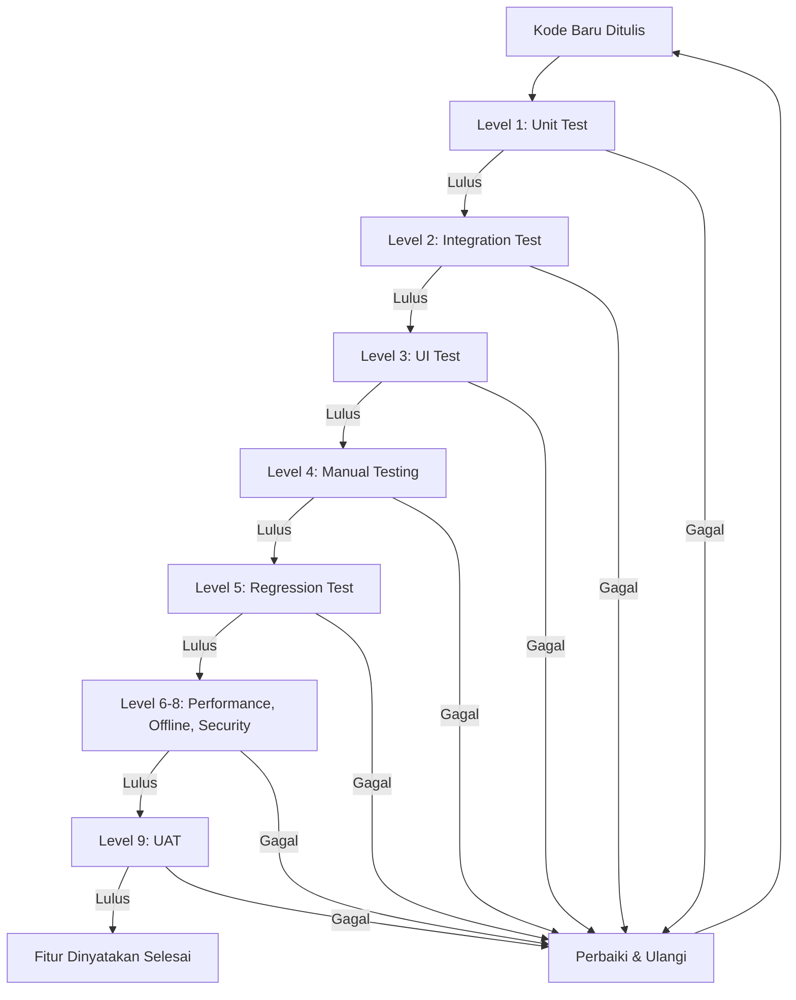
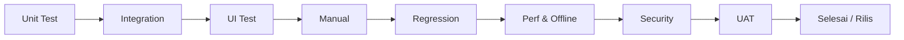
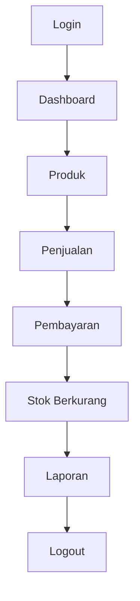
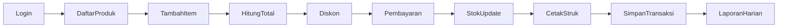

# TESTING GUIDE

> **Versi** : 1.0  
> **Tanggal** : Auto Generate  
> **Status** : Standar Resmi  
> **Berlaku Untuk** : Developer, QA, Tester, AI Coding Assistant, Project Manager

---

## Tujuan

Dokumen ini adalah **panduan resmi pengujian** proyek POS Offline PWA. Seluruh proses pengujian — manual maupun otomatis — **wajib** mengikuti standar ini sebelum sebuah fitur dinyatakan selesai.

Panduan ini digunakan oleh:

| Peran | Kegunaan |
|---|---|
| **Developer** | Menulis & menjalankan test sebelum menyerahkan kode |
| **QA / Tester** | Menjalankan test manual & regression sesuai checklist |
| **AI Coding Assistant** | Menambah test baru, menjalankan regression, tidak menghapus test lama |
| **Project Manager** | Memantau status pengujian & kualitas rilis |

---

## Daftar Isi

1. [Tujuan Testing](#1-tujuan-testing)
2. [Testing Strategy](#2-testing-strategy)
3. [Testing Environment](#3-testing-environment)
4. [Unit Test](#4-unit-test)
5. [Integration Test](#5-integration-test)
6. [UI Test](#6-ui-test)
7. [Database Test](#7-database-test)
8. [Authentication Test](#8-authentication-test)
9. [Router Test](#9-router-test)
10. [CRUD Test](#10-crud-test)
11. [Transaction Test](#11-transaction-test)
12. [Report Test](#12-report-test)
13. [Offline Test](#13-offline-test)
14. [Performance Test](#14-performance-test)
15. [Security Test](#15-security-test)
16. [Regression Test](#16-regression-test)
17. [User Acceptance Test](#17-user-acceptance-test)
18. [Bug Report Template](#18-bug-report-template)
19. [Test Checklist](#19-test-checklist)
20. [AI Testing Rules](#20-ai-testing-rules)

---

## 1. Tujuan Testing

Pengujian dilakukan untuk memastikan kualitas aplikasi secara menyeluruh.

### 1.1 Tujuan Utama

| Tujuan | Penjelasan |
|---|---|
| **Memastikan fitur berjalan** | Setiap fitur berfungsi sesuai spesifikasi |
| **Mencegah bug** | Menemukan kesalahan sebelum sampai ke pengguna |
| **Menjaga stabilitas** | Aplikasi tidak crash pada skenario normal maupun ekstrem |
| **Menjaga performa** | Waktu respons tetap dalam target (lihat Section 14) |
| **Menjaga kualitas kode** | Kode tetap terstruktur dan mudah dipelihara |
| **Memastikan business rules dipatuhi** | Aturan bisnis (diskon, stok, margin, akses) selalu berlaku |

### 1.2 Prinsip Pengujian

```text
1. Uji sejak awal (shift-left): test ditulis bersamaan dengan kode.
2. Uji semua lapisan: unit -> integration -> UI -> manual.
3. Uji offline: aplikasi adalah POS offline, internet tidak boleh menjadi syarat.
4. Uji semua role: Owner, Admin, Kasir.
5. Setiap bug yang ditemukan harus punya langkah reproduksi yang jelas.
6. Tidak ada fitur selesai tanpa melewati checklist pengujian.
```

---

## 2. Testing Strategy

### 2.1 Tingkatan Testing

| Level | Jenis Test | Fokus | Dilakukan Oleh | Waktu |
|---|---|---|---|---|
| **1** | Unit Test | Fungsi/logika terkecil (repository, service, validator) | Developer / AI | Saat menulis kode |
| **2** | Integration Test | Kerja sama antar modul (login -> dashboard -> transaksi) | Developer / AI | Setelah fitur jadi |
| **3** | UI Test | Perilaku antarmuka (dropdown, modal, form, responsive) | Tester / QA | Setelah build |
| **4** | Manual Testing | Eksplorasi langsung oleh manusia | QA / Tester | Setiap rilis |
| **5** | Regression Test | Fitur lama tetap berfungsi setelah perubahan | QA / AI | Setiap sprint / rilis |
| **6** | Performance Test | Kecepatan & penggunaan resource | Developer | Sebelum rilis |
| **7** | Offline Test | Perilaku tanpa internet | QA / Developer | Sebelum rilis |
| **8** | Security Test | Kerentanan & perlindungan data | Developer / QA | Sebelum rilis |
| **9** | UAT (User Acceptance Test) | Kesesuaian kebutuhan user | Pengguna / PM | Sebelum go-live |

### 2.2 Diagram Alur Testing



### 2.3 Urutan Penerapan Test pada Proyek



---

## 3. Testing Environment

### 3.1 Browser yang Diuji

| Browser | Versi Minimal | Prioritas |
|---|---|---|
| **Chrome** | Terbaru (stable) | Utama — target utama |
| **Edge** | Terbaru (stable) | Tinggi |
| **Firefox** | Terbaru (stable) | Sedang |
| **Android Chrome** | Terbaru (stable) | Tinggi — PWA mobile |

> Catatan: Aplikasi menggunakan IndexedDB (Dexie) dan Service Worker. Setiap browser **wajib** diuji karena perilaku storage/PWA bisa berbeda.

### 3.2 Perangkat & Resolusi Layar

| Kategori | Resolusi (px) | Diuji? |
|---|---|---|
| Desktop | 1920 x 1080 | Wajib |
| Laptop | 1366 x 768 | Wajib |
| Tablet | 768 x 1024 | Wajib |
| Mobile | 375 x 667 | Wajib |

### 3.3 Sistem Operasi

| OS | Prioritas |
|---|---|
| **Windows** | Utama (desktop) |
| **Android** | Utama (PWA mobile) |

### 3.4 Mode Browser

| Mode | Dipakai Untuk |
|---|---|
| Normal | Testing fungsional |
| Incognito / Private | Uji session, storage terpisah, first-run |
| Device Mode (DevTools) | Uji responsive mobile/tablet |
| Airplane mode / Offline | Uji offline (Section 13) |

---

## 4. Unit Test

### 4.1 Sasaran Unit Test

| Sasaran | Contoh Yang Diuji |
|---|---|
| **Repository** | `getById`, `getPage`, `softDelete`, search |
| **Service** | kalkulasi total, cek stok, alur checkout |
| **Validator** | input valid, input tidak valid, boundary |
| **Utility** | format tanggal, hash, id generator |
| **Router** | `getRouteKey`, guard route |
| **Permission** | `hasPermission`, `getMenuForRole` |
| **Authentication** | `login`, `logout`, `validateSession` |
| **Theme** | `toggleTheme`, persistensi tema |
| **Database** | schema, migration, seed idempoten |
| **PWA** | cache version, cleanup, register |

### 4.2 Struktur Test

Test ditulis dengan pola `describe()` + `it()` + `expect()`.

```js
import { describe, it, expect } from 'vitest';
import { productValidator } from '../modules/product/product-validator.js';

describe('productValidator', () => {
  it('mengembalikan error saat nama kosong', () => {
    const errors = productValidator.validate({ name: '', price: 100 });
    expect(errors).toContainEqual(
      { field: 'name', message: 'Nama produk wajib diisi' }
    );
  });

  it('mengembalikan error saat harga negatif', () => {
    const errors = productValidator.validate({ name: 'A', price: -1 });
    expect(errors.length).toBeGreaterThan(0);
  });

  it('valid ketika semua input benar', () => {
    const errors = productValidator.validate({ name: 'Kopi', price: 15000 });
    expect(errors).toHaveLength(0);
  });
});
```

### 4.3 Contoh Unit Test Repository

```js
describe('productRepository', () => {
  it('menyimpan produk baru', async () => {
    const product = await productRepository.create({
      name: 'Nasi Goreng',
      price: 20000,
      stock: 10,
    });
    expect(product.id).toBeDefined();
  });

  it('soft delete menandai deletedAt', async () => {
    await productRepository.softDelete(product.id);
    const found = await productRepository.getById(product.id);
    expect(found.deletedAt).toBeDefined();
  });
});
```

### 4.4 Contoh Unit Test Service

```js
describe('saleService', () => {
  it('menghitung total dengan diskon', () => {
    const total = saleService.calculateTotal([
      { price: 10000, qty: 2 },
      { price: 5000, qty: 1 },
    ], 10); // diskon 10%
    expect(total).toBe(22500);
  });

  it('menolak transaksi saat stok tidak cukup', async () => {
    await expect(saleService.createSale(itemsWithStockLack))
      .rejects.toThrow('Stok tidak mencukupi');
  });
});
```

---

## 5. Integration Test

### 5.1 Skenario Alur Utama

Semua alur berikut **wajib** diuji sebagai satu kesatuan:



### 5.2 Alur Penjualan Lengkap



### 5.3 Tabel Skenario Integrasi

| No | Skenario | Langkah | Expected Result |
|---|---|---|---|
| 1 | Login -> Dashboard | Login berhasil | Dashboard tampil dengan KPI |
| 2 | Dashboard -> Produk | Buka menu Produk | List produk tampil |
| 3 | Produk -> Penjualan | Tambah produk ke keranjang | Item masuk keranjang |
| 4 | Penjualan -> Pembayaran | Isi nominal bayar | Hitung kembalian benar |
| 5 | Pembayaran -> Stok | Selesaikan transaksi | Stok produk berkurang |
| 6 | Stok -> Laporan | Buka laporan penjualan | Transaksi muncul di laporan |
| 7 | Laporan -> Logout | Klik Keluar | Kembali ke halaman login |

### 5.4 Contoh Test Case Integrasi (tabel)

| Test ID | Alur | Data | Expected | Actual | Status |
|---|---|---|---|---|---|
| IT-01 | Login -> Dashboard | owner / password benar | Dashboard tampil | | |
| IT-02 | Produk -> Penjualan -> Pembayaran | 2 item, bayar 50rb | Total & kembalian benar | | |
| IT-03 | Pembayaran -> Stok | Produk qty 2 | Stok turun 2 | | |
| IT-04 | Penjualan -> Laporan | Transaksi hari ini | Muncul di laporan harian | | |
| IT-05 | Logout | Klik Keluar | Kembali ke login, session bersih | | |

---

## 6. UI Test

### 6.1 Checklist Pengujian UI

| Item UI | Check |
|---|---|
| **Layout** | Tata letak halaman sesuai desain |
| **Sidebar** | Menu tampil, navigasi berfungsi, collapse bekerja |
| **Topbar** | Tanggal, tema, dropdown user, logout |
| **Responsive** | Desktop, laptop, tablet, mobile |
| **Dark Mode** | Warna & kontras benar |
| **Light Mode** | Warna & kontras benar |
| **Loading** | Spinner/skeleton tampil saat memuat |
| **Skeleton** | Placeholder sebelum data tampil |
| **Modal** | Buka, isi, simpan, tutup |
| **Notification** | Pemberitahuan sukses/gagal |
| **Toast** | Muncul & hilang otomatis |
| **Dropdown** | Buka/tutup, pilih item |
| **Pagination** | Pindah halaman, jumlah benar |
| **Search** | Hasil sesuai keyword |
| **Sorting** | Urutan naik/turun benar |
| **Validation** | Pesan error tampil jelas |
| **Icon** | Semua icon Bootstrap Icons tampil |
| **Animation** | Transisi halus, tidak lambat |
| **Accessibility** | Label, keyboard navigation, contrast |

### 6.2 Contoh Skenario UI Test

```text
Skenario UI-01: Membuka modal tambah produk
1. Buka halaman Produk.
2. Klik tombol "Tambah Produk".
3. Expected: modal terbuka dengan form kosong.
4. Isi form lalu klik "Simpan".
5. Expected: toast sukses, list bertambah.
```

### 6.3 Contoh Skenario Responsive Test

```text
Skenario UI-02: Responsive sidebar
1. Buka aplikasi pada lebar 375px (mobile).
2. Expected: hamburger menu tampil, sidebar tersembunyi.
3. Klik hamburger.
4. Expected: sidebar terbuka (overlay).
```

---

## 7. Database Test

### 7.1 Operasi yang Diuji

| Operasi | Deskripsi |
|---|---|
| **Create** | Insert data baru berhasil |
| **Read** | Data terbaca sesuai id/filter |
| **Update** | Data berubah sesuai input |
| **Delete** | Data terhapus (permanen) |
| **Soft Delete** | Data ditandai `deletedAt`, tidak hilang |
| **Restore** | Data soft-deleted dikembalikan |
| **Migration** | Perubahan skema jalan tanpa error |
| **Version** | Versi database naik sesuai skema |
| **Seed Data** | Data awal terisi sekali (idempoten) |
| **IndexedDB** | Penyimpanan berfungsi di browser |
| **Dexie** | Query, transaction, relation berfungsi |

### 7.2 Contoh Test Database (pseudocode)

```js
describe('database', () => {
  it('seed roles hanya sekali (idempoten)', async () => {
    await seedDatabase();
    const count1 = await db.roles.count();
    await seedDatabase();
    const count2 = await db.roles.count();
    expect(count2).toBe(count1);
  });

  it('soft delete tidak menghapus fisik data', async () => {
    await productRepository.softDelete(id);
    const row = await db.products.get(id);
    expect(row).toBeDefined();
    expect(row.deletedAt).toBeDefined();
  });

  it('migration versi berjalan', async () => {
    const version = await db.verno;
    expect(version).toBeGreaterThanOrEqual(EXPECTED_VERSION);
  });
});
```

### 7.3 Checklist Database Test

- [ ] Create berhasil
- [ ] Read berhasil
- [ ] Update berhasil
- [ ] Delete berhasil
- [ ] Soft delete berjalan (deletedAt terisi)
- [ ] Restore berhasil (deletedAt dihapus)
- [ ] Migration tidak merusak data lama
- [ ] Version naik sesuai perubahan
- [ ] Seed idempoten (tidak dobel)
- [ ] IndexedDB persisten setelah browser ditutup
- [ ] Dexie transaction atomic (rollback saat error)

---

## 8. Authentication Test

### 8.1 Skenario Autentikasi

| No | Skenario | Langkah | Expected Result |
|---|---|---|---|
| 1 | **Login berhasil** | Username & password benar | Masuk ke Dashboard |
| 2 | **Password salah** | Password keliru | Muncul error, tetap di login |
| 3 | **Username salah** | Username tidak ada | Muncul error "user tidak ditemukan" |
| 4 | **Session expired** | Tunggu melewati expiry | Otomatis kembali ke login |
| 5 | **Logout** | Klik Keluar | Kembali ke login, session bersih |
| 6 | **Remember Me** | Centang "ingat saya" | Session bertahan setelah browser ditutup |
| 7 | **Role Owner** | Login owner | Akses semua menu |
| 8 | **Role Admin** | Login admin | Akses sesuai permission admin |
| 9 | **Role Kasir** | Login kasir | Hanya dashboard & penjualan |
| 10 | **Permission** | Akses menu di luar hak | Ditolak / redirect |
| 11 | **Session Timeout** | Idle melewati batas | Otomatis logout |
| 12 | **Refresh Browser** | Reload saat login | Tetap login (session valid) |

### 8.2 Contoh Test Case Autentikasi

```js
describe('authentication', () => {
  it('login dengan kredensial benar', async () => {
    const result = await authService.login('owner', 'password-benar', false);
    expect(result.success).toBe(true);
    expect(authService.isLoggedIn()).toBe(true);
  });

  it('login dengan password salah', async () => {
    const result = await authService.login('owner', 'salah', false);
    expect(result.success).toBe(false);
  });

  it('logout membersihkan session', () => {
    authService.logout({ redirect: false });
    expect(authService.isLoggedIn()).toBe(false);
  });
});
```

### 8.3 Checklist Session

- [ ] Session memiliki `expiresAt`
- [ ] Session expired -> redirect login
- [ ] Logout menghapus session di semua storage
- [ ] Remember me (30 hari) berfungsi
- [ ] Non-remember (sessionStorage) hilang saat browser ditutup
- [ ] Session perangkat berbeda ditolak (deviceId)

---

## 9. Router Test

### 9.1 Semua Route Diuji

| Route | Tipe | Diproteksi? | Expected |
|---|---|---|---|
| `#/` | Home | Ya | Redirect ke Dashboard / Login |
| `#/login` | Auth-only | Tidak | Login page (bila belum login) |
| `#/dashboard` | Protected | Ya | Dashboard |
| `#/produk` | Protected | Ya | Halaman produk |
| `#/pelanggan` | Protected | Ya | Halaman pelanggan |
| `#/supplier` | Protected | Ya | Halaman supplier |
| `#/penjualan` | Protected | Ya | Halaman penjualan |
| `#/pembelian` | Protected | Ya | Halaman pembelian |
| `#/laporan` | Protected | Ya | Halaman laporan |
| `#/pengaturan` | Protected | Ya | Halaman pengaturan |
| `#/unknown-route` | — | — | Halaman 404 |
| Route tanpa session | — | — | Unauthorized -> redirect login |

### 9.2 Skenario Router

| Test ID | Kondisi | Hash | Expected |
|---|---|---|---|
| RT-01 | Belum login | `#/dashboard` | Redirect `#/login` |
| RT-02 | Sudah login | `#/login` | Redirect `#/dashboard` |
| RT-03 | Sudah login | `#/produk` | Halaman produk |
| RT-04 | Belum login | `#/unknown` | Redirect login (guard) |
| RT-05 | Sudah login | `#/unknown` | Halaman 404 |
| RT-06 | Kasir | `#/laporan` | Ditolak / redirect |

### 9.3 Contoh Test Route

```js
describe('router', () => {
  it('getRouteKey menormalkan hash', () => {
    expect(getRouteKey('#/produk')).toBe('produk');
    expect(getRouteKey('#/')).toBe('dashboard');
    expect(getRouteKey('')).toBe('dashboard');
  });

  it('route protected redirect ke login saat tidak login', () => {
    expect(resolveRouteRedirect(routes.dashboard)).toBe('#/login');
  });

  it('route authOnly redirect ke dashboard saat login', () => {
    // stub authService.isLoggedIn = true
    expect(resolveRouteRedirect(routes.login)).toBe('#/dashboard');
  });
});
```

---

## 10. CRUD Test

### 10.1 Master Data yang Wajib Diuji

| Master Data | Modul |
|---|---|
| Produk | `#/produk` |
| Pelanggan | `#/pelanggan` |
| Supplier | `#/supplier` |
| Kategori | Modul produk / pengaturan |
| Satuan | Modul produk / pengaturan |
| User | `#/pengaturan` |
| Kasir | `#/pengaturan` |

### 10.2 Checklist CRUD per Master Data

| Operasi | Produk | Pelanggan | Supplier | User |
|---|---|---|---|---|
| Tambah | ☐ | ☐ | ☐ | ☐ |
| Edit | ☐ | ☐ | ☐ | ☐ |
| Hapus (soft) | ☐ | ☐ | ☐ | ☐ |
| Cari | ☐ | ☐ | ☐ | ☐ |
| Filter | ☐ | ☐ | ☐ | ☐ |
| Sort | ☐ | ☐ | ☐ | ☐ |
| Pagination | ☐ | ☐ | ☐ | ☐ |
| Export | ☐ | ☐ | ☐ | ☐ |
| Import | ☐ | ☐ | ☐ | ☐ |

### 10.3 Contoh Skenario CRUD Produk

```text
CRUD-01 Tambah produk
  -> Buka #/produk, klik Tambah, isi nama/harga/stok, Simpan
  -> Expected: list bertambah, toast sukses

CRUD-02 Edit produk
  -> Klik Edit pada baris, ubah harga, Simpan
  -> Expected: harga berubah di list & detail

CRUD-03 Hapus produk
  -> Klik Hapus, konfirmasi
  -> Expected: produk hilang dari list (soft delete)

CRUD-04 Cari produk
  -> Ketik keyword di search
  -> Expected: hasil sesuai keyword

CRUD-05 Export produk
  -> Klik Export Excel
  -> Expected: file terunduh berisi data produk
```

### 10.4 Contoh Test Case Validator CRUD

```js
describe('product CRUD', () => {
  it('menolak produk dengan nama kosong', async () => {
    await expect(productService.create({ name: '', price: 0 }))
      .rejects.toThrow('Nama produk wajib diisi');
  });

  it('menolak harga negatif', async () => {
    await expect(productService.create({ name: 'A', price: -5 }))
      .rejects.toThrow('Harga tidak valid');
  });
});
```

---

## 11. Transaction Test

### 11.1 Jenis Transaksi yang Diuji

| Transaksi | Keterangan |
|---|---|
| **Penjualan** | Alur jual produk ke pelanggan |
| **Pembelian** | Alur beli dari supplier |
| **Retur** | Pengembalian barang |
| **Stok Masuk** | Tambah stok (pembelian/retur) |
| **Stok Keluar** | Kurangi stok (penjualan) |
| **Pembayaran** | Tunai / nominal & kembalian |
| **Diskon** | Diskon per item / total |
| **Pajak** | Perhitungan pajak bila ada |
| **Multi Item** | Transaksi banyak item |
| **Void** | Membatalkan transaksi |
| **Draft** | Transaksi tersimpan sementara |
| **Cetak** | Cetak struk / invoice |

### 11.2 Contoh Skenario Transaksi

```text
TRX-01 Penjualan multi item
  -> Tambah 3 item berbeda, hitung total
  -> Expected: subtotal, diskon, total benar

TRX-02 Pembayaran & kembalian
  -> Total 47.500, bayar 50.000
  -> Expected: kembalian 2.500

TRX-03 Stok berkurang setelah penjualan
  -> Jual 2 unit produk stok 10
  -> Expected: stok menjadi 8

TRX-04 Void transaksi
  -> Batalkan transaksi yang sudah selesai
  -> Expected: transaksi dibatalkan, stok dikembalikan

TRX-05 Draft transaksi
  -> Simpan draft, buka kembali
  -> Expected: draft tersimpan dengan item lengkap

TRX-06 Cetak struk
  -> Selesaikan transaksi, cetak
  -> Expected: struk muncul / file tersimpan
```

### 11.3 Contoh Test Kalkulasi Transaksi

```js
describe('transaksi', () => {
  it('menghitung total multi item tanpa diskon', () => {
    const total = transactionService.calculateSubtotal([
      { price: 10000, qty: 3 },   // 30.000
      { price: 5000, qty: 2 },    // 10.000
    ]);
    expect(total).toBe(40000);
  });

  it('menghitung diskon persen', () => {
    expect(transactionService.applyDiscount(40000, 10)).toBe(36000);
  });

  it('menghitung kembalian', () => {
    expect(transactionService.calculateChange(36000, 50000)).toBe(14000);
  });
});
```

---

## 12. Report Test

### 12.1 Jenis Laporan yang Diuji

| Laporan | Keterangan |
|---|---|
| **Dashboard** | KPI, chart, ringkasan |
| **Laporan Harian** | Rekap per hari |
| **Laporan Mingguan** | Rekap per minggu |
| **Laporan Bulanan** | Rekap per bulan |
| **Laporan Tahunan** | Rekap per tahun |
| **Laporan Produk** | Penjualan per produk |
| **Laporan Stok** | Mutasi stok |
| **Laporan Laba** | Laba/rugi |
| **Laporan Kas** | Arus kas |
| **Export PDF** | Unduh laporan PDF |
| **Export Excel** | Unduh laporan Excel |

### 12.2 Contoh Skenario Report Test

```text
RPT-01 Laporan harian
  -> Buka #/laporan, pilih hari ini
  -> Expected: total penjualan, jumlah transaksi benar

RPT-02 Laporan bulanan
  -> Pilih bulan
  -> Expected: data sesuai transaksi bulan tersebut

RPT-03 Laporan stok
  -> Buka laporan stok
  -> Expected: stok saat ini sesuai data produk

RPT-04 Export PDF
  -> Klik Export PDF
  -> Expected: file PDF terunduh, isi sesuai laporan

RPT-05 Export Excel
  -> Klik Export Excel
  -> Expected: file Excel terunduh, bisa dibuka
```

### 12.3 Checklist Report Test

- [ ] KPI Dashboard akurat
- [ ] Filter tanggal berfungsi (harian/mingguan/bulanan/tahunan)
- [ ] Total penjualan benar
- [ ] Jumlah transaksi benar
- [ ] Laporan produk benar
- [ ] Laporan stok benar
- [ ] Laporan laba benar
- [ ] Laporan kas benar
- [ ] Export PDF terbuka & isi benar
- [ ] Export Excel terbuka & isi benar

---

## 13. Offline Test

### 13.1 Tujuan

POS Offline PWA **wajib** tetap berfungsi penuh tanpa internet. Test offline dilakukan dengan mematikan internet / mode airplane.

### 13.2 Prosedur Test Offline

```text
1. Buka aplikasi (pastikan sudah pernah dimuat agar cache ada).
2. Matikan internet (mode airplane) / DevTools -> Network -> Offline.
3. Uji seluruh alur di bawah ini.
4. Expected: SEMUA berjalan normal, tidak ada request gagal yang memblokir.
```

### 13.3 Checklist Test Offline

| Fitur | Offline Berjalan? |
|---|---|
| Login tetap berjalan (session aktif) | ☐ |
| CRUD tetap berjalan | ☐ |
| Database (IndexedDB) tetap berjalan | ☐ |
| PWA tetap berjalan | ☐ |
| Export tetap berjalan | ☐ |
| Tidak ada request gagal yang memblokir fitur | ☐ |
| Navigasi antar halaman tetap jalan (cache) | ☐ |
| Reload halaman tidak menampilkan error | ☐ |

### 13.4 Skenario Offline yang Harus Diuji

| No | Skenario | Expected |
|---|---|---|
| 1 | Buka aplikasi offline (cache terisi) | Aplikasi tampil normal |
| 2 | Login dengan session aktif offline | Login page terlewati, Dashboard tampil |
| 3 | Tambah produk offline | Data tersimpan di IndexedDB |
| 4 | Transaksi penjualan offline | Transaksi tercatat lokal |
| 5 | Export PDF/Excel offline | File tetap terunduh |
| 6 | Navigasi menu offline | Halaman tetap dimuat dari cache |

---

## 14. Performance Test

### 14.1 Target Performa

| Item | Target |
|---|---|
| **Startup** | < 2 detik |
| **Dashboard** | < 1 detik |
| **Search** | < 300 ms |
| **Pagination** | < 200 ms |
| **CRUD** | < 500 ms |
| **Import** | 1000 data tanpa timeout |
| **Export** | 1000 data tanpa timeout |
| **Memory** | Stabil, tidak naik terus |
| **CPU** | Penggunaan wajar, tidak berlebihan |

### 14.2 Cara Mengukur

```text
1. Chrome DevTools -> Performance untuk startup & dashboard.
2. Chrome DevTools -> Network untuk waktu request/cache.
3. Chrome DevTools -> Memory untuk penggunaan memori.
4. Stopwatch/pengukuran manual untuk search, pagination, CRUD.
```

### 14.3 Checklist Performance Test

| Item | Target | Hasil | Lulus? |
|---|---|---|---|
| Startup < 2s | 2.0 s | | ☐ |
| Dashboard < 1s | 1.0 s | | ☐ |
| Search < 300ms | 300 ms | | ☐ |
| Pagination < 200ms | 200 ms | | ☐ |
| CRUD < 500ms | 500 ms | | ☐ |
| Import 1000 data | 1000 | | ☐ |
| Export 1000 data | 1000 | | ☐ |
| Memori stabil | — | | ☐ |
| CPU wajar | — | | ☐ |

---

## 15. Security Test

### 15.1 Checklist Keamanan

| No | Item | Check |
|---|---|---|
| 1 | Tidak ada password plaintext di database | ☐ |
| 2 | Tidak ada token bocor di source code | ☐ |
| 3 | Tidak ada secret/API key di source code | ☐ |
| 4 | Session timeout berjalan (idle & expiry) | ☐ |
| 5 | Role validation benar (Owner/Admin/Kasir) | ☐ |
| 6 | Permission validation untuk setiap akses | ☐ |
| 7 | SQL Injection tidak berlaku (IndexedDB, bukan SQL server) | ☐ |
| 8 | XSS: input tidak dieksekusi sebagai HTML | ☐ |
| 9 | LocalStorage hanya berisi data yang aman | ☐ |
| 10 | IndexedDB hanya berisi data yang seharusnya | ☐ |
| 11 | Service Worker tidak mengekspos data sensitif | ☐ |
| 12 | Session punya `expiresAt` & dicek | ☐ |
| 13 | Logout menghapus session dari semua storage | ☐ |
| 14 | Device berbeda tidak bisa memakai session lama | ☐ |

### 15.2 Catatan Keamanan Spesifik Proyek

- Database memakai **IndexedDB (Dexie)** — bukan SQL, sehingga SQL Injection tidak relevan, namun tetap **validasi semua input**.
- **XSS**: pastikan data pengguna dirender sebagai teks, bukan HTML mentah.
- **Default user/password**: wajib diganti saat first-run; tidak boleh ada kredensial default yang tertanam.
- **Session**: periksa `isSessionValid()` setiap akses route protected.

---

## 16. Regression Test

### 16.1 Kapan Regression Test Dijalankan

- Setelah setiap **sprint** selesai.
- Setiap kali ada perubahan kode yang menyentuh modul inti.
- Setiap kali AI melakukan perubahan kode (wajib, lihat Section 20).

### 16.2 Modul yang Wajib Diuji Ulang

| Modul | Wajib Diuji |
|---|---|
| Login | ☐ |
| Dashboard | ☐ |
| Produk | ☐ |
| Pelanggan | ☐ |
| Supplier | ☐ |
| Penjualan | ☐ |
| Pembelian | ☐ |
| Laporan | ☐ |
| Pengaturan | ☐ |
| Logout | ☐ |
| Offline mode | ☐ |
| Session & permission | ☐ |

### 16.3 Checklist Regression per Modul

```text
[]  Login & logout berjalan
[]  Dashboard & KPI tampil benar
[]  CRUD produk berjalan
[]  CRUD pelanggan berjalan
[]  CRUD supplier berjalan
[]  Penjualan & pembayaran berjalan
[]  Pembelian berjalan
[]  Laporan & export berjalan
[]  Pengaturan & user berjalan
[]  Permission per role benar
[]  Offline mode tetap berjalan
[]  Tidak ada fitur lama yang rusak
```

---

## 17. User Acceptance Test (UAT)

### 17.1 Tujuan

UAT memastikan aplikasi sesuai kebutuhan pengguna sebelum go-live. Diuji oleh pengguna/PM berdasarkan skenario bisnis nyata.

### 17.2 Tabel UAT

| No | Fitur | Skenario | Expected Result | Actual Result | Status | Tester | Tanggal | Catatan |
|---|---|---|---|---|---|---|---|---|
| 1 | Login | Login owner | Masuk dashboard | | | | | |
| 2 | Dashboard | Lihat KPI hari ini | Data sesuai | | | | | |
| 3 | Produk | Tambah produk | Produk tersimpan | | | | | |
| 4 | Penjualan | Jual 2 item, bayar | Total & kembalian benar | | | | | |
| 5 | Stok | Cek stok setelah jual | Stok berkurang | | | | | |
| 6 | Laporan | Export laporan harian | File terunduh | | | | | |
| 7 | Logout | Keluar aplikasi | Kembali ke login | | | | | |

> Status: `Pass` / `Fail` / `Pending`. Semua baris `Fail` wajib dibuatkan Bug Report (Section 18).

---

## 18. Bug Report Template

### 18.1 Template Laporan Bug

```markdown
# BUG REPORT

## ID
BUG-001

## Judul
[Ringkasan singkat bug]

## Modul
[Login / Dashboard / Produk / Penjualan / Laporan / Pengaturan / PWA]

## Severity
- [ ] Critical (aplikasi crash / data hilang)
- [ ] High (fitur utama gagal)
- [ ] Medium (fitur berjalan tapi salah)
- [ ] Low (masalah kosmetik)

## Priority
- [ ] P1 (segera)
- [ ] P2 (tinggi)
- [ ] P3 (normal)
- [ ] P4 (rendah)

## Langkah Reproduksi
1. Buka ...
2. Klik ...
3. Masukkan data ...

## Expected
Hasil yang seharusnya terjadi.

## Actual
Hasil yang sebenarnya terjadi.

## Screenshot
[Tambahkan screenshot / video]

## Environment
- Browser: Chrome/Edge/Firefox/Android Chrome
- OS: Windows/Android
- Resolusi: 1920x1080 / 1366x768 / 768x1024 / 375x667
- Mode: Online / Offline

## Status
- [ ] Open
- [ ] In Progress
- [ ] Fixed
- [ ] Verified
- [ ] Closed

## PIC
[Penanggung jawab]
```

### 18.2 Aturan Bug Report

- Setiap bug **wajib** memiliki langkah reproduksi yang jelas.
- Severity & priority ditentukan bersama developer & PM.
- Setelah fix, bug diverifikasi ulang dengan langkah yang sama.

---

## 19. Test Checklist

Checklist menyeluruh sebelum fitur dinyatakan selesai. Centang setiap item yang lolos.

### 19.1 Autentikasi & Session

- [ ] Login berhasil (user valid)
- [ ] Login gagal (password salah) menampilkan error
- [ ] Login gagal (username salah) menampilkan error
- [ ] Logout berhasil & session bersih
- [ ] Session expired -> kembali ke login
- [ ] Session timeout (idle) -> logout otomatis
- [ ] Remember me (30 hari) berfungsi
- [ ] Non-remember hilang saat browser ditutup
- [ ] Refresh browser tidak memutus session valid
- [ ] Device lain menolak session lama

### 19.2 Role & Permission

- [ ] Role Owner bisa akses semua menu
- [ ] Role Admin sesuai permission
- [ ] Role Kasir hanya dashboard & penjualan
- [ ] Akses menu di luar hak ditolak
- [ ] Permission dicek di sisi logic (bukan hanya UI)

### 19.3 Dashboard

- [ ] Dashboard tampil setelah login
- [ ] Sidebar tampil & navigasi berfungsi
- [ ] Topbar tampil (tanggal, tema, user dropdown)
- [ ] KPI menampilkan data benar
- [ ] Chart tampil & interaktif
- [ ] Dashboard load < 1 detik

### 19.4 Search, Sort, Pagination

- [ ] Search bekerja (mencari data)
- [ ] Search debounce (tidak spamming)
- [ ] Sorting naik/turun benar
- [ ] Pagination berfungsi
- [ ] Jumlah halaman benar
- [ ] Pagination < 200ms

### 19.5 CRUD

- [ ] Tambah produk berhasil
- [ ] Edit produk berhasil
- [ ] Hapus produk (soft delete) berhasil
- [ ] Tambah pelanggan berhasil
- [ ] Edit pelanggan berhasil
- [ ] Hapus pelanggan berhasil
- [ ] Tambah supplier berhasil
- [ ] Edit supplier berhasil
- [ ] Hapus supplier berhasil
- [ ] CRUD kategori & satuan berhasil
- [ ] CRUD user & kasir berhasil
- [ ] Validasi form tampil saat input salah
- [ ] Data tidak bisa diisi duplikat (bila rule melarang)

### 19.6 Transaksi

- [ ] Penjualan multi item berhasil
- [ ] Perhitungan subtotal benar
- [ ] Diskon benar
- [ ] Pajak benar
- [ ] Pembayaran & kembalian benar
- [ ] Stok berkurang setelah penjualan
- [ ] Pembelian menambah stok
- [ ] Retur berjalan
- [ ] Void transaksi berjalan
- [ ] Draft transaksi tersimpan & terbuka
- [ ] Cetak struk berjalan

### 19.7 Laporan

- [ ] Laporan harian benar
- [ ] Laporan mingguan benar
- [ ] Laporan bulanan benar
- [ ] Laporan tahunan benar
- [ ] Laporan produk benar
- [ ] Laporan stok benar
- [ ] Laporan laba benar
- [ ] Laporan kas benar
- [ ] Export Excel berhasil
- [ ] Export PDF berhasil

### 19.8 Export & Import

- [ ] Export Excel produk
- [ ] Export Excel laporan
- [ ] Import Excel produk
- [ ] Import data 1000 baris tanpa timeout
- [ ] File hasil export bisa dibuka
- [ ] Import file korup ditolak dengan pesan jelas

### 19.9 UI & Tema

- [ ] Dark Mode berfungsi
- [ ] Light Mode berfungsi
- [ ] Toggle tema tersimpan
- [ ] Responsive desktop (1920x1080)
- [ ] Responsive laptop (1366x768)
- [ ] Responsive tablet (768x1024)
- [ ] Responsive mobile (375x667)
- [ ] Semua icon tampil (Bootstrap Icons)
- [ ] Loading & skeleton tampil saat memuat
- [ ] Modal & toast berfungsi
- [ ] Dropdown berfungsi
- [ ] Tidak ada inline style hardcode yang menyalahi standar
- [ ] Warna dari design system (variables.css)

### 19.10 Database

- [ ] IndexedDB normal
- [ ] Dexie query berfungsi
- [ ] Migration berjalan tanpa error
- [ ] Version sesuai skema
- [ ] Seed data terisi sekali (idempoten)
- [ ] Soft delete berjalan
- [ ] Restore soft delete berjalan
- [ ] Data persisten setelah browser ditutup

### 19.11 PWA & Offline

- [ ] Service Worker aktif
- [ ] PWA dapat diinstall
- [ ] Cache version sesuai build
- [ ] Update SW otomatis reload
- [ ] PWA Offline tetap berjalan
- [ ] Login offline (session aktif) berjalan
- [ ] CRUD offline berjalan
- [ ] Export offline berjalan
- [ ] Tidak ada request gagal yang memblokir fitur offline

### 19.12 Keamanan

- [ ] Tidak ada password plaintext
- [ ] Tidak ada token/secret di source
- [ ] Session timeout berjalan
- [ ] Role & permission validation benar
- [ ] Input divalidasi (anti XSS)
- [ ] Data sensitif tidak tampil di log

### 19.13 Error & Stabilitas

- [ ] Tidak ada error di console saat alur normal
- [ ] Error ditangani dengan pesan jelas
- [ ] Tidak ada crash saat data kosong
- [ ] Tidak ada crash saat data banyak (1000+)
- [ ] Aplikasi stabil setelah penggunaan lama

---

## 20. AI Testing Rules

Aturan khusus untuk **AI Coding Assistant** yang mengerjakan proyek ini.

### 20.1 Kewajiban AI

| Kewajiban | Keterangan |
|---|---|
| **Audit sebelum coding** | Baca & pahami kode terkait sebelum mengubah |
| **Menjalankan regression test setelah coding** | Pastikan fitur lama tidak rusak |
| **Tidak menghapus test lama** | Test yang ada adalah aset, jangan dihapus |
| **Menambahkan test untuk fitur baru** | Setiap fitur baru wajib punya test |
| **Memastikan seluruh Business Rules tetap berlaku** | Jangan mengubah aturan bisnis tanpa persetujuan |
| **Memastikan API Contract tidak berubah** | Kontrak fungsi/route tidak diubah tanpa persetujuan |
| **Memastikan Development Standards dipatuhi** | Ikuti `docs/19_DEVELOPMENT_STANDARDS.md` |

### 20.2 Workflow AI Testing

```text
1. Audit kode & test yang ada.
2. Identifikasi modul yang terdampak perubahan.
3. Jalankan unit test modul terdampak.
4. Jalankan regression test (modul terkait).
5. Tambahkan test baru untuk fitur/perubahan baru.
6. Verifikasi manual untuk skenario yang tidak bisa otomatis.
7. Laporkan hasil test (lulus/gagal + detail).
8. Jika ada kegagalan, perbaiki & ulangi.
```

### 20.3 Larangan AI

- Tidak menghapus atau melemahkan test yang sudah ada.
- Tidak melewati proses test untuk mengejar kecepatan.
- Tidak mengubah business rules / API tanpa persetujuan.
- Tidak mengubah database/schema tanpa migration & persetujuan.
- Tidak menandai fitur "selesai" tanpa lulus checklist Section 19.

### 20.4 Checklist AI Sebelum Menyerahkan Kode

```text
[]  Audit kode terkait selesai
[]  Unit test modul terdampak dijalankan
[]  Regression test dijalankan
[]  Test baru untuk fitur baru ditambahkan
[]  Business rules tetap berlaku
[]  API contract tidak berubah
[]  Development standards dipatuhi
[]  Hasil test dilaporkan
```

---

## Lampiran

### A. Definisi Status Test

| Status | Arti |
|---|---|
| **Pass** | Test lulus sesuai expected |
| **Fail** | Test gagal, perlu Bug Report |
| **Pending** | Belum dijalankan |
| **Blocked** | Tidak bisa dijalankan (menunggu data/environment) |
| **Skipped** | Dilewati (butuh persetujuan) |

### B. Severity & Priority

| Severity | Arti | Priority | Arti |
|---|---|---|---|
| Critical | Crash / data hilang | P1 | Segera diperbaiki |
| High | Fitur utama gagal | P2 | Tinggi |
| Medium | Fitur salah tapi jalan | P3 | Normal |
| Low | Kosmetik | P4 | Rendah |

### C. Definisi Selesai (Definition of Done)

- [ ] Semua test otomatis lulus
- [ ] Checklist Section 19 tidak ada yang gagal
- [ ] Offline test lulus
- [ ] UAT lulus / disetujui
- [ ] Bug yang ditemukan sudah dibuat laporannya
- [ ] Dokumentasi diperbarui

---

> **Versi 1.0** — Panduan pengujian resmi POS Offline PWA.

### Riwayat Revisi

| Versi | Tanggal | Perubahan |
|---|---|---|
| 1.0 | 2026-08-06 | Versi awal: 20 section panduan testing |
