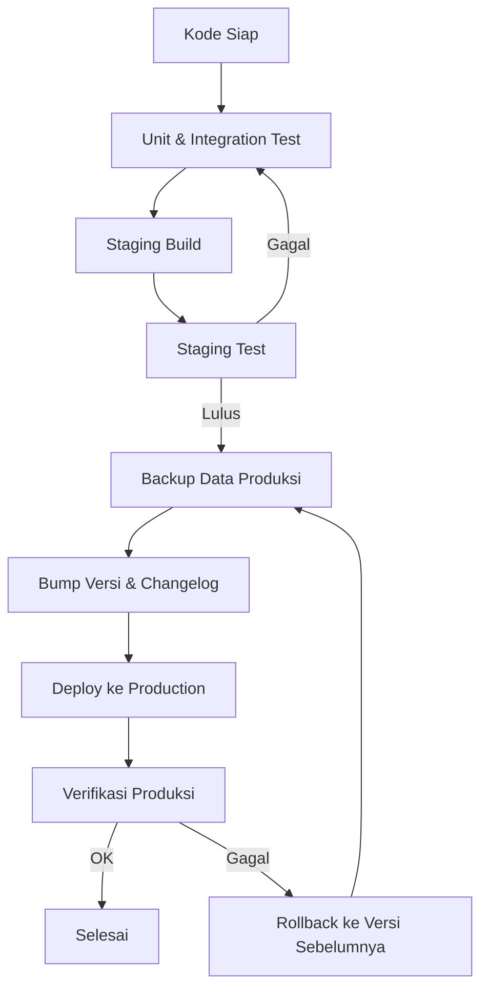
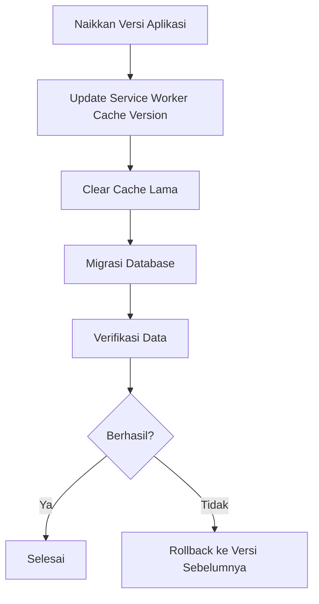

# DEPLOYMENT GUIDE

> **Versi** : 1.0  
> **Tanggal** : Auto Generate  
> **Status** : Standar Resmi  
> **Berlaku Untuk** : Developer, System Administrator, QA, AI Coding Assistant, Pemilik Usaha

---

## Tujuan

Dokumen ini adalah **panduan resmi deployment** proyek POS Offline PWA. Panduan mencakup proses menjalankan aplikasi, build, distribusi, update, backup, maintenance, hingga persiapan deployment masa depan.

Setiap proses deployment **wajib** mengikuti standar ini agar:

- Aplikasi berjalan stabil di lingkungan produksi.
- Proses update tidak merusak data.
- Data tetap aman melalui backup yang benar.
- Seluruh anggota tim memahami alur yang sama.

---

## Daftar Isi

1. [Overview](#1-overview)
2. [System Requirements](#2-system-requirements)
3. [Project Structure](#3-project-structure)
4. [Installation](#4-installation)
5. [Development Mode](#5-development-mode)
6. [Localhost Testing](#6-localhost-testing)
7. [PWA Deployment](#7-pwa-deployment)
8. [Production Build](#8-production-build)
9. [Deploy ke Web Server](#9-deploy-ke-web-server)
10. [Deploy ke Android](#10-deploy-ke-android)
11. [Deploy ke Desktop](#11-deploy-ke-desktop)
12. [Database Deployment](#12-database-deployment)
13. [Update Aplikasi](#13-update-aplikasi)
14. [Backup & Restore](#14-backup--restore)
15. [Troubleshooting](#15-troubleshooting)
16. [Security Checklist](#16-security-checklist)
17. [Performance Checklist](#17-performance-checklist)
18. [Release Checklist](#18-release-checklist)
19. [AI Deployment Rules](#19-ai-deployment-rules)
20. [Future Deployment Roadmap](#20-future-deployment-roadmap)

---

## 1. Overview

### 1.1 Tujuan Deployment

Deployment adalah proses membawa aplikasi dari kode ke lingkungan yang dapat digunakan. Tujuannya:

| Tujuan | Penjelasan |
|---|---|
| **Menjalankan** | Aplikasi dapat diakses oleh pengguna (web, mobile, desktop) |
| **Build** | Menyiapkan asset yang siap produksi |
| **Distribusi** | Menyebarkan aplikasi ke perangkat pengguna |
| **Update** | Menyediakan versi terbaru secara aman |
| **Backup** | Melindungi data dari kehilangan |
| **Maintenance** | Menjaga aplikasi tetap sehat dalam jangka panjang |

### 1.2 Perbedaan Environment

| Aspek | Development | Testing | Staging | Production |
|---|---|---|---|---|
| **Tujuan** | Menulis kode | Menguji fitur | Simulasi produksi | Penggunaan nyata |
| **Server** | Lokal | Lokal/staging | Staging server | Server produksi |
| **Data** | Data dummy | Data dummy | Data mirip produksi | Data asli |
| **Browser** | Semua | Chrome/Edge/Android | Semua | Sesuai pengguna |
| **Service Worker** | Boleh dinonaktifkan | Aktif | Aktif | Aktif (wajib) |
| **Cache** | No-cache | No-cache | Sesuai produksi | Cache aktif |
| **Update** | Setiap saat | Setiap saat | Terjadwal | Terjadwal & berhati-hati |

### 1.3 Workflow Deployment



---

## 2. System Requirements

### 2.1 Minimal Spesifikasi Perangkat Pengguna

| Komponen | Minimal | Rekomendasi |
|---|---|---|
| **OS** | Windows 10 / 11 | Windows 11 |
| **RAM** | 4 GB | 8 GB+ |
| **Processor** | Dual-core 2.0 GHz | Quad-core / i5+ |
| **Storage** | 500 MB free | 2 GB free |
| **Browser** | Chrome / Edge terbaru | Chrome terbaru |

> Aplikasi adalah PWA offline — semua data di simpan lokal (IndexedDB). Kapasitas storage browser sangat bergantung pada data transaksi.

### 2.2 Spesifikasi Developer / Server Development

| Komponen | Minimal | Rekomendasi |
|---|---|---|
| **NodeJS** | 18.x | 20.x / 22.x (LTS) |
| **NPM** | 9.x | 10.x+ |
| **Git** | 2.x | Terbaru |
| **VS Code** | Terbaru | Terbaru + ekstensi ESM |
| **Chrome** | Terbaru | Terbaru (DevTools) |
| **Edge** | Terbaru | Terbaru |

### 2.3 Tools yang Dibutuhkan

| Tool | Fungsi |
|---|---|
| **NodeJS + NPM** | Menjalankan dev server, install dependencies |
| **Git** | Version control, clone repository |
| **VS Code** | Editor kode |
| **Chrome / Edge DevTools** | Debugging, PWA audit, performance |
| **http-server** | Static server untuk PWA |

---

## 3. Project Structure

### 3.1 Struktur Folder Proyek

```
pos-offline-pwa/
├── docs/                    # Dokumentasi proyek
│   ├── 01_PROJECT_BLUEPRINT.md
│   ├── 19_DEVELOPMENT_STANDARDS.md
│   ├── 20_TESTING_GUIDE.md
│   └── 21_DEPLOYMENT_GUIDE.md
├── src/
│   ├── app/                 # Entry point & bootstrap
│   ├── auth/                # Autentikasi & session
│   ├── components/          # Komponen UI reusable
│   ├── config/              # Konfigurasi aplikasi
│   ├── database/            # Dexie, schema, migration, seed
│   ├── layouts/             # Layout halaman
│   ├── modules/             # Modul bisnis
│   ├── pages/               # Halaman & route
│   ├── router/              # Routing & guard
│   ├── services/            # Service lintas modul
│   ├── styles/              # CSS & design system
│   ├── utils/               # Helper murni
│   └── pwa/                 # Service Worker, manifest, cache
├── index.html               # Halaman utama
├── manifest.json            # Web App Manifest (PWA)
├── service-worker.js        # Service Worker
├── package.json             # Dependensi & scripts
└── node_modules/            # Dependensi terinstall
```

### 3.2 Fungsi Setiap Folder

| Folder | Fungsi |
|---|---|
| `docs/` | Dokumentasi proyek (standar, testing, deployment) |
| `src/app/` | Entry point aplikasi (`app.js`, `bootstrap.js`) |
| `src/auth/` | Login, session, auth logic |
| `src/components/` | Komponen UI yang dipakai ulang |
| `src/config/` | Konfigurasi global (app, db, theme) |
| `src/database/` | IndexedDB (Dexie), schema, migration, seed |
| `src/layouts/` | Kerangka layout (AppLayout) |
| `src/modules/` | Modul bisnis per fitur |
| `src/pages/` | Halaman dan route handler |
| `src/router/` | Routing, navigasi, guard |
| `src/services/` | Service lintas modul (auth, theme, idle) |
| `src/styles/` | CSS global & design system |
| `src/utils/` | Helper murni |
| `src/pwa/` | Service Worker lifecycle, cache, install |
| `index.html` | Dokumen HTML utama |
| `manifest.json` | Metadata PWA (nama, icon, start_url) |
| `service-worker.js` | SW untuk caching & offline |
| `package.json` | Daftar dependensi & script |

---

## 4. Installation

### 4.1 Prasyarat

- Git terinstall.
- NodeJS + NPM terinstall.
- VS Code (opsional).

### 4.2 Clone Repository

```bash
git clone <repository-url> pos-offline-pwa
cd pos-offline-pwa
```

### 4.3 Install NodeJS

1. Unduh NodeJS LTS dari https://nodejs.org
2. Install (centang opsi menambahkan ke PATH).
3. Verifikasi:

```bash
node --version
npm --version
```

### 4.4 Install Dependencies

```bash
npm install
```

> Jika PowerShell memblokir `npm.ps1` (execution policy), gunakan:
>
> ```powershell
> npm.cmd install
> ```

### 4.5 Verifikasi package.json

Pastikan file `package.json` memiliki script yang benar:

```json
{
  "name": "pos-offline-pwa",
  "version": "1.0.0",
  "type": "module",
  "scripts": {
    "start": "http-server . -c-1",
    "dev": "http-server . -c-1"
  },
  "dependencies": {
    "bootstrap": "^5.3.7",
    "bootstrap-icons": "^1.13.1",
    "chart.js": "^4.5.0",
    "dexie": "^4.2.0",
    "jspdf": "^3.0.3",
    "xlsx": "^0.18.5"
  },
  "devDependencies": {
    "http-server": "^14.1.1"
  }
}
```

### 4.6 Verifikasi node_modules

```bash
# Cek apakah node_modules terisi
ls node_modules/.bin
# Pastikan http-server terinstall
npx http-server --version
```

### 4.7 Checklist Instalasi

- [ ] Repository ter-clone
- [ ] NodeJS terinstall & `node --version` berjalan
- [ ] NPM terinstall & `npm --version` berjalan
- [ ] `npm install` selesai tanpa error
- [ ] `package.json` sesuai
- [ ] `node_modules` terisi

---

## 5. Development Mode

### 5.1 Cara Menjalankan Aplikasi

| Perintah | Kapan Digunakan | Keterangan |
|---|---|---|
| `npm install` | Pertama kali / ada dependensi baru | Menginstall dependensi |
| `npm run dev` | Mode development | Sama dengan `http-server . -c-1` |
| `npm start` | Mode development / staging | Sama dengan dev |
| `npx http-server . -c-1` | Tanpa edit package.json | Menjalankan http-server langsung |
| `python -m http.server 8080` | Tidak ada NodeJS | Server statis Python |

### 5.2 Penjelasan Perintah

```bash
# 1. Install dependensi
npm install

# 2. Jalankan dev server (dari package.json)
npm run dev
# atau
npm start

# 3. Jalankan langsung http-server
npx http-server . -c-1
# -c-1 artinya disable cache (wajib untuk development)

# 4. Alternatif tanpa NodeJS
python -m http.server 8080
```

> **Penting**: `http-server` **wajib** memakai `-c-1` (disable cache) agar perubahan kode langsung terlihat tanpa hard refresh.

### 5.3 Kapan Menggunakan Masing-masing

| Skenario | Perintah yang Disarankan |
|---|---|
| Developer harian | `npm run dev` |
| QA / tester | `npm start` |
| Debug cepat tanpa npm | `npx http-server . -c-1` |
| Server tanpa NodeJS | `python -m http.server 8080` |

### 5.4 Checklist Development Mode

- [ ] Server berjalan tanpa error
- [ ] Halaman terbuka di browser
- [ ] Cache disabled (`-c-1`)
- [ ] Perubahan kode langsung tampil saat refresh

---

## 6. Localhost Testing

### 6.1 Membuka Aplikasi

Setelah server berjalan, buka browser:

```
http://127.0.0.1:8080
http://localhost:8080
```

Kedua alamat menunjuk server yang sama.

### 6.2 Membuka DevTools

| Shortcut | Fungsi |
|---|---|
| `F12` | Buka DevTools |
| `Ctrl + Shift + I` | Buka DevTools |
| `Ctrl + Shift + C` | Inspect element |

### 6.3 Melihat Console

1. Buka DevTools (`F12`).
2. Tab **Console**.
3. Perhatikan error/peringatan.
4. Gunakan filter (Error/Warning/Info).

### 6.4 Melihat Network

1. Buka DevTools.
2. Tab **Network**.
3. Reload halaman (`F5`).
4. Periksa status request (200, 404, failed).

| Kolom | Arti |
|---|---|
| Name | Nama file yang diminta |
| Status | Kode HTTP |
| Type | Jenis resource (script, css, fetch) |
| Size | Ukuran / asal (cache/network) |

### 6.5 Menghapus Cache

```text
Cara 1 (via DevTools):
  DevTools -> Application -> Storage -> "Clear site data"

Cara 2 (hapus SW):
  DevTools -> Application -> Service Workers -> Unregister

Cara 3 (hard reload):
  Ctrl + Shift + R
```

### 6.6 Checklist Localhost Testing

- [ ] Aplikasi terbuka di localhost
- [ ] Console bersih dari error (alur normal)
- [ ] Network tidak ada request gagal
- [ ] Cache lama bisa dihapus
- [ ] Service Worker bisa di-unregister untuk reset

---

## 7. PWA Deployment

### 7.1 Checklist PWA

| Item | Keterangan | Status |
|---|---|---|
| **Manifest** | `manifest.json` benar (name, short_name, start_url, icons) | ☐ |
| **Service Worker** | Terdaftar, aktif, mengontrol halaman | ☐ |
| **Offline Cache** | Asset di-cache untuk mode offline | ☐ |
| **Offline First** | Aplikasi berjalan penuh tanpa internet | ☐ |
| **Installable** | Browser menawarkan "Install App" | ☐ |
| **Splash Screen** | Layar splash saat PWA dibuka (icon + background) | ☐ |
| **Theme Color** | Warna tema sesuai brand | ☐ |
| **Icon** | Icon 192px & 512px tersedia | ☐ |
| **Update Strategy** | SW versi naik + auto reload saat update | ☐ |

### 7.2 Contoh Manifest

```json
{
  "name": "POS Offline PWA",
  "short_name": "POS",
  "description": "Kasir Cerdas, Usaha Maju",
  "start_url": "/",
  "scope": "/",
  "display": "standalone",
  "background_color": "#3B82F6",
  "theme_color": "#3B82F6",
  "icons": [
    { "src": "src/pwa/icons/icon-192.svg", "sizes": "192x192", "type": "image/svg+xml" },
    { "src": "src/pwa/icons/icon-512.svg", "sizes": "512x512", "type": "image/svg+xml" }
  ]
}
```

### 7.3 Update Strategy Service Worker

```js
// service-worker.js
const CACHE_VERSION = 'v4';
const APP_CACHE = `pos-app-${CACHE_VERSION}`;
const CDN_CACHE = `pos-cdn-${CACHE_VERSION}`;
const DYNAMIC_CACHE = `pos-dynamic-${CACHE_VERSION}`;

const VALID_CACHES = [APP_CACHE, CDN_CACHE, DYNAMIC_CACHE];

// cleanup cache lama saat aktivasi
async function cleanupCaches() {
  const keys = await caches.keys();
  await Promise.all(
    keys.filter(key => !VALID_CACHES.includes(key)).map(key => caches.delete(key))
  );
}
```

### 7.4 Verifikasi PWA (Lighthouse)

```text
1. Buka aplikasi di Chrome.
2. DevTools -> Lighthouse.
3. Pilih kategori "PWA".
4. Generate report.
5. Target skor PWA >= 90.
```

---

## 8. Production Build

Proyek ini adalah **ES Modules murni tanpa bundler** — file langsung disajikan. "Production build" di sini berarti menyiapkan file agar optimal di produksi.

### 8.1 Checklist Production Build

| Langkah | Keterangan | Status |
|---|---|---|
| **Minify** | Minimalkan ukuran file (opsional, memakai tool) | ☐ |
| **Compress** | Aktifkan gzip/brotli di server | ☐ |
| **Versioning** | Naikkan versi aplikasi di `package.json` | ☐ |
| **Cache Busting** | Naikkan `CACHE_VERSION` SW saat asset berubah | ☐ |
| **Service Worker Version** | SW versi konsisten dengan build | ☐ |

### 8.2 Minify & Compress

```bash
# Contoh: kompresi manual dengan gzip
gzip -9 -k index.html
gzip -9 -k service-worker.js

# Contoh konfigurasi Nginx untuk gzip
```

```nginx
# nginx.conf
gzip on;
gzip_types text/css application/javascript application/json image/svg+xml;
gzip_min_length 1024;
```

### 8.3 Versioning & Cache Busting

| File | Aksi Saat Update |
|---|---|
| `package.json` | Naikkan `version` (misal 1.0.0 -> 1.1.0) |
| `service-worker.js` | Naikkan `CACHE_VERSION` (v4 -> v5) |
| `src/pwa/pwa-config.js` | Sesuaikan `cacheVersion` dengan SW |
| `src/layouts/AppLayout.js` | Versi footer aplikasi jika perlu |

### 8.4 Best Practice Production Build

```text
1. Semua asset statis di-cache oleh SW dengan versi konsisten.
2. Navigasi memakai Network First agar update langsung terlihat.
3. Asset statis memakai Cache First agar cepat & offline.
4. Cache lama di-cleanup saat SW baru aktif.
5. Auto reload saat SW baru mengontrol halaman (controllerchange).
```

---

## 9. Deploy ke Web Server

### 9.1 Cara Deploy

Aplikasi adalah **website statis** — cukup salin seluruh file proyek ke document root server.

### 9.2 Apache

```apache
# Letakkan proyek di htdocs/pos-offline-pwa
# http://localhost/pos-offline-pwa/

# .htaccess (opsional) — cache control untuk asset
<IfModule mod_expires.c>
  ExpiresActive On
  ExpiresByType text/css "access plus 1 year"
  ExpiresByType application/javascript "access plus 1 year"
</IfModule>
```

### 9.3 Nginx

```nginx
# /etc/nginx/sites-available/pos
server {
    listen 80;
    server_name pos.local;

    root /var/www/pos-offline-pwa;
    index index.html;

    location / {
        try_files $uri $uri/ /index.html;
    }

    location ~* \.(css|js|svg|png|json)$ {
        expires 1y;
        add_header Cache-Control "public, immutable";
    }
}
```

### 9.4 XAMPP

```text
1. Salin folder proyek ke: C:\xampp\htdocs\pos-offline-pwa
2. Buka XAMPP Control Panel.
3. Start Apache.
4. Buka: http://localhost/pos-offline-pwa/
```

### 9.5 Laragon

```text
1. Salin folder proyek ke: C:\laragon\www\pos-offline-pwa
2. Buka Laragon, start web server (Apache/Nginx).
3. Buka: http://pos-offline-pwa.test
```

### 9.6 Shared Hosting

```text
1. Upload seluruh isi proyek via cPanel / File Manager / FTP.
2. Pastikan index.html di public_html (atau subfolder).
3. Pastikan server mengizinkan Service Worker (HTTPS atau localhost).
4. Buka domain.
```

### 9.7 Local Network (LAN)

```text
1. Jalankan server di komputer pusat: npx http-server . -p 8080
2. Dapatkan IP lokal: ipconfig (misal 192.168.1.10)
3. Perangkat lain membuka: http://192.168.1.10:8080
4. Catatan: Service Worker membutuhkan HTTPS kecuali localhost.
```

### 9.8 Tabel Perbandingan Server

| Server | Cocok Untuk | Kelebihan | Kekurangan |
|---|---|---|---|
| Apache | Shared hosting | Umum, banyak dokumentasi | Konfigurasi manual |
| Nginx | VPS / produksi | Cepat, cache mudah | Perlu pengaturan |
| XAMPP | Local dev | Mudah di Windows | Tidak untuk produksi |
| Laragon | Local dev | Ringan, cepat | Tidak untuk produksi |
| Shared Hosting | Bisnis kecil | Murah, kelola mudah | Fitur terbatas |
| LAN Server | Kasir lokal | Offline penuh | Butuh komputer selalu nyala |

---

## 10. Deploy ke Android

### 10.1 Pilihan Metode

| Metode | Kelebihan | Kekurangan |
|---|---|---|
| **PWA Install** | Tanpa build, langsung "Add to Home Screen" | Tidak ada Play Store, token terbatas |
| **Trusted Web Activity (TWA)** | Seperti native, ada Play Store | Perlu Android Studio + keahlian Android |
| **Bubblewrap** | Wrapper TWA otomatis | Perlu setup build tool |
| **Capacitor** | Akses native, ekosistem modern | Perlu project native |
| **Cordova (opsional)** | Matang, banyak plugin | Lebih berat, legacy |

### 10.2 PWA Install (Paling Sederhana)

```text
1. Buka aplikasi di Chrome Android.
2. Klik menu (...) -> "Install app" / "Add to Home Screen".
3. Aplikasi tampil sebagai app standalone.
4. Jalankan offline sepenuhnya.
```

### 10.3 Trusted Web Activity (TWA) — Bubblewrap

```bash
# Install bubblewrap
npm install -g @bubblewrap/cli

# Init project TWA
bubblewrap init --manifest https://pos.example.com/manifest.json

# Build APK
bubblewrap build
```

### 10.4 Capacitor

```bash
# Install capacitor
npm install @capacitor/core @capacitor/cli

# Init project android
npx cap init "POS Offline" com.example.pos --web-dir .
npx cap add android
npx cap copy android
npx cap open android
```

### 10.5 Checklist Deploy Android

- [ ] Manifest lengkap (icon, theme color, start_url)
- [ ] HTTPS aktif (wajib untuk PWA/TWA)
- [ ] SW berjalan & cache offline
- [ ] Aplikasi terinstall di Android
- [ ] Berjalan offline di Android
- [ ] Update dapat dilakukan (SW auto update)

---

## 11. Deploy ke Desktop

### 11.1 Pilihan Metode

| Metode | Kelebihan | Kekurangan |
|---|---|---|
| **Electron** | Matang, cross-platform, auto-update | Ukuran besar (~100MB) |
| **Tauri (opsional)** | Ukuran kecil, cepat, ringan | Perlu Rust |
| **Windows Installer** | Installer native (.exe/.msi) | Perlu build tool |
| **Portable EXE** | Tanpa install, tinggal jalan | Update manual |

### 11.2 Electron (Direkomendasikan untuk Desktop)

```bash
# Install electron
npm install --save-dev electron electron-builder

# package.json tambahan
```

```json
{
  "main": "electron/main.js",
  "scripts": {
    "electron": "electron .",
    "dist:win": "electron-builder --win"
  },
  "build": {
    "appId": "com.pos.offline",
    "productName": "POS Offline",
    "win": { "target": ["nsis", "portable"] }
  }
}
```

```js
// electron/main.js
const { app, BrowserWindow } = require('electron');
app.whenReady().then(() => {
  const win = new BrowserWindow({
    width: 1280,
    height: 800,
    autoHideMenuBar: true,
  });
  win.loadFile('index.html');
});
```

### 11.3 Windows Installer

```bash
# Build installer .exe (NSIS) + portable
npm run dist:win
# Output di folder dist/
```

### 11.4 Portable EXE

```text
1. Build dengan electron-builder target "portable".
2. Salin .exe ke flashdisk / komputer kasir.
3. Jalankan tanpa proses install.
```

### 11.5 Auto Update

| Metode | Cara |
|---|---|
| **electron-updater** | Auto download & install update dari server |
| **Manual** | Bandingkan versi, download installer baru |
| **PWA di desktop** | Chrome/Edge "Install" — update otomatis via SW |

> Untuk kasir sederhana, **PWA desktop** (Chrome/Edge install) sudah cukup dan update-nya otomatis via Service Worker.

---

## 12. Database Deployment

### 12.1 IndexedDB (Dexie)

Database aplikasi adalah **IndexedDB** yang dikelola Dexie. Tidak ada database server — seluruh data tersimpan lokal di browser.

### 12.2 Migration

Perubahan skema dilakukan lewat migration Dexie:

```js
// src/database/migrations.js
db.version(1).stores({
  products: '++id, name, price, deletedAt',
  customers: '++id, name, phone, deletedAt',
  users: 'id, username, roleId, isActive',
});

db.version(2).stores({
  products: '++id, name, price, stock, deletedAt', // + kolom stock
});

db.version(3).stores({
  sale_transactions: '++id, createdAt, total, deletedAt',
});
```

| Aturan | Keterangan |
|---|---|
| Versi naik berurutan | 1 -> 2 -> 3 ... |
| Migration idempoten | Aman dijalankan ulang |
| Jangan hapus kolom lama tanpa migrasi | Bisa merusak data |

### 12.3 Seed Data

```js
// seeds.js — data awal diisi sekali
const count = await db.roles.count();
if (count === 0) {
  await db.roles.bulkAdd(INITIAL_ROLES);
}
```

### 12.4 Backup

Backup dilakukan dengan mengekspor data IndexedDB:

```js
// src/database/backup.js
export async function exportDatabase() {
  const tables = db.tables;
  const dump = {};
  for (const table of tables) {
    dump[table.name] = await table.toArray();
  }
  return JSON.stringify(dump);
}
```

### 12.5 Restore

```js
// src/database/restore.js
export async function importDatabase(json) {
  const dump = JSON.parse(json);
  for (const tableName in dump) {
    await db.table(tableName).clear();
    if (dump[tableName].length > 0) {
      await db.table(tableName).bulkAdd(dump[tableName]);
    }
  }
}
```

### 12.6 Version Upgrade

```text
1. Naikkan versi di Dexie (db.version(n)).
2. Tulis migration untuk versi baru.
3. Uji migration terhadap data versi lama.
4. Pastikan seed idempoten.
5. Update dokumentasi skema (docs/02_DATABASE_SCHEMA.md).
```

### 12.7 Checklist Database Deployment

- [ ] Migration versi berurutan
- [ ] Migration tidak merusak data lama
- [ ] Seed idempoten (tidak dobel)
- [ ] Backup dapat dihasilkan
- [ ] Restore berhasil diverifikasi
- [ ] Versi database konsisten dengan kode

---

## 13. Update Aplikasi

### 13.1 Prosedur Update



### 13.2 Langkah Update

| Langkah | Aksi | Contoh |
|---|---|---|
| 1. **Naikkan versi** | Update `package.json` | `"version": "1.1.0"` |
| 2. **Update SW** | Naikkan `CACHE_VERSION` | `'v4'` -> `'v5'` |
| 3. **Clear cache lama** | SW cleanup otomatis di activate | `cleanupCaches()` |
| 4. **Migrasi database** | Tambah `db.version(n)` | migration baru |
| 5. **Verifikasi data** | Cek data masih utuh | CRUD berjalan |
| 6. **Rollback jika gagal** | Kembalikan versi lama | deploy sebelumnya |

### 13.3 Auto Update pada PWA

```js
// src/app/app.js — reload otomatis saat SW baru aktif
navigator.serviceWorker?.addEventListener('controllerchange', () => {
  window.location.reload();
});
```

### 13.4 Checklist Update

- [ ] Versi aplikasi naik
- [ ] Cache version SW naik
- [ ] Cache lama dihapus (cleanup)
- [ ] Migration database berjalan
- [ ] Seed idempoten
- [ ] Data diverifikasi (tidak hilang)
- [ ] Rollback plan siap
- [ ] Changelog diupdate

---

## 14. Backup & Restore

### 14.1 Yang Wajib di Backup

| Data | Keterangan | Prioritas |
|---|---|---|
| **Database** | IndexedDB (produk, transaksi, dll) | Wajib |
| **Setting** | Pengaturan aplikasi/toko | Wajib |
| **User** | Akun pengguna & role | Wajib |
| **Master Data** | Produk, pelanggan, supplier | Wajib |
| **Transaksi** | Riwayat penjualan/pembelian | Wajib |

### 14.2 Prosedur Backup

```text
1. Buka menu Backup di aplikasi (bila tersedia) ATAU jalankan export:
   -> Export database ke file JSON.
2. Simpan file di lokasi aman (flashdisk, cloud, folder terpisah).
3. Catat tanggal & versi aplikasi saat backup.
4. Lakukan backup berkala:
   -> Harian (data transaksi aktif)
   -> Mingguan (backup penuh)
```

### 14.3 Prosedur Restore

```text
1. Pastikan versi aplikasi sama/kompatibel dengan versi backup.
2. Import file backup JSON.
3. Restore: clear tabel -> bulkAdd data backup.
4. Verifikasi hasil restore:
   -> Login berhasil
   -> Data master tampil
   -> Transaksi lama terbaca
   -> Laporan sesuai
```

### 14.4 Verifikasi Hasil Restore

| Item Verifikasi | Hasil |
|---|---|
| Login setelah restore | ☐ |
| Jumlah produk sesuai backup | ☐ |
| Jumlah pelanggan sesuai backup | ☐ |
| Transaksi lama terbaca | ☐ |
| Laporan sesuai periode | ☐ |
| Setting/user tersimpan | ☐ |

### 14.5 Best Practice Backup

- Simpan minimal **2 lokasi berbeda** (misal flashdisk + cloud).
- Backup sebelum **setiap update**.
- Uji restore **secara berkala** (bulanan) — backup tanpa uji restore bukanlah backup.

---

## 15. Troubleshooting

### 15.1 Tabel Masalah Umum

| No | Masalah | Penyebab | Solusi |
|---|---|---|---|
| 1 | **Halaman putih** | Error JS / cache rusak / SW bermasalah | Buka Console, hapus cache & unregister SW, reload |
| 2 | **Service Worker gagal** | HTTPS tidak aktif / path salah | Jalankan via HTTPS atau localhost; periksa path SW |
| 3 | **Manifest gagal** | Icon/URL salah | Periksa manifest.json, pastikan icon & start_url valid |
| 4 | **Error 404** | File tidak ada / salah path | Periksa path import; pastikan file tersedia |
| 5 | **Error 500** | Server konfigurasi / PHP error | Periksa log server; pastikan file permission benar |
| 6 | **IndexedDB error** | Storage penuh / migration rusak | Bersihkan data situs; periksa migration |
| 7 | **XLSX error** | Library SheetJS gagal dimuat | Pastikan CDN/cache tersedia; reload |
| 8 | **Chart tidak tampil** | Chart.js tidak dimuat / data kosong | Cek Network; pastikan data ada |
| 9 | **Login gagal** | Kredensial salah / user nonaktif | Periksa username/password; cek user aktif |
| 10 | **Session expired** | Idle melewati batas / melewati expiry | Login ulang; periksa pengaturan session timeout |
| 11 | **Permission denied** | Role tidak punya akses | Login dengan role yang benar (Owner/Admin) |
| 12 | **Blank dashboard** | Data kosong / error render | Cek Console; pastikan data & permission benar |
| 13 | **Offline tidak jalan** | Cache tidak lengkap / SW belum aktif | Muat aplikasi sekali online dulu; periksa cache |
| 14 | **Export gagal** | Library tidak dimuat / data besar | Reload; cek Network; coba export data kecil |
| 15 | **Import gagal** | Format file salah / data korup | Gunakan template benar; periksa pesan error |

### 15.2 Langkah Diagnosa Umum

```text
1. Buka DevTools (F12).
2. Cek tab Console — catat error pertama.
3. Cek tab Network — cari request gagal (merah).
4. Cek tab Application -> Service Workers — apakah aktif?
5. Cek tab Application -> IndexedDB — data ada?
6. Bersihkan data situs bila perlu, lalu reload.
```

### 15.3 Reset Paksa (Aplikasi)

```text
Jika aplikasi dalam kondisi rusak (white screen / error):
1. DevTools -> Application -> Service Workers -> Unregister.
2. DevTools -> Application -> Storage -> Clear site data.
3. Hard reload (Ctrl + Shift + R).
4. Aplikasi akan masuk first-run / login kembali.
```

---

## 16. Security Checklist

### 16.1 Checklist Keamanan Deployment

| No | Item | Check |
|---|---|---|
| 1 | **HTTPS** aktif di lingkungan produksi | ☐ |
| 2 | **Session Timeout** berjalan (idle & expiry) | ☐ |
| 3 | **Role Permission** dicek untuk setiap akses | ☐ |
| 4 | **Password** disimpan sebagai hash (bukan plaintext) | ☐ |
| 5 | Tidak ada default password yang tertanam | ☐ |
| 6 | **Backup** tersedia & teruji | ☐ |
| 7 | **Service Worker** tidak mengekspos data sensitif | ☐ |
| 8 | **Cache** tidak menyimpan data sensitif | ☐ |
| 9 | **IndexedDB** hanya berisi data yang diperlukan | ☐ |
| 10 | Logout menghapus session dari semua storage | ☐ |
| 11 | Device berbeda menolak session lama (deviceId) | ☐ |
| 12 | Input divalidasi di semua lapisan (anti XSS) | ☐ |

### 16.2 Catatan Keamanan

- Aplikasi offline: **HTTPS** terutama penting untuk mengaktifkan Service Worker di luar `localhost`.
- Jangan pernah menyimpan token/secret di kode.
- Ganti user default pada first-run.
- Backup harus tersimpan di lokasi yang aman.

---

## 17. Performance Checklist

### 17.1 Checklist Performa Deployment

| No | Item | Target | Check |
|---|---|---|---|
| 1 | **Startup** aplikasi | < 2 detik | ☐ |
| 2 | **Memory** stabil | Tidak naik terus | ☐ |
| 3 | **CPU** wajar | Tidak berlebihan | ☐ |
| 4 | **Offline** tetap cepat | Sama seperti online | ☐ |
| 5 | **Lazy Load** halaman | Halaman dimuat saat dibutuhkan | ☐ |
| 6 | **Image Optimization** | Icon/asset kecil | ☐ |
| 7 | **Compression** | gzip/brotli aktif | ☐ |
| 8 | **Minification** | File sebesar wajar | ☐ |
| 9 | Search responsif | < 300ms | ☐ |
| 10 | Pagination responsif | < 200ms | ☐ |

### 17.2 Cara Mengukur

```text
1. Chrome DevTools -> Performance -> Record.
2. Chrome DevTools -> Network -> ukur waktu load asset.
3. Chrome DevTools -> Memory -> monitor heap.
4. Jalankan Lighthouse untuk skor performa & PWA.
```

---

## 18. Release Checklist

Checklist **wajib** sebelum setiap release. Semua item harus ter-centang.

### 18.1 Testing

- [ ] Semua test lulus (unit, integration, regression)
- [ ] UAT disetujui
- [ ] Offline test lulus
- [ ] Performance target terpenuhi
- [ ] Security checklist lulus

### 18.2 Kualitas Kode

- [ ] Tidak ada TODO / FIXME tersisa
- [ ] Tidak ada console.log
- [ ] Tidak ada dead code
- [ ] Tidak ada duplicate code
- [ ] Tidak ada inline style menyalahi standar
- [ ] Tidak ada warna hardcode
- [ ] Business rules dipatuhi
- [ ] Development standards dipatuhi

### 18.3 Fungsional

- [ ] Semua route berjalan
- [ ] Semua CRUD berjalan
- [ ] Semua export berjalan
- [ ] Semua import berjalan
- [ ] Dashboard normal
- [ ] Login normal
- [ ] Logout normal
- [ ] Search berfungsi
- [ ] Pagination berfungsi
- [ ] Filter & sort berfungsi
- [ ] Validasi form berfungsi
- [ ] Notifikasi/toast berfungsi
- [ ] Dropdown berfungsi
- [ ] Modal berfungsi

### 18.4 Role & Permission

- [ ] Role Owner berfungsi
- [ ] Role Admin berfungsi
- [ ] Role Kasir berfungsi
- [ ] Permission per route benar
- [ ] Session timeout berjalan
- [ ] Remember me berfungsi

### 18.5 UI

- [ ] Dark mode berfungsi
- [ ] Light mode berfungsi
- [ ] Responsive desktop
- [ ] Responsive mobile
- [ ] Semua icon tampil
- [ ] Loading & skeleton berfungsi
- [ ] Tidak ada layout rusak

### 18.6 Database

- [ ] IndexedDB normal
- [ ] Migration berjalan
- [ ] Seed data benar
- [ ] Data tidak hilang saat update
- [ ] Backup normal
- [ ] Restore normal
- [ ] Verifikasi restore berhasil

### 18.7 PWA & Offline

- [ ] PWA normal
- [ ] Offline normal
- [ ] Service Worker aktif
- [ ] Cache version benar
- [ ] Update SW otomatis reload
- [ ] Manifest valid
- [ ] Icon & splash screen benar
- [ ] Installable (add to home screen)

### 18.8 Deployment

- [ ] Versi aplikasi dinaikkan
- [ ] Changelog diupdate
- [ ] Cache version SW dinaikkan
- [ ] Backup produksi dibuat sebelum deploy
- [ ] Deploy ke staging berhasil
- [ ] Deploy ke production berhasil
- [ ] Verifikasi produksi selesai
- [ ] Rollback plan siap
- [ ] Dokumentasi diperbarui

### 18.9 Dokumentasi

- [ ] CHANGELOG diperbarui
- [ ] Dokumentasi schema (jika berubah) diperbarui
- [ ] API contract (jika berubah) diperbarui
- [ ] README diperbarui

---

## 19. AI Deployment Rules

Aturan khusus untuk **AI Coding Assistant** yang terlibat dalam deployment.

### 19.1 Kewajiban AI

| Kewajiban | Keterangan |
|---|---|
| **Audit sebelum deployment** | Periksa kode & dampak perubahan sebelum deploy |
| **Tidak mengubah Business Rules** | Aturan bisnis tidak diubah tanpa persetujuan |
| **Tidak mengubah API** | Kontrak fungsi/route tidak diubah tanpa persetujuan |
| **Tidak mengubah Database tanpa Migration** | Setiap perubahan skema wajib migration |
| **Selalu update CHANGELOG** | Catat perubahan di changelog |
| **Selalu update versi aplikasi** | Naikkan versi sesuai jenis perubahan |
| **Selalu melakukan regression test** | Pastikan fitur lama tidak rusak |

### 19.2 Workflow AI Deployment

```text
1. Audit kode terkait & dampak perubahan.
2. Naikkan versi aplikasi (semver): MAJOR.MINOR.PATCH.
3. Tulis migration jika database berubah.
4. Naikkan CACHE_VERSION SW jika asset berubah.
5. Update CHANGELOG.
6. Jalankan unit + regression test.
7. Verifikasi offline & PWA.
8. Lapor hasil ke developer/PM.
```

### 19.3 Larangan AI

- Tidak mengubah business rules / API tanpa persetujuan.
- Tidak mengubah database tanpa migration.
- Tidak men-deploy tanpa regression test.
- Tidak menghapus fitur/test lama secara diam-diam.
- Tidak menandai deployment "sukses" tanpa verifikasi.

---

## 20. Future Deployment Roadmap

Panduan kesiapan untuk deployment masa depan. Setiap keputusan arsitektur saat ini menjaga keterbukaan terhadap skenario berikut.

### 20.1 Roadmap Deployment

| Skenario | Deskripsi | Persiapan Saat Ini |
|---|---|---|
| **Google Apps Script Connector** | Sinkronisasi ke Google Sheets/Apps Script | Service menyimpan business logic terpisah dari UI |
| **REST API** | Backend server untuk data | Repository & service siap di-expose |
| **Cloud Sync** | Sinkronisasi antar perangkat | Data lokal terstruktur, mudah di-merge |
| **Firebase** | Sync & auth cloud | Service layer siap diganti backend |
| **Supabase** | Postgres + auth + sync | Sama dengan Firebase |
| **Docker** | Containerize aplikasi | Siap dibungkus image statis |
| **Electron** | Desktop app | Struktur UI terpisah dari platform |
| **Android APK** | Native Android wrapper (TWA/Capacitor) | PWA & manifest sudah ada |
| **Play Store** | Publikasi APK | Perlu TWA/Bubblewrap + akun |
| **Windows Installer** | Installer desktop | electron-builder siap |
| **Linux** | Desktop Linux | Electron/Tauri cross-platform |
| **macOS** | Desktop Mac | Electron/Tauri cross-platform |

### 20.2 Prioritas Adopsi

| Fase | Target | Metode |
|---|---|---|
| **Fase 1 (sekarang)** | PWA web + offline | Deploy statis + SW |
| **Fase 2** | Desktop (Windows) | Electron / PWA desktop |
| **Fase 3** | Mobile (Android) | TWA / Capacitor |
| **Fase 4** | Cloud sync | Firebase/Supabase/REST API |
| **Fase 5** | Integrasi eksternal | Google Apps Script Connector |

### 20.3 Contoh Docker (Masa Depan)

```dockerfile
# Dockerfile (contoh untuk deployment mendatang)
FROM nginx:alpine
COPY . /usr/share/nginx/html
COPY nginx.conf /etc/nginx/conf.d/default.conf
EXPOSE 80
```

```bash
# Build & run
docker build -t pos-offline-pwa .
docker run -d -p 8080:80 pos-offline-pwa
```

### 20.4 Checklist Future Ready

```text
[]  Business logic terpisah dari UI (siap di-expose API)
[]  Repository terpisah (siap ganti ke cloud)
[]  Data lokal terstruktur (siap sync)
[]  Permission terpusat (siap multi role/branch)
[]  PWA & SW selalu dijaga kompatibel
[]  Versioning & changelog disiplin
[]  Backup & restore teruji
[]  Dokumentasi deployment selalu diperbarui
```

---

## Lampiran

### A. Checklist Pre-Deploy Cepat

- [ ] `npm install` bersih tanpa error
- [ ] `npm run dev` berjalan
- [ ] Aplikasi terbuka di `http://localhost:8080`
- [ ] Test lulus (Section 18 release checklist)
- [ ] Versi & changelog diupdate
- [ ] SW cache version dinaikkan
- [ ] Backup dibuat
- [ ] Rollback plan siap

### B. Perintah Penting

| Perintah | Fungsi |
|---|---|
| `npm install` | Install dependensi |
| `npm run dev` / `npm start` | Jalankan server dev |
| `npx http-server . -c-1` | Server statis (no cache) |
| `python -m http.server 8080` | Server statis alternatif |
| `npm run dist:win` | Build installer Windows (electron) |

### C. Definisi Selesai (Definition of Done — Deployment)

- [ ] Semua release checklist lulus
- [ ] Data production di-backup
- [ ] Aplikasi terverifikasi di produksi
- [ ] Versi & changelog sesuai
- [ ] Rollback plan terdokumentasi
- [ ] Dokumentasi diperbarui

---

> **Versi 1.0** — Panduan deployment resmi POS Offline PWA.

### Riwayat Revisi

| Versi | Tanggal | Perubahan |
|---|---|---|
| 1.0 | 2026-08-06 | Versi awal: 20 section panduan deployment |
