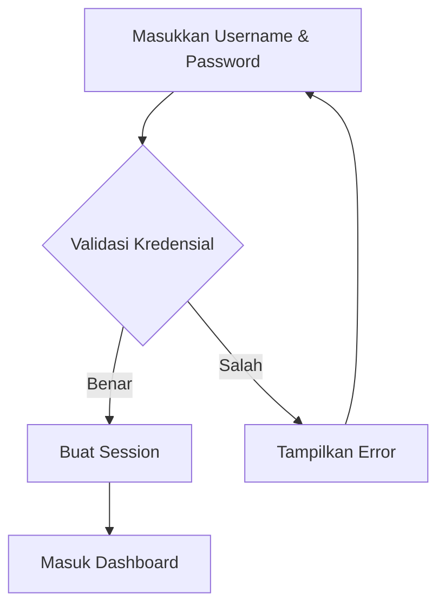
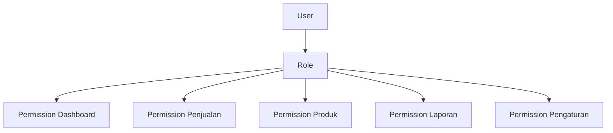
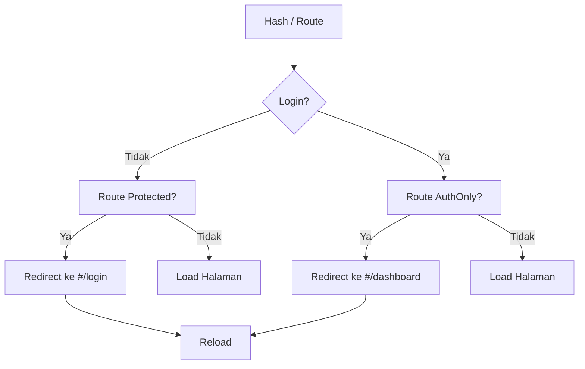

# SECURITY GUIDE

> **Aplikasi** : POS Offline PWA  
> **Versi** : 1.0  
> **Status** : Standar Resmi  
> **Berlaku Untuk** : Developer, QA, Tester, AI Coding Assistant, System Administrator

---

## Tujuan

Dokumen ini adalah **standar keamanan resmi** proyek POS Offline PWA. Dokumen menjelaskan seluruh aspek keamanan aplikasi:

| Aspek | Cakupan |
|---|---|
| **Authentication** | Login, logout, session, password |
| **Authorization** | Role Based Access Control (RBAC) |
| **Route Protection** | Guard halaman, redirect |
| **Session Management** | Storage, expiry, idle, multi-tab |
| **Password Security** | Hashing, salt, PBKDF2 |
| **OWASP Top 10** | Mitigasi kerentanan umum |
| **Data Protection** | Encryption, export, backup, import |
| **Audit Log** | Jejak aktivitas pengguna |
| **Permission Matrix** | Hak akses per role |
| **Security Checklist** | Checklist sebelum release |
| **Roadmap** | Rencana keamanan masa depan |

> POS Offline PWA menyimpan seluruh data di **perangkat lokal** (IndexedDB, localStorage, sessionStorage) dan tidak memiliki server. Keamanan difokuskan pada **proteksi data lokal**, **kontrol akses**, dan **integritas session**.

---

## Daftar Isi

1. [Authentication](#1-authentication)
2. [Authorization](#2-authorization)
3. [Route Protection](#3-route-protection)
4. [Session Management](#4-session-management)
5. [Password Security](#5-password-security)
6. [OWASP Top 10](#6-owasp-top-10)
7. [Data Protection](#7-data-protection)
8. [Audit Log](#8-audit-log)
9. [Permission Matrix](#9-permission-matrix)
10. [Security Checklist](#10-security-checklist)
11. [Future Security Roadmap](#11-future-security-roadmap)

---

## 1. Authentication

### 1.1 Alur Autentikasi



### 1.2 Login

| Aspek | Standar |
|---|---|
| Input | Username + password |
| Validasi | Di semua lapisan (UI, Business, DB) |
| Hash password | PBKDF2 (tidak pernah plaintext) |
| Login gagal | Pesan error tanpa membocorkan informasi user |
| Login sukses | Session dibuat & disimpan |
| After login | Redirect ke Dashboard |

```js
// Standar: kredensial dicek melalui auth-service
const result = await authService.login(username, password, rememberMe);
if (result.success) {
  // redirect ke dashboard
} else {
  // tampilkan error
}
```

### 1.3 Logout

| Aspek | Standar |
|---|---|
| Aksi | Pengguna klik "Keluar" |
| Session | Dihapus dari semua storage |
| Redirect | Kembali ke `#/login` |
| Cache user | Dikosongkan |

```js
authService.logout({ redirect: true });
// -> session dibersihkan
// -> redirect ke #/login
```

### 1.4 Lock Screen

Lock Screen adalah layar sementara saat aplikasi dikunci.

| Aspek | Standar |
|---|---|
| Pemicu | Idle session timeout |
| Perilaku | Pengguna harus masuk kembali (PIN/password) |
| Data | Tidak hilang, sesi dipertahankan |
| Alternatif | Auto logout (mengikuti konfigurasi) |

### 1.5 Session Restore

Session Restore adalah kemampuan memulihkan sesi saat halaman di-refresh.

| Aspek | Standar |
|---|---|
| Refresh | Session valid -> tetap login |
| Session tidak valid | Kembali ke login |
| Validasi | `isSessionValid()` memeriksa `expiresAt`, `deviceId`, status user |

```js
// Validasi sesi sebelum render halaman internal
const valid = await authService.validateSession();
if (!valid) {
  // redirect ke #/login
}
```

### 1.6 Remember Me

| Mode | Storage | Durasi | Perilaku Saat Browser Ditutup |
|---|---|---|---|
| **Remember Me** | localStorage | 30 hari | Session tetap aktif |
| **Tidak Remember** | sessionStorage | 24 jam | Session hilang |

- Remember Me menyimpan session di `localStorage`.
- Tidak remember menyimpan di `sessionStorage` (hilang saat tab ditutup).
- Keduanya memiliki `expiresAt` yang wajib dicek.

### 1.7 Session Timeout

| Aspek | Standar |
|---|---|
| Idle timeout | Sesuai `APP_CONFIG.sessionTimeout` (default 30 menit) |
| Aksi saat timeout | Auto logout + redirect login |
| Aktivitas | Mouse, keyboard, touch, scroll me-reset timer |

```js
// idle-service.js
const IDLE_TIMEOUT_MS = (APP_CONFIG.sessionTimeout || 30) * 60 * 1000;
// aktivitas pengguna me-reset timer
// saat timeout -> authService.logout({ redirect: true })
```

### 1.8 Password Change

| Aspek | Standar |
|---|---|
| Aksi | Pengguna mengganti password di Pengaturan |
| Verifikasi | Password lama wajib benar |
| Hash | Password baru di-hash dengan salt baru |
| Notifikasi | Konfirmasi sukses |

### 1.9 First Login

First Login adalah kondisi saat aplikasi dijalankan pertama kali (belum ada akun owner).

| Aspek | Standar |
|---|---|
| Deteksi | `hasOwnerAccount()` = false |
| Halaman | Wizard First-Run (buat akun owner) |
| Default user | Tidak ada user default yang tertanam |
| Setelah dibuat | Login dengan akun owner yang baru dibuat |

### 1.10 Business Rules Authentication

| No | Rule |
|---|---|
| 1 | Tidak boleh ada user default dengan password publik |
| 2 | Password tidak pernah disimpan plaintext |
| 3 | Session wajib punya `expiresAt` |
| 4 | Session perangkat lain ditolak (deviceId berbeda) |
| 5 | User nonaktif / terhapus -> session tidak valid |
| 6 | Role wajib valid & aktif |
| 7 | Logout menghapus session di semua storage |
| 8 | Halaman internal wajib dicek autentikasi |

---

## 2. Authorization

### 2.1 RBAC — Role Based Access Control

Aplikasi menggunakan **Role Based Access Control (RBAC)**. Setiap user memiliki satu role, dan role menentukan hak akses terhadap fitur.



### 2.2 Daftar Role

| Role | Deskripsi |
|---|---|
| **Owner** | Pemilik usaha, akses penuh semua fitur termasuk pengaturan |
| **Admin** | Manajer operasional, akses hampir semua fitur (tanpa pengaturan owner) |
| **Kasir** | Petugas kasir, hanya transaksi penjualan & dashboard |
| **Gudang** | Petugas stok, kelola produk & stok |
| **Supervisor** | Pengawas, akses luas termasuk laporan & pembelian |
| **Manager** | Pengelola cabang/operasional, akses manajemen lengkap |

### 2.3 Hak Akses per Role

| Fitur | Owner | Admin | Kasir | Gudang | Supervisor | Manager |
|---|---|---|---|---|---|---|
| Dashboard | ✓ | ✓ | ✓ | ✓ | ✓ | ✓ |
| Penjualan | ✓ | ✓ | ✓ | — | ✓ | ✓ |
| Produk | ✓ | ✓ | — | ✓ | ✓ | ✓ |
| Pelanggan | ✓ | ✓ | — | — | ✓ | ✓ |
| Supplier | ✓ | ✓ | — | ✓ | ✓ | ✓ |
| Pembelian | ✓ | ✓ | — | ✓ | ✓ | ✓ |
| Laporan | ✓ | ✓ | — | ✓ | ✓ | ✓ |
| Pengaturan | ✓ | — | — | — | — | — |
| User Management | ✓ | — | — | — | — | — |

> Matriks ini adalah **standar minimum**. Setiap perubahan wajib melalui persetujuan dan dicatat di dokumentasi.

### 2.4 Prinsip Authorization

```text
1. Setiap akses fungsi wajib dicek permission (bukan hanya sembunyikan tombol).
2. Role yang tidak memiliki permission tidak boleh mengakses route terkait.
3. Guard diterapkan di sisi router (bukan hanya UI).
4. Perubahan permission harus disetujui & terdokumentasi.
5. Dilarang hardcode hak akses di dalam halaman.
```

---

## 3. Route Protection

### 3.1 Kategori Halaman

| Kategori | Halaman | Autentikasi |
|---|---|---|
| **Halaman Publik** | `#/login`, `#/first-run` | Tidak wajib login |
| **Halaman Internal** | `#/dashboard`, `#/penjualan`, `#/produk`, `#/pelanggan`, `#/supplier`, `#/pembelian`, `#/laporan`, `#/pengaturan` | Wajib login |
| **Halaman Khusus** | `#/lock-screen` | Bergantung konfigurasi |

### 3.2 Halaman yang Wajib Login

Semua halaman internal **wajib login** dan dicek oleh route guard:

- `#/dashboard`
- `#/penjualan`
- `#/produk`
- `#/pelanggan`
- `#/supplier`
- `#/pembelian`
- `#/laporan`
- `#/pengaturan`

### 3.3 Halaman Publik

| Halaman | Kondisi Akses |
|---|---|
| `#/login` | Hanya untuk yang belum login. Jika sudah login -> redirect dashboard |
| `#/first-run` | Hanya tampil saat belum ada akun owner |

### 3.4 Flow Redirect



### 3.5 Contoh Implementasi Guard

```js
// guard: route protected + belum login -> #/login
if (route.protected && !authService.isLoggedIn()) {
  return LOGIN_PATH; // '#/login'
}
// guard: route auth-only + sudah login -> #/dashboard
if (route.authOnly && authService.isLoggedIn()) {
  return HOME_PATH; // '#/dashboard'
}
```

### 3.6 Aturan Route Protection

```text
1. Semua halaman internal ditandai protected: true.
2. Halaman login ditandai authOnly: true.
3. Validasi penuh (cek user aktif di DB) dilakukan untuk route protected.
4. Tidak boleh ada route yang bisa diakses tanpa login.
5. 404 ditampilkan untuk hash yang tidak dikenal.
```

---

## 4. Session Management

### 4.1 Media Penyimpanan Session

| Media | Dipakai Untuk | Perilaku |
|---|---|---|
| **Session Storage** | Session tidak remember-me | Hilang saat tab/browser ditutup |
| **Local Storage** | Session remember-me, device id | Persisten sampai dihapus / logout |
| **IndexedDB** | Data aplikasi (produk, transaksi) | Persisten, kapasitas besar |
| **Cookie** | **Tidak digunakan** | — |

> Aplikasi **tidak menggunakan cookie**. Session disimpan di Web Storage (localStorage / sessionStorage).

### 4.2 Expiration

| Mode | Masa Berlaku |
|---|---|
| Tidak remember-me | 24 jam |
| Remember-me | 30 hari |

- Setiap akses, `isSessionValid()` memeriksa `expiresAt`.
- Session kedaluwarsa otomatis dihapus.

```js
if (Date.now() >= session.expiresAt) {
  clearSession();
  // redirect login
}
```

### 4.3 Idle Timeout

- Jika tidak ada aktivitas (mouse, keyboard, touch, scroll) melewati batas, aplikasi melakukan **auto logout**.
- Default: 30 menit (sesuai `APP_CONFIG.sessionTimeout`).

### 4.4 Auto Logout

| Pemicu | Aksi |
|---|---|
| Session expired | Hapus session, redirect login |
| Idle timeout | Logout otomatis, redirect login |
| Logout manual | Hapus session, redirect login |

### 4.5 Lock Screen

- Aplikasi memiliki mekanisme lock-screen saat idle.
- Setelah lock, pengguna harus membuka kunci (masuk kembali).
- Data tidak hilang selama sesi belum benar-benar berakhir.

### 4.6 Multiple Tabs

| Skenario | Perilaku |
|---|---|
| Dua tab membuka aplikasi | Setiap tab berbagi session yang sama (storage bersama) |
| Logout di satu tab | Session hilang, tab lain akan ter-logout saat validasi |
| Tab baru | Membaca session dari storage yang sama |

> Karena session disimpan di storage bersama, logout di satu tab memengaruhi semua tab. Ini perilaku yang diinginkan.

### 4.7 Refresh Browser

| Kondisi | Perilaku |
|---|---|
| Session valid | Refresh tidak memutus login |
| Session tidak valid | Redirect ke login |
| Session expired | Redirect ke login |

### 4.8 Offline Session

- Aplikasi offline-first: session tetap berfungsi tanpa internet.
- Session divalidasi secara lokal (tanpa server).
- User dianggap login selama session valid & user aktif di database lokal.

### 4.9 Checklist Session Management

- [ ] Session punya `expiresAt`
- [ ] Session kedaluwarsa -> redirect login
- [ ] Idle timeout -> auto logout
- [ ] Logout menghapus semua storage
- [ ] Remember me bertahan (30 hari)
- [ ] Non-remember hilang saat tab ditutup
- [ ] Refresh tidak memutus session valid
- [ ] Device lain menolak session
- [ ] Offline session tetap berjalan
- [ ] Tidak ada data session di cookie

---

## 5. Password Security

### 5.1 Minimal Password

| Aturan | Standar |
|---|---|
| Panjang minimal | 8 karakter |
| Kombinasi | Huruf + angka (disarankan + simbol) |
| Default | Tidak ada password default tertanam |
| First run | Password dibuat oleh pemilik akun pertama |

### 5.2 Hashing

Password **wajib** disimpan sebagai **hash**, bukan plaintext.

```text
password + salt -> PBKDF2 -> hash (disimpan)
```

- Plaintext tidak pernah disimpan.
- Hash tidak pernah ditampilkan.

### 5.3 Salt

- Setiap user memiliki **salt unik**.
- Salt dipakai agar dua password sama menghasilkan hash berbeda.
- Salt disimpan bersama hash.

### 5.4 PBKDF2

| Aspek | Standar |
|---|---|
| Algoritma | PBKDF2 (Web Crypto API) |
| Iterasi | Memadai untuk memperlambat serangan brute-force |
| Fungsi | `crypto.subtle.deriveBits` / hash utility |
| Lokasi | `src/utils/hash-utils.js` |

```js
// Contoh konsep (implementasi di hash-utils)
async function hashPassword(password, salt) {
  return pbkdf2(password, salt, ITERATIONS);
}
```

### 5.5 bcrypt (Future)

| Status | Keterangan |
|---|---|
| Saat ini | PBKDF2 via Web Crypto API |
| Masa depan | bcrypt (library) bila aplikasi terhubung server/backend |
| Alasan | bcrypt lebih umum di backend & self-contained |

### 5.6 Password Reset

| Aspek | Standar |
|---|---|
| Offline | Reset oleh user berperan Owner/Admin |
| Verifikasi | Pengguna dikonfirmasi sebelum reset |
| Efek | Password baru di-hash dengan salt baru |
| Login lain | Session lama dapat dianggap tidak valid |

### 5.7 Password Expiration

| Aspek | Standar |
|---|---|
| Opsional | Dapat diaktifkan sesuai kebijakan |
| Default | Tidak wajib kedaluwarsa (untuk kasir sederhana) |
| Masa depan | Konfigurasi kebijakan expiration per role |

### 5.8 Checklist Password

- [ ] Tidak ada password plaintext
- [ ] Tidak ada password default tertanam
- [ ] Hashing PBKDF2 dengan salt unik
- [ ] Minimal 8 karakter
- [ ] Password lama diverifikasi saat ganti
- [ ] Reset password menghasilkan hash baru

---

## 6. OWASP Top 10

Bagian ini membahas **OWASP Top 10** dan bagaimana aplikasi menghindari/menangani kerentanan tersebut.

| No | Kerentanan | Penanganan Aplikasi |
|---|---|---|
| 1 | **Injection** | Database lokal (IndexedDB/Dexie) — bukan SQL server. Tetap validasi semua input |
| 2 | **Broken Authentication** | Session expiry, password hash, deviceId check, lock screen |
| 3 | **Sensitive Data Exposure** | Data lokal terisolasi; tidak ada server yang membocorkan data |
| 4 | **Broken Access Control** | RBAC + route guard + permission check di sisi logic |
| 5 | **Security Misconfiguration** | Konfigurasi terpusat (`src/config/`), tidak ada secret hardcode |
| 6 | **XSS** | Input dirender sebagai teks, tidak sebagai HTML mentah |
| 7 | **CSRF** | Tidak relevan (tanpa server/form lintas-domain) — tetap jaga kebersihan data |
| 8 | **SSRF** | Tidak relevan (aplikasi tidak memanggil URL server) |
| 9 | **Dependency** | Library dijaga versi & di-audit (`npm audit`) |
| 10 | **Logging** | Logging via logger aplikasi tanpa data sensitif |

### 6.1 Injection

- Aplikasi memakai **IndexedDB (Dexie)**, bukan database SQL — sehingga SQL Injection tidak berlaku secara langsung.
- Tetap wajib **validasi semua input** untuk mencegah query yang tidak diinginkan.

### 6.2 Broken Authentication

Mitigasi:

| Mitigasi | Status |
|---|---|
| Session expiry | ✓ |
| Password di-hash | ✓ |
| Session per-device (deviceId) | ✓ |
| Idle timeout | ✓ |
| Login berulang dibatasi | Perlu diperkuat (rate limit lokal) |

### 6.3 Sensitive Data Exposure

- Data tersimpan lokal di IndexedDB.
- Tidak ada transfer data ke server.
- Export/backup harus dilindungi dari akses tidak sah.

### 6.4 Broken Access Control

- Setiap fitur dicek permission (RBAC).
- Route guard melindungi halaman internal.
- Tombol disembunyikan **dan** permission tetap dicek di logic.

### 6.5 Security Misconfiguration

- Konfigurasi terpusat & terdokumentasi.
- Tidak ada kredensial/secret dalam source.
- Versi & cache dikelola dengan jelas.

### 6.6 XSS

```js
// AMAN: gunakan textContent, bukan innerHTML untuk data pengguna
element.textContent = userInput;

// BERISIKO: jangan menaruh data pengguna langsung di innerHTML
// element.innerHTML = userInput;  <-- DILARANG
```

- Saat merender data pengguna, selalu gunakan `textContent` atau escape HTML.
- Hindari `innerHTML` dengan data dari luar.

### 6.7 CSRF

- Aplikasi tidak menggunakan cookie atau request lintas-domain.
- CSRF tidak relevan untuk aplikasi offline tanpa server.
- Tetap disiplin menangani data dari sumber yang dipercaya.

### 6.8 SSRF

- Aplikasi tidak melakukan fetch ke URL server.
- SSRF tidak relevan. Tetap jangan menambah fitur fetch ke server tanpa review.

### 6.9 Dependency

| Tindakan | Keterangan |
|---|---|
| `npm audit` | Jalankan rutin untuk mendeteksi kerentanan dependensi |
| Update library | Perbarui ke versi patched |
| Review baru | Setiap library baru di-review sebelum dipakai |

```bash
npm audit
```

### 6.10 Logging

- Gunakan `logger.info/warn/error`, bukan `console.log`.
- Jangan pernah mencatat password, token, atau data sensitif ke log.

---

## 7. Data Protection

### 7.1 Encryption

| Aspek | Standar |
|---|---|
| Data lokal | Disimpan di IndexedDB (terisolasi per origin browser) |
| Data sensitif | Bila perlu, enkripsi field sensitif sebelum disimpan |
| Transport | Tidak ada (offline), tetapi bila ada server gunakan HTTPS |
| Masa depan | Enkripsi penuh + key rotation (lihat Section 11) |

### 7.2 IndexedDB

- Data aplikasi disimpan di IndexedDB via Dexie.
- Terisolasi per **origin** (localhost berbeda dengan domain).
- Capacity browser bergantung browser & perangkat.

### 7.3 Export Excel

| Aspek | Standar |
|---|---|
| Data | Data yang diekspor sesuai permission user |
| Validasi | Pastikan hanya data yang berhak diekspor |
| Perlindungan | File export bisa berisi data sensitif — kelola penyimpanannya |
| XSS | Isi sel di-render sebagai nilai (bukan formula) |

### 7.4 Backup

| Aspek | Standar |
|---|---|
| Isi | Database, setting, user, master data, transaksi |
| Format | File JSON hasil export |
| Keamanan | File backup disimpan di lokasi aman |
| Frekuensi | Harian/mingguan sesuai kebijakan |

### 7.5 Restore

| Aspek | Standar |
|---|---|
| Proses | Import file backup -> clear + bulkAdd |
| Verifikasi | Cek data & login setelah restore |
| Risiko | Restore menimpa data — wajib konfirmasi |

### 7.6 Local File

- File yang diproduksi (export, struk, laporan) tersimpan lokal.
- Jangan menyimpan file sensitif di folder publik.
- Struk/laporan bisa berisi data transaksi.

### 7.7 Import Validation

```js
// Setiap file import wajib divalidasi sebelum disimpan
const errors = validateImportFile(file);
if (errors.length > 0) {
  // tolak import & tampilkan error
}
```

| Aspek | Standar |
|---|---|
| Format | Validasi ekstensi & struktur file |
| Ukuran | Batas ukuran file |
| Isi | Validasi setiap baris sebelum insert |
| Duplikat | Deteksi & tangani duplikat |
| Kerusakan | File korup ditolak dengan pesan jelas |

### 7.8 Checklist Data Protection

- [ ] Data disimpan di IndexedDB
- [ ] Field sensitif dienkripsi bila perlu
- [ ] Export sesuai permission
- [ ] Backup tersimpan di lokasi aman
- [ ] Restore diverifikasi
- [ ] Import divalidasi penuh
- [ ] File export tidak mengandung formula berbahaya

---

## 8. Audit Log

### 8.1 Tujuan

Audit log mencatat aktivitas penting untuk jejak dan investigasi. Log membantu menjawab **siapa melakukan apa, kapan**.

### 8.2 Event yang Dicatat

| Kategori | Event |
|---|---|
| **Autentikasi** | Login, logout, login gagal, session expired |
| **Produk** | Tambah produk, edit produk, hapus (soft delete), restore |
| **Master Data** | Tambah/edit/hapus pelanggan, supplier |
| **Transaksi** | Penjualan, pembelian, retur, void |
| **Import / Export** | Import data, export data |
| **Backup / Restore** | Backup dibuat, restore dijalankan |
| **User Management** | Tambah user, edit role, reset password |
| **Settings** | Perubahan pengaturan aplikasi |
| **Keamanan** | Akses ditolak, route terlarang |

### 8.3 Format Audit Log

| Field | Keterangan | Contoh |
|---|---|---|
| `timestamp` | Waktu kejadian (ISO) | `2026-08-06T10:30:00Z` |
| `actorId` | ID user yang melakukan | `user-owner-1` |
| `actorName` | Nama user | `Budi` |
| `role` | Role user | `Owner` |
| `action` | Jenis aksi | `product.create` |
| `module` | Modul | `product` |
| `targetId` | Objek yang diubah | `prod-001` |
| `detail` | Detail perubahan | `{ name, price }` |
| `result` | Hasil | `success` / `failed` |

```json
{
  "timestamp": "2026-08-06T10:30:00Z",
  "actorId": "user-owner-1",
  "actorName": "Budi",
  "role": "Owner",
  "action": "product.create",
  "module": "product",
  "targetId": "prod-001",
  "detail": { "name": "Nasi Goreng", "price": 20000 },
  "result": "success"
}
```

### 8.4 Aturan Audit Log

```text
1. Setiap event wajib berisi: waktu, actor, action, module, result.
2. Jangan catat password / hash / data sensitif ke audit log.
3. Log disimpan di IndexedDB (tabel audit).
4. Akses log terbatas pada role berwenang (Owner/Admin).
5. Log tidak bisa diubah oleh user biasa.
```

### 8.5 Checklist Audit Log

- [ ] Login & logout tercatat
- [ ] Tambah/edit/hapus produk tercatat
- [ ] Delete & restore tercatat
- [ ] Import & export tercatat
- [ ] Backup & restore tercatat
- [ ] User management tercatat
- [ ] Perubahan settings tercatat
- [ ] Akses ditolak tercatat
- [ ] Tidak ada password/data sensitif di log
- [ ] Log dapat dilihat role berwenang

---

## 9. Permission Matrix

### 9.1 Matriks Lengkap Role vs Fitur

| # | Fitur | Owner | Admin | Kasir | Gudang | Supervisor | Manager |
|---|---|---|---|---|---|---|---|
| 1 | Login / Logout | ✓ | ✓ | ✓ | ✓ | ✓ | ✓ |
| 2 | Dashboard | ✓ | ✓ | ✓ | ✓ | ✓ | ✓ |
| 3 | Penjualan | ✓ | ✓ | ✓ | — | ✓ | ✓ |
| 4 | Pembayaran | ✓ | ✓ | ✓ | — | ✓ | ✓ |
| 5 | Retur | ✓ | ✓ | — | — | ✓ | ✓ |
| 6 | Produk (lihat) | ✓ | ✓ | ✓ | ✓ | ✓ | ✓ |
| 7 | Produk (tambah/edit) | ✓ | ✓ | — | ✓ | ✓ | ✓ |
| 8 | Produk (hapus/restore) | ✓ | ✓ | — | — | ✓ | ✓ |
| 9 | Stok Masuk | ✓ | ✓ | — | ✓ | ✓ | ✓ |
| 10 | Pelanggan | ✓ | ✓ | — | — | ✓ | ✓ |
| 11 | Supplier | ✓ | ✓ | — | ✓ | ✓ | ✓ |
| 12 | Pembelian | ✓ | ✓ | — | ✓ | ✓ | ✓ |
| 13 | Laporan | ✓ | ✓ | — | ✓ | ✓ | ✓ |
| 14 | Export | ✓ | ✓ | ✓ | ✓ | ✓ | ✓ |
| 15 | Import | ✓ | ✓ | — | ✓ | ✓ | ✓ |
| 16 | Backup / Restore | ✓ | — | — | — | — | — |
| 17 | User Management | ✓ | — | — | — | — | — |
| 18 | Role & Permission | ✓ | — | — | — | — | — |
| 19 | Pengaturan Aplikasi | ✓ | — | — | — | — | — |
| 20 | Audit Log | ✓ | ✓ | — | — | ✓ | ✓ |

> **Catatan**: Matriks di atas adalah standar minimum. Perubahan wajib disetujui, diterapkan di `ROLE_PERMISSIONS` / `auth-service.js`, dan didokumentasikan.

### 9.2 Prinsip Permission

```text
1. Default deny: fitur yang tidak tercantum = tidak boleh diakses.
2. Permission dicek di sisi logic (guard + service), bukan hanya UI.
3. Tombol tersembunyi != aman; selalu ada validasi logic.
4. Permission dikelola terpusat, bukan tersebar di tiap halaman.
```

---

## 10. Security Checklist

Checklist **wajib** dijalankan sebelum release.

### 10.1 Authentication

- [ ] Login berhasil dengan kredensial benar
- [ ] Login gagal menampilkan error tanpa bocor info
- [ ] Logout menghapus session semua storage
- [ ] Session expired -> redirect login
- [ ] Idle timeout -> auto logout
- [ ] Remember me berfungsi (30 hari)
- [ ] Non-remember hilang saat tab ditutup
- [ ] Refresh browser tidak memutus session valid
- [ ] Session device berbeda ditolak
- [ ] First login menampilkan wizard pembuatan owner

### 10.2 Password

- [ ] Tidak ada password plaintext
- [ ] Tidak ada password default tertanam
- [ ] Password di-hash dengan salt (PBKDF2)
- [ ] Password minimal 8 karakter
- [ ] Ganti password memverifikasi password lama

### 10.3 Authorization

- [ ] RBAC berjalan
- [ ] Role Owner akses penuh
- [ ] Role Admin sesuai matriks
- [ ] Role Kasir hanya diizinkan
- [ ] Role Gudang sesuai matriks
- [ ] Role Supervisor sesuai matriks
- [ ] Role Manager sesuai matriks
- [ ] Akses di luar permission ditolak
- [ ] Permission dicek di logic (bukan hanya UI)

### 10.4 Route Protection

- [ ] Semua halaman internal wajib login
- [ ] Halaman login redirect saat sudah login
- [ ] Route guard berfungsi
- [ ] 404 untuk route tidak dikenal
- [ ] Tidak ada route yang bisa diakses tanpa login

### 10.5 Session

- [ ] Session punya expiresAt
- [ ] Storage session sesuai (local/session storage)
- [ ] Cookie tidak digunakan
- [ ] Offline session berjalan
- [ ] Multiple tab perilaku konsisten

### 10.6 Data Protection

- [ ] Data di IndexedDB
- [ ] Field sensitif dienkripsi bila perlu
- [ ] Export sesuai permission
- [ ] Import divalidasi
- [ ] Backup dibuat
- [ ] Restore teruji
- [ ] File export tidak mengandung formula berbahaya

### 10.7 OWASP

- [ ] Input divalidasi (anti injection)
- [ ] Data user dirender aman (anti XSS)
- [ ] Tidak ada secret di source
- [ ] Dependensi di-audit (`npm audit`)
- [ ] Logging tanpa data sensitif

### 10.8 Audit & Log

- [ ] Audit log mencatat login/logout
- [ ] Audit log mencatat CRUD produk
- [ ] Audit log mencatat import/export
- [ ] Audit log mencatat backup/restore
- [ ] Audit log mencatat user management
- [ ] Tidak ada data sensitif di log

### 10.9 PWA & Offline

- [ ] Service Worker tidak mengekspos data
- [ ] Cache tidak menyimpan data sensitif
- [ ] Offline tetap aman (session lokal valid)
- [ ] Update aplikasi tidak menurunkan keamanan

### 10.10 Proses

- [ ] Security checklist direview
- [ ] Dokumentasi keamanan diperbarui
- [ ] Perubahan permission disetujui
- [ ] Tidak ada TODO/FIXME terkait keamanan tersisa

---

## 11. Future Security Roadmap

Rencana peningkatan keamanan untuk masa depan.

### 11.1 Roadmap Keamanan

| Fitur | Status | Prioritas | Keterangan |
|---|---|---|---|
| **2FA (Two Factor Authentication)** | Rencana | Tinggi | Verifikasi dua langkah saat login |
| **OTP** | Rencana | Tinggi | One-Time Password (email/authenticator) |
| **Biometric** | Rencana | Sedang | Fingerprint/face unlock (perangkat pendukung) |
| **PIN** | Rencana | Sedang | PIN cepat untuk kasir (lock screen) |
| **Cloud Sync** | Rencana | Sedang | Sinkronisasi dengan enkripsi end-to-end |
| **Encryption Key Rotation** | Rencana | Sedang | Rotasi kunci enkripsi berkala |
| **Digital Signature** | Rencana | Sedang | Tanda tangan digital untuk transaksi/laporan |
| **Rate Limit Login** | Rencana | Tinggi | Batasi percobaan login berulang |
| **Session Revocation** | Rencana | Sedang | Cabut session dari jarak jauh |
| **Tamper Detection** | Rencana | Rendah | Deteksi manipulasi data lokal |

### 11.2 Detail Rencana

#### 2FA / OTP

```text
1. Setelah password benar, minta kode OTP.
2. OTP dikirim via email / authenticator app.
3. Berlaku singkat (misal 5 menit).
4. Membutuhkan koneksi/server di masa depan.
```

#### Biometric & PIN

```text
1. Kasir dapat membuka kunci dengan PIN singkat.
2. Perangkat dengan fingerprint/face mendukung unlock biometrik.
3. PIN disimpan sebagai hash (jangan plaintext).
```

#### Cloud Sync

```text
1. Data dienkripsi end-to-end sebelum di-sync.
2. Kunci enkripsi disimpan terpisah & bisa di-rotate.
3. Sync hanya dengan server tepercaya (HTTPS).
```

#### Encryption Key Rotation

```text
1. Kunci enkripsi memiliki masa pakai.
2. Kunci baru diperkenalkan, kunci lama di-migrasi.
3. Proses rotasi terdokumentasi & teruji.
```

#### Digital Signature

```text
1. Transaksi & laporan ditandatangani digital.
2. Memastikan integritas & keaslian data.
3. Untuk kebutuhan audit & hukum.
```

### 11.3 Prioritas Implementasi

| Fase | Fitur |
|---|---|
| **Fase 1** | Rate limit login, PIN lock screen, session revocation |
| **Fase 2** | 2FA / OTP, password expiration policy |
| **Fase 3** | Biometric, digital signature |
| **Fase 4** | Cloud sync dengan enkripsi & key rotation |

### 11.4 Checklist Future Security

- [ ] Roadmap keamanan didokumentasikan
- [ ] Setiap fitur baru dinilai dampak keamanannya
- [ ] Perubahan permission disetujui
- [ ] Update dependensi diaudit
- [ ] Kebijakan keamanan ditinjau berkala

---

## Lampiran

### A. Definisi Selesai (Security)

- [ ] Checklist Section 10 lulus
- [ ] Tidak ada password/secret di source
- [ ] Session & RBAC berfungsi
- [ ] Route protection aktif
- [ ] Audit log berjalan
- [ ] Dokumentasi keamanan diperbarui

### B. Dokumen Terkait

| Dokumen | Topik |
|---|---|
| `docs/19_DEVELOPMENT_STANDARDS.md` | Standar pengembangan (termasuk keamanan kode) |
| `docs/20_TESTING_GUIDE.md` | Panduan pengujian (termasuk security test) |
| `docs/21_DEPLOYMENT_GUIDE.md` | Panduan deployment (termasuk security checklist) |
| `docs/03_BUSINESS_RULES.md` | Aturan bisnis & hak akses |

---

> **Versi 1.0** — Standar keamanan resmi POS Offline PWA.

### Riwayat Revisi

| Versi | Tanggal | Perubahan |
|---|---|---|
| 1.0 | 2026-08-06 | Versi awal: 11 section standar keamanan |
