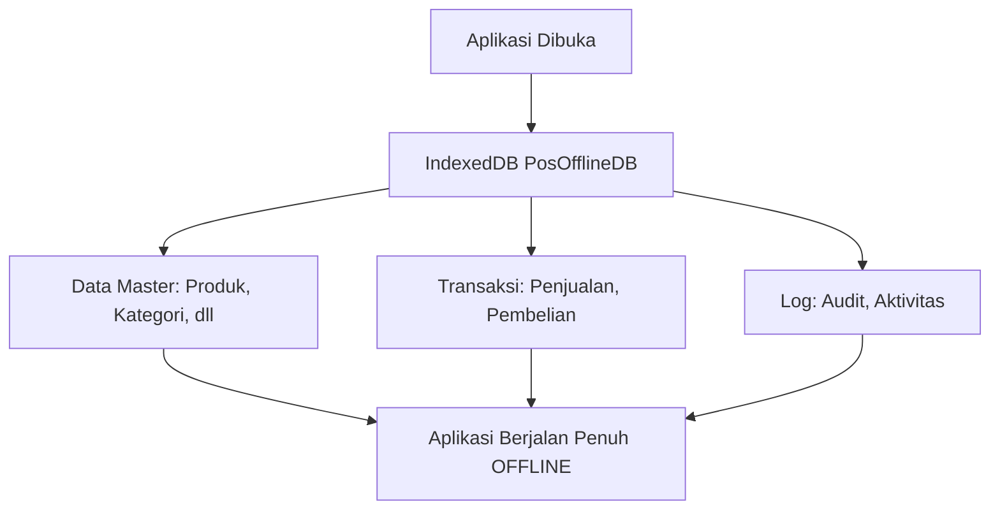
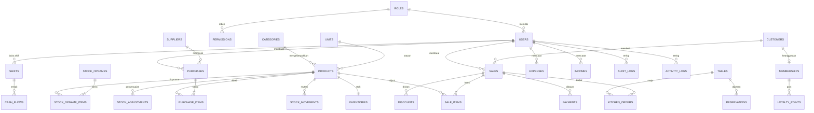
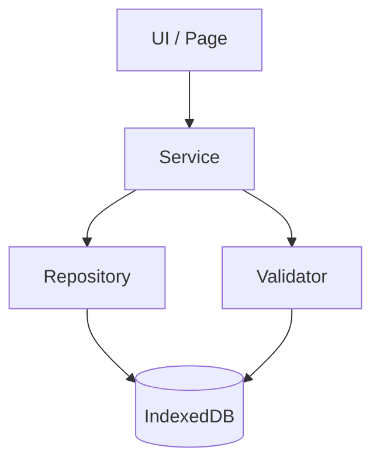

# DATABASE DESIGN

> **Aplikasi** : POS Offline PWA  
> **Database** : IndexedDB via Dexie — `PosOfflineDB`  
> **Versi Skema** : 2  
> **Status** : Standar Resmi

---

## Tujuan

Dokumen ini mendokumentasikan **seluruh desain database IndexedDB** proyek POS Offline PWA. Dokumen menjelaskan konsep, seluruh tabel, skema, relasi, migrasi, repository pattern, soft delete, optimasi index, backup, performa, dan best practices.

Setiap perubahan skema **wajib** didokumentasikan di dokumen ini dan diimplementasikan melalui migration (lihat Section 6).

---

## Daftar Isi

1. [Konsep Database](#1-konsep-database)
2. [Daftar Seluruh Tabel](#2-daftar-seluruh-tabel)
3. [Detail Tabel](#3-detail-tabel)
4. [Database Schema](#4-database-schema)
5. [Relasi Antar Tabel](#5-relasi-antar-tabel)
6. [Migration](#6-migration)
7. [Repository Pattern](#7-repository-pattern)
8. [Soft Delete](#8-soft-delete)
9. [Index Optimization](#9-index-optimization)
10. [Backup](#10-backup)
11. [Performance](#11-performance)
12. [Best Practices](#12-best-practices)

---

## 1. Konsep Database

### 1.1 Mengapa Memakai IndexedDB

IndexedDB adalah database transaksional yang tertanam di browser. Aplikasi POS Offline PWA memilih IndexedDB karena:

| Alasan | Penjelasan |
|---|---|
| **Offline-first** | Data tersimpan lokal, aplikasi berjalan tanpa internet |
| **Kapasitas besar** | Jauh lebih besar dari localStorage (ratusan MB) |
| **Struktur** | Mendukung index, query, transaction |
| **Persisten** | Data tidak hilang saat browser ditutup |
| **Transaksional** | Operasi bersifat atomic (all-or-nothing) |
| **Tidak ada server** | Tanpa biaya server, tanpa latensi jaringan |

### 1.2 Mengapa Memakai Dexie

Dexie adalah wrapper modern di atas IndexedDB yang membuat penggunaannya lebih mudah.

| Keuntungan Dexie | IndexedDB Murni |
|---|---|
| API sederhana (`db.table.get()`) | API verbose & callback |
| Promise-native | Event-based |
| Versioning & migration mudah | Migrasi manual rumit |
| Query fleksibel (`where`, `filter`) | IndexedDB terbatas |
| TypeScript support | Tidak ada |

```js
// Dexie — sederhana
const product = await db.products.get('prd-001');

// IndexedDB murni — verbose
const tx = db.transaction('products', 'readonly');
const store = tx.objectStore('products');
const request = store.get('prd-001');
request.onsuccess = () => { /* ... */ };
```

### 1.3 Offline First



- **IndexedDB adalah sumber utama data** (single source of truth).
- Aplikasi tidak bergantung pada server/internet untuk operasi inti.
- Semua fitur (CRUD, transaksi, laporan, export) berjalan dari data lokal.

### 1.4 Migration Strategy

| Aspek | Strategi |
|---|---|
| Mekanisme | `db.version(n).stores(...)` milik Dexie |
| Penambahan tabel | Daftar di `TABLES` pada `schema.js` |
| Naik versi | Tambah `db.version(n+1)` di `db.js` |
| Idempoten | Migration aman dijalankan saat upgrade |
| Seed | Idempoten — hanya insert bila tabel kosong |

### 1.5 Versioning

| Komponen | Lokasi | Nilai Saat Ini |
|---|---|---|
| `SCHEMA_VERSION` | `src/database/schema.js` | `2` |
| `DB_CONFIG.schemaVersion` | `src/config/db.config.js` | `2` |
| `db.version(n)` | `src/database/db.js` | `version(2)` |
| Nama database | `src/database/db.js` | `PosOfflineDB` |

Aturan versioning:

```text
1. Setiap perubahan skema => SCHEMA_VERSION naik.
2. DB_CONFIG.schemaVersion disamakan dengan SCHEMA_VERSION.
3. db.version(n) menambah store/index baru.
4. Semua perubahan dicatat di Section 6 (Migration).
5. Dilarang mengubah skema tanpa migration.
```

---

## 2. Daftar Seluruh Tabel

### 2.1 Tabel yang Sudah Diimplementasikan

| # | Tabel | Kelompok | Keterangan |
|---|---|---|---|
| 1 | `users` | Autentikasi | Akun pengguna |
| 2 | `roles` | Autentikasi | Role pengguna (Owner, Admin, dll) |
| 3 | `permissions` | Autentikasi | Hak akses per role |
| 4 | `settings` | Konfigurasi | Pengaturan aplikasi & toko |
| 5 | `categories` | Master | Kategori produk |
| 6 | `units` | Master | Satuan produk |
| 7 | `suppliers` | Master | Pemasok |
| 8 | `customers` | Master | Pelanggan |
| 9 | `products` | Master | Produk |
| 10 | `sales` | Transaksi | Penjualan (header) |
| 11 | `saleItems` | Transaksi | Item penjualan (detail) |
| 12 | `payments` | Transaksi | Pembayaran |
| 13 | `discounts` | Transaksi | Diskon |
| 14 | `taxes` | Transaksi | Pajak |
| 15 | `vouchers` | Transaksi | Kupon/voucher |
| 16 | `purchases` | Transaksi | Pembelian (header) |
| 17 | `purchaseItems` | Transaksi | Item pembelian (detail) |
| 18 | `inventories` | Inventori | Stok produk |
| 19 | `stockMovements` | Inventori | Mutasi stok |
| 20 | `stockAdjustments` | Inventori | Penyesuaian stok |
| 21 | `stockOpnames` | Inventori | Stock opname (header) |
| 22 | `stockOpnameItems` | Inventori | Item stock opname |
| 23 | `cashFlows` | Keuangan | Arus kas |
| 24 | `expenses` | Keuangan | Pengeluaran |
| 25 | `incomes` | Keuangan | Pemasukan |
| 26 | `shifts` | Operasional | Shift kasir |
| 27 | `auditLogs` | Log | Log audit keamanan |
| 28 | `activityLogs` | Log | Log aktivitas pengguna |
| 29 | `tables` | Restoran | Meja (dine-in) |
| 30 | `kitchenOrders` | Restoran | Order dapur |
| 31 | `reservations` | Restoran | Reservasi meja |
| 32 | `memberships` | Loyalty | Keanggotaan/member |
| 33 | `loyaltyPoints` | Loyalty | Poin loyalty |
| 34 | `backupMetadata` | Sistem | Metadata hasil backup |

### 2.2 Tabel yang Direncanakan (Belum Ada)

| Tabel | Status | Keterangan |
|---|---|---|
| `sessions` | Rencana | Session aktif terpisah (saat ini via Web Storage) |
| `notifications` | Rencana | Notifikasi in-app |
| `draftTransactions` | Rencana | Transaksi draft |

> Saat tabel baru diimplementasikan, wajib ditambahkan ke `schema.js` + `db.js` + migrasi + dokumen ini.

---

## 3. Detail Tabel

> Konvensi: `&field` = unique index, `*` = auto-increment, field lain = index biasa. Foreign key bersifat **logical** (tidak di-enforce oleh IndexedDB, dijaga oleh repository/service).

### 3.1 `users`

| Aspek | Keterangan |
|---|---|
| **Nama** | `users` |
| **Tujuan** | Menyimpan akun & kredensial pengguna |
| **Primary Key** | `id` (string UUID) |
| **Indexes** | `&username`, `roleId`, `isActive`, `deletedAt` |
| **Unique Index** | `&username` (username tidak boleh duplikat) |
| **Foreign Key (logical)** | `roleId` -> `roles.id` |

Contoh data:

```json
{
  "id": "user-owner-1",
  "username": "owner",
  "passwordHash": "pbkdf2$10000$salt$hash",
  "fullName": "Budi Santoso",
  "roleId": "role-owner",
  "pin": null,
  "isActive": true,
  "createdAt": "2026-08-01T00:00:00.000Z",
  "updatedAt": "2026-08-01T00:00:00.000Z",
  "deletedAt": null
}
```

**Relasi**: 1 user -> 1 role; 1 user -> banyak sales/purchases.

---

### 3.2 `roles`

| Aspek | Keterangan |
|---|---|
| **Nama** | `roles` |
| **Tujuan** | Menyimpan role dan hak akses tingkat tinggi |
| **Primary Key** | `id` (string UUID) |
| **Indexes** | `&name`, `isSystem`, `deletedAt` |
| **Unique Index** | `&name` |
| **Foreign Key (logical)** | — |

Contoh data:

```json
{
  "id": "role-owner",
  "name": "Owner",
  "isSystem": true,
  "sortOrder": 1,
  "createdAt": "2026-08-01T00:00:00.000Z",
  "updatedAt": "2026-08-01T00:00:00.000Z",
  "deletedAt": null
}
```

**Relasi**: 1 role -> banyak users; 1 role -> banyak permissions.

---

### 3.3 `permissions`

| Aspek | Keterangan |
|---|---|
| **Nama** | `permissions` |
| **Tujuan** | Menyimpan permission detail per role |
| **Primary Key** | `id` |
| **Indexes** | `roleId`, `module`, `action` |
| **Unique Index** | — |
| **Foreign Key (logical)** | `roleId` -> `roles.id` |

Contoh data:

```json
{
  "id": "perm-1",
  "roleId": "role-owner",
  "module": "product",
  "action": "create"
}
```

**Relasi**: banyak permissions -> 1 role.

---

### 3.4 `settings`

| Aspek | Keterangan |
|---|---|
| **Nama** | `settings` |
| **Tujuan** | Menyimpan pengaturan aplikasi & toko (key-value) |
| **Primary Key** | `id` |
| **Indexes** | `&key`, `type` |
| **Unique Index** | `&key` |
| **Foreign Key (logical)** | — |

Contoh data:

```json
{
  "id": "setting-1",
  "key": "store-name",
  "value": "Toko Saya",
  "type": "string",
  "isEditable": true
}
```

**Relasi**: mandiri.

---

### 3.5 `categories`

| Aspek | Keterangan |
|---|---|
| **Nama** | `categories` |
| **Tujuan** | Kategori produk (mendukung hirarki) |
| **Primary Key** | `id` |
| **Indexes** | `name`, `parentId`, `isActive`, `deletedAt` |
| **Unique Index** | — |
| **Foreign Key (logical)** | `parentId` -> `categories.id` |

Contoh data:

```json
{
  "id": "cat-makanan",
  "name": "Makanan",
  "parentId": null,
  "isActive": true
}
```

**Relasi**: 1 kategori -> banyak products; kategori bisa punya parent.

---

### 3.6 `units`

| Aspek | Keterangan |
|---|---|
| **Nama** | `units` |
| **Tujuan** | Satuan produk (pcs, kg, liter, dll) |
| **Primary Key** | `id` |
| **Indexes** | `name`, `abbreviation`, `isActive`, `deletedAt` |
| **Unique Index** | — |
| **Foreign Key (logical)** | — |

Contoh data:

```json
{
  "id": "unit-pcs",
  "name": "Pcs",
  "abbreviation": "pcs",
  "isActive": true
}
```

**Relasi**: 1 unit -> banyak products.

---

### 3.7 `suppliers`

| Aspek | Keterangan |
|---|---|
| **Nama** | `suppliers` |
| **Tujuan** | Data pemasok |
| **Primary Key** | `id` |
| **Indexes** | `code`, `name`, `phone`, `isActive`, `deletedAt` |
| **Unique Index** | — |
| **Foreign Key (logical)** | — |

Contoh data:

```json
{
  "id": "sup-makmur",
  "code": "SUP-001",
  "name": "PT Sumber Makmur",
  "phone": "021-5550001",
  "isActive": true
}
```

**Relasi**: 1 supplier -> banyak purchases.

---

### 3.8 `customers`

| Aspek | Keterangan |
|---|---|
| **Nama** | `customers` |
| **Tujuan** | Data pelanggan |
| **Primary Key** | `id` |
| **Indexes** | `name`, `phone`, `isMember`, `isActive`, `deletedAt` |
| **Unique Index** | — |
| **Foreign Key (logical)** | — |

Contoh data:

```json
{
  "id": "cus-001",
  "name": "Toko ABC",
  "phone": "0812-0000-0000",
  "isMember": false,
  "isActive": true
}
```

**Relasi**: 1 customer -> banyak sales; 1 customer -> 1 memberships (bila member).

---

### 3.9 `products`

| Aspek | Keterangan |
|---|---|
| **Nama** | `products` |
| **Tujuan** | Data produk utama (master data inti) |
| **Primary Key** | `id` |
| **Indexes** | `&sku`, `barcode`, `name`, `categoryId`, `unitId`, `sellPrice`, `minStock`, `isActive`, `type`, `deletedAt` |
| **Unique Index** | `&sku` (SKU unik) |
| **Foreign Key (logical)** | `categoryId` -> `categories.id`; `unitId` -> `units.id` |

Contoh data:

```json
{
  "id": "prd-001",
  "sku": "PRD-0001",
  "barcode": "8991001001001",
  "name": "Beras Premium 5kg",
  "categoryId": "cat-sembako",
  "unitId": "unit-kg",
  "buyPrice": 55000,
  "sellPrice": 65000,
  "stock": 50,
  "minStock": 10,
  "supplierId": "sup-makmur",
  "isActive": true,
  "type": "product"
}
```

**Relasi**: 1 produk -> 1 kategori, 1 unit; 1 produk -> banyak saleItems, purchaseItems, stockMovements, 1 inventories.

---

### 3.10 `sales`

| Aspek | Keterangan |
|---|---|
| **Nama** | `sales` |
| **Tujuan** | Header transaksi penjualan |
| **Primary Key** | `id` |
| **Indexes** | `&invoiceNumber`, `customerId`, `userId`, `shiftId`, `paymentStatus`, `paymentMethod`, `saleDate` |
| **Unique Index** | `&invoiceNumber` (nomor invoice unik) |
| **Foreign Key (logical)** | `customerId` -> `customers.id`; `userId` -> `users.id`; `shiftId` -> `shifts.id` |

Contoh data:

```json
{
  "id": "sls-001",
  "invoiceNumber": "INV-20260101-0001",
  "customerId": null,
  "customerName": "Umum",
  "userId": null,
  "shiftId": null,
  "paymentStatus": "paid",
  "paymentMethod": "cash",
  "saleDate": "2026-01-01T00:00:00.000Z",
  "subtotal": 143000,
  "grandTotal": 143000
}
```

**Relasi**: 1 sale -> banyak saleItems, payments, discounts; 1 sale -> 1 customer (opsional), 1 shift, 1 user.

---

### 3.11 `saleItems`

| Aspek | Keterangan |
|---|---|
| **Nama** | `saleItems` |
| **Tujuan** | Detail item dalam satu penjualan |
| **Primary Key** | `id` |
| **Indexes** | `saleId`, `productId` |
| **Unique Index** | — |
| **Foreign Key (logical)** | `saleId` -> `sales.id`; `productId` -> `products.id` |

Contoh data:

```json
{
  "id": "sli-001",
  "saleId": "sls-001",
  "productId": "prd-013",
  "productName": "Air Mineral 600ml",
  "quantity": 2,
  "unitPrice": 3000,
  "subtotal": 6000
}
```

**Relasi**: banyak saleItems -> 1 sale; banyak saleItems -> 1 product.

---

### 3.12 `payments`

| Aspek | Keterangan |
|---|---|
| **Nama** | `payments` |
| **Tujuan** | Pembayaran atas penjualan |
| **Primary Key** | `id` |
| **Indexes** | `saleId`, `method` |
| **Unique Index** | — |
| **Foreign Key (logical)** | `saleId` -> `sales.id` |

**Relasi**: banyak payments -> 1 sale.

---

### 3.13 `discounts`

| Aspek | Keterangan |
|---|---|
| **Nama** | `discounts` |
| **Tujuan** | Diskon per sale / per saleItem |
| **Primary Key** | `id` |
| **Indexes** | `saleId`, `saleItemId`, `type` |
| **Unique Index** | — |
| **Foreign Key (logical)** | `saleId` -> `sales.id`; `saleItemId` -> `saleItems.id` |

**Relasi**: banyak discounts -> 1 sale.

---

### 3.14 `taxes`

| Aspek | Keterangan |
|---|---|
| **Nama** | `taxes` |
| **Tujuan** | Definisi pajak |
| **Primary Key** | `id` |
| **Indexes** | `name`, `isActive`, `isDefault` |
| **Unique Index** | — |
| **Foreign Key (logical)** | — |

**Relasi**: mandiri.

---

### 3.15 `vouchers`

| Aspek | Keterangan |
|---|---|
| **Nama** | `vouchers` |
| **Tujuan** | Kupon / voucher diskon |
| **Primary Key** | `id` |
| **Indexes** | `&code`, `type`, `validFrom`, `validUntil`, `isActive`, `deletedAt` |
| **Unique Index** | `&code` |
| **Foreign Key (logical)** | — |

**Relasi**: mandiri.

---

### 3.16 `purchases`

| Aspek | Keterangan |
|---|---|
| **Nama** | `purchases` |
| **Tujuan** | Header transaksi pembelian |
| **Primary Key** | `id` |
| **Indexes** | `&poNumber`, `supplierId`, `userId`, `status`, `orderDate`, `deletedAt` |
| **Unique Index** | `&poNumber` |
| **Foreign Key (logical)** | `supplierId` -> `suppliers.id`; `userId` -> `users.id` |

Contoh data:

```json
{
  "id": "po-001",
  "poNumber": "PO-0001",
  "supplierId": "sup-makmur",
  "supplierName": "PT Sumber Makmur",
  "status": "received",
  "orderDate": "2026-01-01T00:00:00.000Z",
  "subtotal": 1375000,
  "grandTotal": 1375000
}
```

**Relasi**: 1 purchase -> banyak purchaseItems; 1 purchase -> 1 supplier.

---

### 3.17 `purchaseItems`

| Aspek | Keterangan |
|---|---|
| **Nama** | `purchaseItems` |
| **Tujuan** | Detail item pembelian |
| **Primary Key** | `id` |
| **Indexes** | `purchaseId`, `productId` |
| **Unique Index** | — |
| **Foreign Key (logical)** | `purchaseId` -> `purchases.id`; `productId` -> `products.id` |

**Relasi**: banyak purchaseItems -> 1 purchase; banyak purchaseItems -> 1 product.

---

### 3.18 `inventories`

| Aspek | Keterangan |
|---|---|
| **Nama** | `inventories` |
| **Tujuan** | Stok terkini per produk (1 baris per produk) |
| **Primary Key** | `id` |
| **Indexes** | `&productId`, `quantity` |
| **Unique Index** | `&productId` (satu inventory per produk) |
| **Foreign Key (logical)** | `productId` -> `products.id` |

Contoh data:

```json
{
  "id": "inv-001",
  "productId": "prd-001",
  "quantity": 50
}
```

**Relasi**: 1 inventory -> 1 product.

---

### 3.19 `stockMovements`

| Aspek | Keterangan |
|---|---|
| **Nama** | `stockMovements` |
| **Tujuan** | Riwayat mutasi stok (masuk/keluar) |
| **Primary Key** | `id` |
| **Indexes** | `productId`, `type`, `referenceType`, `referenceId`, `userId` |
| **Unique Index** | — |
| **Foreign Key (logical)** | `productId` -> `products.id`; `referenceId` -> transaksi terkait; `userId` -> `users.id` |

**Relasi**: banyak stockMovements -> 1 product.

---

### 3.20 `stockAdjustments`

| Aspek | Keterangan |
|---|---|
| **Nama** | `stockAdjustments` |
| **Tujuan** | Penyesuaian stok manual |
| **Primary Key** | `id` |
| **Indexes** | `productId`, `type`, `userId` |
| **Unique Index** | — |
| **Foreign Key (logical)** | `productId` -> `products.id`; `userId` -> `users.id` |

**Relasi**: banyak adjustments -> 1 product.

---

### 3.21 `stockOpnames`

| Aspek | Keterangan |
|---|---|
| **Nama** | `stockOpnames` |
| **Tujuan** | Header stock opname |
| **Primary Key** | `id` |
| **Indexes** | `&opnameNumber`, `status`, `userId` |
| **Unique Index** | `&opnameNumber` |
| **Foreign Key (logical)** | `userId` -> `users.id` |

**Relasi**: 1 opname -> banyak stockOpnameItems.

---

### 3.22 `stockOpnameItems`

| Aspek | Keterangan |
|---|---|
| **Nama** | `stockOpnameItems` |
| **Tujuan** | Detail item stock opname |
| **Primary Key** | `id` |
| **Indexes** | `opnameId`, `productId` |
| **Unique Index** | — |
| **Foreign Key (logical)** | `opnameId` -> `stockOpnames.id`; `productId` -> `products.id` |

**Relasi**: banyak items -> 1 opname.

---

### 3.23 `cashFlows`

| Aspek | Keterangan |
|---|---|
| **Nama** | `cashFlows` |
| **Tujuan** | Arus kas (masuk/keluar) |
| **Primary Key** | `id` |
| **Indexes** | `type`, `category`, `shiftId`, `userId`, `cashDate` |
| **Unique Index** | — |
| **Foreign Key (logical)** | `shiftId` -> `shifts.id`; `userId` -> `users.id` |

**Relasi**: banyak cashFlows -> 1 shift.

---

### 3.24 `expenses`

| Aspek | Keterangan |
|---|---|
| **Nama** | `expenses` |
| **Tujuan** | Pencatatan pengeluaran |
| **Primary Key** | `id` |
| **Indexes** | `&expenseNumber`, `category`, `userId`, `expenseDate` |
| **Unique Index** | `&expenseNumber` |
| **Foreign Key (logical)** | `userId` -> `users.id` |

**Relasi**: banyak expenses -> 1 user.

---

### 3.25 `incomes`

| Aspek | Keterangan |
|---|---|
| **Nama** | `incomes` |
| **Tujuan** | Pencatatan pemasukan non-penjualan |
| **Primary Key** | `id` |
| **Indexes** | `&incomeNumber`, `category`, `userId`, `incomeDate` |
| **Unique Index** | `&incomeNumber` |
| **Foreign Key (logical)** | `userId` -> `users.id` |

**Relasi**: banyak incomes -> 1 user.

---

### 3.26 `shifts`

| Aspek | Keterangan |
|---|---|
| **Nama** | `shifts` |
| **Tujuan** | Shift kasir / jam kerja |
| **Primary Key** | `id` |
| **Indexes** | `&shiftNumber`, `userId`, `openedAt`, `status`, `deletedAt` |
| **Unique Index** | `&shiftNumber` |
| **Foreign Key (logical)** | `userId` -> `users.id` |

**Relasi**: 1 shift -> 1 user; 1 shift -> banyak sales, cashFlows.

---

### 3.27 `auditLogs`

| Aspek | Keterangan |
|---|---|
| **Nama** | `auditLogs` |
| **Tujuan** | Log audit keamanan & aktivitas penting |
| **Primary Key** | `id` |
| **Indexes** | `userId`, `action`, `entityType`, `entityId` |
| **Unique Index** | — |
| **Foreign Key (logical)** | `userId` -> `users.id` |

Contoh data:

```json
{
  "id": "audit-1",
  "userId": "user-owner-1",
  "action": "product.create",
  "entityType": "product",
  "entityId": "prd-001",
  "detail": { "name": "Nasi Goreng" },
  "result": "success",
  "timestamp": "2026-08-06T10:30:00.000Z"
}
```

**Relasi**: banyak auditLogs -> 1 user.

---

### 3.28 `activityLogs`

| Aspek | Keterangan |
|---|---|
| **Nama** | `activityLogs` |
| **Tujuan** | Log aktivitas umum pengguna |
| **Primary Key** | `id` |
| **Indexes** | `userId`, `activity`, `module`, `level` |
| **Unique Index** | — |
| **Foreign Key (logical)** | `userId` -> `users.id` |

**Relasi**: banyak activityLogs -> 1 user.

---

### 3.29 `tables`

| Aspek | Keterangan |
|---|---|
| **Nama** | `tables` |
| **Tujuan** | Meja restoran (dine-in) |
| **Primary Key** | `id` |
| **Indexes** | `name`, `status`, `isActive`, `deletedAt` |
| **Unique Index** | — |
| **Foreign Key (logical)** | — |

**Relasi**: 1 table -> banyak kitchenOrders, reservations.

---

### 3.30 `kitchenOrders`

| Aspek | Keterangan |
|---|---|
| **Nama** | `kitchenOrders` |
| **Tujuan** | Order untuk dapur |
| **Primary Key** | `id` |
| **Indexes** | `saleId`, `tableId`, `status` |
| **Unique Index** | — |
| **Foreign Key (logical)** | `saleId` -> `sales.id`; `tableId` -> `tables.id` |

**Relasi**: banyak kitchenOrders -> 1 sale, 1 table.

---

### 3.31 `reservations`

| Aspek | Keterangan |
|---|---|
| **Nama** | `reservations` |
| **Tujuan** | Reservasi meja |
| **Primary Key** | `id` |
| **Indexes** | `tableId`, `reservationDate`, `status` |
| **Unique Index** | — |
| **Foreign Key (logical)** | `tableId` -> `tables.id` |

**Relasi**: banyak reservations -> 1 table.

---

### 3.32 `memberships`

| Aspek | Keterangan |
|---|---|
| **Nama** | `memberships` |
| **Tujuan** | Keanggotaan pelanggan |
| **Primary Key** | `id` |
| **Indexes** | `&customerId`, `&memberNumber`, `tier`, `points`, `isActive`, `deletedAt` |
| **Unique Index** | `&customerId`, `&memberNumber` |
| **Foreign Key (logical)** | `customerId` -> `customers.id` |

**Relasi**: 1 membership -> 1 customer; 1 membership -> banyak loyaltyPoints.

---

### 3.33 `loyaltyPoints`

| Aspek | Keterangan |
|---|---|
| **Nama** | `loyaltyPoints` |
| **Tujuan** | Riwayat poin loyalty |
| **Primary Key** | `id` |
| **Indexes** | `membershipId`, `type`, `points` |
| **Unique Index** | — |
| **Foreign Key (logical)** | `membershipId` -> `memberships.id` |

**Relasi**: banyak loyaltyPoints -> 1 membership.

---

### 3.34 `backupMetadata`

| Aspek | Keterangan |
|---|---|
| **Nama** | `backupMetadata` |
| **Tujuan** | Menyimpan metadata hasil backup |
| **Primary Key** | `id` |
| **Indexes** | `schemaVersion`, `exportedAt` |
| **Unique Index** | — |
| **Foreign Key (logical)** | — |

Contoh data:

```json
{
  "id": "bkp-001",
  "fileName": "backup-2026-08-06.json",
  "fileSize": 1048576,
  "checksum": "sha256...",
  "schemaVersion": "2",
  "exportedAt": "2026-08-06T10:30:00.000Z"
}
```

**Relasi**: mandiri.

---

## 4. Database Schema

### 4.1 Definisi Store (Lengkap)

Source: `src/database/schema.js` — `buildStoreDefinitions()`.

```js
// db.js
const db = new Dexie('PosOfflineDB');

db.version(2).stores({
  users:              'id, &username, roleId, isActive, deletedAt',
  roles:              'id, &name, isSystem, deletedAt',
  permissions:        'id, roleId, module, action',
  settings:           'id, &key, type',
  categories:         'id, name, parentId, isActive, deletedAt',
  units:              'id, name, abbreviation, isActive, deletedAt',
  suppliers:          'id, code, name, phone, isActive, deletedAt',
  customers:          'id, name, phone, isMember, isActive, deletedAt',
  products:           'id, &sku, barcode, name, categoryId, unitId, sellPrice, minStock, isActive, type, deletedAt',
  sales:              'id, &invoiceNumber, customerId, userId, shiftId, paymentStatus, paymentMethod, saleDate',
  saleItems:          'id, saleId, productId',
  payments:           'id, saleId, method',
  discounts:          'id, saleId, saleItemId, type',
  taxes:              'id, name, isActive, isDefault',
  vouchers:           'id, &code, type, validFrom, validUntil, isActive, deletedAt',
  purchases:          'id, &poNumber, supplierId, userId, status, orderDate, deletedAt',
  purchaseItems:      'id, purchaseId, productId',
  inventories:        'id, &productId, quantity',
  stockMovements:     'id, productId, type, referenceType, referenceId, userId',
  stockAdjustments:   'id, productId, type, userId',
  stockOpnames:       'id, &opnameNumber, status, userId',
  stockOpnameItems:   'id, opnameId, productId',
  cashFlows:          'id, type, category, shiftId, userId, cashDate',
  expenses:           'id, &expenseNumber, category, userId, expenseDate',
  incomes:            'id, &incomeNumber, category, userId, incomeDate',
  shifts:             'id, &shiftNumber, userId, openedAt, status, deletedAt',
  auditLogs:          'id, userId, action, entityType, entityId',
  activityLogs:       'id, userId, activity, module, level',
  tables:             'id, name, status, isActive, deletedAt',
  kitchenOrders:      'id, saleId, tableId, status',
  reservations:       'id, tableId, reservationDate, status',
  memberships:        'id, &customerId, &memberNumber, tier, points, isActive, deletedAt',
  loyaltyPoints:      'id, membershipId, type, points',
  backupMetadata:     'id, schemaVersion, exportedAt',
});
```

### 4.2 File Terkait Skema

| File | Fungsi |
|---|---|
| `src/database/schema.js` | Daftar `TABLES` + `buildStoreDefinitions()` |
| `src/database/db.js` | Inisialisasi Dexie + `db.version(2)` |
| `src/database/migrations.js` | Migrasi tambahan (post-open) |
| `src/database/database-manager.js` | Buka DB, jalankan migrasi + seed |
| `src/database/seeds.js` | Seed data awal (idempoten) |
| `src/config/db.config.js` | `databaseName`, `schemaVersion` |

### 4.3 Aturan Skema

```text
1. Format index Dexie: field1, &field2 (unique), *autoInc.
2. & (ampersand) = unique index.
3. Primary key wajib selalu di posisi pertama.
4. Dilarang mengubah skema tanpa menaikkan versi.
5. setara nilai index: semua field yang di-query wajib ada index.
```

---

## 5. Relasi Antar Tabel

### 5.1 Diagram ER (Mermaid)



### 5.2 Catatan Relasi

```text
1. Seluruh relasi bersifat LOGICAL — IndexedDB tidak meng-enforce foreign key.
2. Integritas dijaga oleh Repository & Service (transaction, validasi).
3. Relasi 1-to-many paling umum (parent-child header/detail).
4. Tidak ada join native IndexedDB — dilakukan manual di Service.
```

---

## 6. Migration

### 6.1 Strategi Migrasi

Migration menggunakan mekanisme **Dexie versioning**:

```js
// Pola: tambah versi baru di atas versi lama
db.version(1).stores({ /* skema awal */ });
db.version(2).stores({ /* perubahan */ });
db.version(3).stores({ /* perubahan baru */ });
```

### 6.2 Riwayat Versi

#### Version 1 (skema dasar)

```js
db.version(1).stores({
  users: 'id, &username, roleId, isActive, deletedAt',
  roles: 'id, &name, isSystem, deletedAt',
  // ... tabel inti lainnya
});
```

#### Version 2 (skema saat ini)

```js
db.version(2).stores(buildStoreDefinitions());
// Semua 34 tabel sesuai Section 4.1
```

#### Version 3 (contoh migrasi mendatang)

```js
// Contoh: menambah tabel notifications
db.version(3).stores({
  notifications: 'id, userId, type, isRead, createdAt',
  // tambahan index pada tabel lain
});
```

### 6.3 Bagaimana Migrasi Dilakukan

```js
// database-manager.js
async function initialize() {
  await db.open();          // Dexie otomatis jalankan migration
  await runMigrations();    // migrasi tambahan (data transform)
  const seeded = await seedDatabase();
}
```

| Langkah | Keterangan |
|---|---|
| 1 | Tambah `db.version(n+1).stores(...)` |
| 2 | Naikkan `SCHEMA_VERSION` |
| 3 | Sync `DB_CONFIG.schemaVersion` |
| 4 | Tulis migrasi data di `migrations.js` bila perlu |
| 5 | Update seed bila perlu |
| 6 | Update dokumentasi (dokumen ini) |

### 6.4 Rollback

| Aspek | Keterangan |
|---|---|
| IndexedDB | Tidak mendukung downgrade otomatis |
| Strategi | Migrasi ditulis maju-saja (forward-only) |
| Data lama | Jangan dihapus tanpa migrasi |
| Rollback data | Gunakan **backup** (Section 10) |
| Rollback versi | Kembalikan kode lama + restore backup |

> **Penting**: Karena IndexedDB tidak bisa downgrade, setiap migrasi **wajib** diuji terhadap data lama, dan backup dibuat **sebelum** upgrade.

---

## 7. Repository Pattern

### 7.1 Alur Akses Data



### 7.2 Pembagian Tanggung Jawab

| Lapisan | Tanggung Jawab | Akses DB |
|---|---|---|
| **Repository** | CRUD, search, pagination, soft delete, query | Ya |
| **Service** | Business rules, workflow, kalkulasi | Tidak (via Repository) |
| **Validation** | Validasi input & aturan | Tidak |
| **UI / Page** | Menampilkan & interaksi | Tidak (via Service) |

### 7.3 Contoh Repository

```js
// product-repository.js
export async function getById(id) {
  return db.products.get(id);
}

export async function getPage({ page = 1, size = 20, keyword = '' }) {
  let query = db.products.where('deletedAt').equals(null);
  if (keyword) query = query.filter((p) => p.name.toLowerCase().includes(keyword));
  return query
    .offset((page - 1) * size)
    .limit(size)
    .toArray();
}

export async function softDelete(id) {
  return db.products.update(id, { deletedAt: new Date().toISOString() });
}
```

### 7.4 Contoh Service

```js
// product-service.js
export async function createProduct(input) {
  const errors = validateProduct(input); // validasi business
  if (errors.length > 0) throw new ValidationError(errors);

  const existing = await productRepository.getBySku(input.sku);
  if (existing) throw new BusinessError('SKU sudah digunakan');

  return productRepository.create(input);
}
```

### 7.5 Aturan Repository Pattern

```text
1. Repository TIDAK boleh berisi business logic.
2. Service TIDAK boleh mengakses database langsung.
3. Validator murni tanpa efek samping.
4. UI hanya memanggil Service.
5. Setiap tabel utama memiliki repository.
6. Transaction lintas tabel ditangani di Service (via db.transaction).
```

---

## 8. Soft Delete

### 8.1 Konsep

Soft delete menandai data sebagai "terhapus" **tanpa menghapus fisik** baris. Field `deletedAt` diisi waktu penghapusan.

| Status | Nilai `deletedAt` |
|---|---|
| Aktif | `null` |
| Terhapus (soft) | ISO timestamp (misal `2026-08-06T10:30:00Z`) |

### 8.2 Contoh Query Soft Delete

```js
// Data aktif: deletedAt = null
const active = await db.products.where('deletedAt').equals(null).toArray();

// Data terhapus: deletedAt tidak null
const trashed = await db.products.filter((p) => p.deletedAt !== null).toArray();
```

### 8.3 Restore

```js
export async function restore(id) {
  return db.products.update(id, { deletedAt: null });
}
```

### 8.4 Permanent Delete

```js
export async function deletePermanent(id) {
  return db.products.delete(id); // hapus fisik
}
```

### 8.5 Aturan Soft Delete

| Operasi | Aturan |
|---|---|
| **Status** | `deletedAt: null` = aktif; `deletedAt: timestamp` = terhapus |
| **Restore** | Set `deletedAt` kembali `null` |
| **Permanent Delete** | Hanya untuk data yang tidak lagi dibutuhkan / sesuai kebijakan |
| **Default** | Semua penghapusan master data memakai soft delete |
| **Query** | Query default harus memfilter `deletedAt: null` |
| **Relasi** | Data terhapus tidak boleh muncul di relasi |

---

## 9. Index Optimization

### 9.1 Prinsip

Setiap query yang sering dijalankan **wajib** memakai index agar cepat pada volume data besar.

### 9.2 Cari Produk

| Skenario | Index yang Dipakai |
|---|---|
| Cari by SKU | `&sku` (unique) |
| Cari by barcode | `barcode` |
| Cari by nama (prefix) | `name` |
| Filter kategori | `categoryId` |
| Filter aktif | `isActive` |
| Sort harga | `sellPrice` |

```js
await db.products.where('barcode').equals('8991001001001').first();
await db.products.where('categoryId').equals('cat-makanan').toArray();
```

### 9.3 Cari Transaksi

| Skenario | Index yang Dipakai |
|---|---|
| Cari by invoice | `&invoiceNumber` |
| By customer | `customerId` |
| By user | `userId` |
| By status pembayaran | `paymentStatus` |
| By tanggal | `saleDate` |

```js
await db.sales.where('saleDate').between(start, end).toArray();
await db.sales.where('paymentStatus').equals('unpaid').toArray();
```

### 9.4 Laporan

| Laporan | Index yang Dipakai |
|---|---|
| Penjualan per hari | `saleDate` |
| Mutasi stok per produk | `stockMovements.productId` |
| Arus kas per tanggal | `cashFlows.cashDate` |
| Pengeluaran per tanggal | `expenses.expenseDate` |

### 9.5 Pagination

```js
// memakai primary key orderBy untuk stabilitas
const page = await db.products
  .orderBy('createdAt')
  .reverse()
  .offset((page - 1) * size)
  .limit(size)
  .toArray();
```

### 9.6 Sorting

| Field Sort | Index |
|---|---|
| Nama produk | `name` |
| Harga jual | `sellPrice` |
| Tanggal transaksi | `saleDate` |
| Tanggal pembelian | `orderDate` |

### 9.7 Search

| Teknik | Rekomendasi |
|---|---|
| Exact match | `where('field').equals()` — index |
| Prefix match | `where('field').startsWith()` — index |
| Contains (tengah) | `filter()` — tanpa index, debounce + batasi |
| Search gabungan | Kombinasi index + debounce |

### 9.8 Checklist Optimasi Index

- [ ] Setiap field yang di-query wajib punya index
- [ ] Field unique memakai `&`
- [ ] Pagination memakai index/orderBy
- [ ] Search exact memakai `where`
- [ ] Search contains dibatasi & di-debounce
- [ ] Tidak ada full scan pada data besar

---

## 10. Backup

### 10.1 Export

Backup mengekspor **seluruh tabel** ke satu file JSON dengan checksum.

```js
// backup.js
export async function exportBackup() {
  const data = {};
  for (const table of TABLES) {
    const records = await db[table.name].toArray();
    if (records.length > 0) data[table.name] = records;
  }
  const payload = JSON.stringify(data);
  const checksum = await sha256(payload); // integritas
  return {
    version: SCHEMA_VERSION,
    exportedAt: new Date().toISOString(),
    checksum,
    encrypted: false,
    data,
  };
}
```

Format backup:

```json
{
  "version": 2,
  "exportedAt": "2026-08-06T10:30:00Z",
  "checksum": "sha256-hex",
  "encrypted": false,
  "data": {
    "products": [ { ... } ],
    "sales": [ { ... } ],
    "saleItems": [ { ... } ]
  }
}
```

### 10.2 Import / Restore

```js
// restore.js
export async function restoreFromBackup(file) {
  const summary = await validateBackupFile(file); // format, versi, checksum
  await db.transaction('rw', TABLES.map((t) => t.name), async () => {
    for (const table of TABLES) {
      await db[table.name].clear();
    }
    for (const [tableName, records] of Object.entries(summary.original.data)) {
      if (db[tableName] && Array.isArray(records) && records.length > 0) {
        await db[tableName].bulkAdd(records);
      }
    }
  });
  return summary;
}
```

### 10.3 Validasi Backup

| Validasi | Keterangan |
|---|---|
| Format file | Harus `.json` |
| Struktur | `version`, `exportedAt`, `checksum`, `data` wajib ada |
| Versi | Versi backup tidak boleh lebih baru dari aplikasi |
| Checksum | SHA-256 harus cocok (deteksi data rusak) |

### 10.4 Recovery

```text
1. Pastikan versi aplikasi kompatibel dengan backup.
2. Import file backup (validasi otomatis).
3. Verifikasi: login, jumlah data, transaksi, laporan.
4. Jika gagal, jangan lanjut — gunakan backup lain.
```

### 10.5 Best Practice Backup

- Backup berkala (harian/mingguan).
- Simpan minimal 2 lokasi berbeda.
- Uji restore secara berkala.
- Backup sebelum setiap update.

---

## 11. Performance

### 11.1 Target Performa

| Skenario | Target |
|---|---|
| Jumlah produk | 20.000 produk |
| Jumlah transaksi | 100.000 transaksi |
| Volume transaksi | 500 transaksi/hari |
| Mode | Offline penuh |

### 11.2 Strategi Mencapai Target

| Aspek | Strategi |
|---|---|
| **Index** | Semua query memakai index (Section 9) |
| **Pagination** | Tidak memuat seluruh data sekaligus |
| **Debounce search** | Search contains dibatasi |
| **Batch write** | Gunakan `bulkAdd`/`bulkPut` untuk volume besar |
| **Transaction** | Header+detail disimpan dalam satu transaction |
| **Query limit** | Selalu batasi hasil query besar |
| **Lazy render** | Hanya render data yang terlihat |
| **Stok terpisah** | `inventories` menyimpan stok terkini (query cepat) |

### 11.3 Contoh Batch Insert

```js
// bulkAdd jauh lebih cepat untuk banyak record
await db.products.bulkAdd(productsArray);
```

### 11.4 Contoh Transaction Header + Detail

```js
await db.transaction('rw', db.sales, db.saleItems, db.inventories, db.stockMovements, async () => {
  await db.sales.add(sale);
  await db.saleItems.bulkAdd(items);
  // kurangi stok & catat mutasi
});
```

### 11.5 Checklist Performa Volume Besar

- [ ] 20.000 produk dapat dimuat & dicari
- [ ] 100.000 transaksi dapat direkap per periode
- [ ] 500 transaksi/hari disimpan tanpa error
- [ ] Pagination stabil di data besar
- [ ] Search tetap responsif (< 300ms)
- [ ] Batch write dipakai untuk volume besar
- [ ] Offline tetap berjalan di volume besar
- [ ] Tidak ada full scan pada data besar

---

## 12. Best Practices

Checklist 40+ poin praktik terbaik database.

### 12.1 Schema & Versioning

- [ ] Setiap perubahan skema menaikkan versi
- [ ] `SCHEMA_VERSION` sinkron dengan `db.version(n)`
- [ ] Skema tidak diubah tanpa migration
- [ ] Index format Dexie benar (`&` untuk unique)
- [ ] Primary key selalu string ID (UUID) kecuali auto-increment disengaja
- [ ] Dokumentasi skema diperbarui setiap perubahan

### 12.2 Index

- [ ] Setiap field yang di-query punya index
- [ ] Field unique memakai unique index (`&`)
- [ ] Field tanggal transaksi di-index
- [ ] Field FK logika di-index
- [ ] Tidak membuat index berlebihan (boros storage)
- [ ] Search contains dibatasi (tidak pakai index)

### 12.3 Repository & Service

- [ ] Repository hanya akses data (tanpa business logic)
- [ ] Service menangani business rules
- [ ] Validator murni
- [ ] UI tidak mengakses database langsung
- [ ] Setiap tabel utama punya repository
- [ ] Query default memfilter `deletedAt: null`

### 12.4 Soft Delete

- [ ] Master data memakai soft delete
- [ ] `deletedAt: null` = aktif
- [ ] Restore berfungsi
- [ ] Permanent delete hanya sesuai kebijakan
- [ ] Data terhapus tidak muncul di relasi

### 12.5 Transaction

- [ ] Operasi header+detail memakai `db.transaction`
- [ ] Transaction atomic (semua sukses atau semua gagal)
- [ ] Update stok + catat mutasi dalam satu transaction
- [ ] Tidak ada operasi tulis parsial

### 12.6 Performa

- [ ] Pagination untuk list panjang
- [ ] Batch write (`bulkAdd`) untuk volume besar
- [ ] Stok terkini di tabel terpisah (`inventories`)
- [ ] Search di-debounce
- [ ] Query dibatasi hasilnya
- [ ] Tidak ada full scan pada data besar

### 12.7 Backup

- [ ] Backup dapat di-export
- [ ] Backup memuat checksum integritas
- [ ] Restore divalidasi (format, versi, checksum)
- [ ] Backup berkala & disimpan di lokasi aman
- [ ] Restore diuji berkala
- [ ] Backup dibuat sebelum update

### 12.8 Data Quality

- [ ] Field wajib divalidasi sebelum insert
- [ ] Unique constraint dijaga (SKU, invoice, username)
- [ ] Timestamp `createdAt`/`updatedAt` terisi
- [ ] Data referensi (category, unit) terhubung benar
- [ ] Nilai moneter konsisten (angka, bukan string)
- [ ] Tanggal disimpan ISO 8601 UTC

### 12.9 Offline & Reliabilitas

- [ ] Semua operasi inti berjalan offline
- [ ] IndexedDB adalah sumber utama data
- [ ] Error database masuk logger
- [ ] Kegagalan transaction tidak meninggalkan data parsial
- [ ] Kapasitas storage dipantau

---

## Lampiran

### A. Ringkasan Index Unik

| Tabel | Unique Index |
|---|---|
| `users` | `&username` |
| `roles` | `&name` |
| `settings` | `&key` |
| `products` | `&sku` |
| `sales` | `&invoiceNumber` |
| `purchases` | `&poNumber` |
| `vouchers` | `&code` |
| `inventories` | `&productId` |
| `stockOpnames` | `&opnameNumber` |
| `expenses` | `&expenseNumber` |
| `incomes` | `&incomeNumber` |
| `shifts` | `&shiftNumber` |
| `memberships` | `&customerId`, `&memberNumber` |

### B. Definisi Selesai (Database)

- [ ] Skema terdokumentasi
- [ ] Versi & migrasi berjalan
- [ ] Repository pattern diikuti
- [ ] Soft delete berjalan
- [ ] Backup & restore teruji
- [ ] Target performa terpenuhi
- [ ] Best practices dipatuhi

### C. Dokumen Terkait

| Dokumen | Topik |
|---|---|
| `docs/02_DATABASE_SCHEMA.md` | Dokumentasi skema awal |
| `docs/14_UNIVERSAL_DATABASE_DESIGN.md` | Desain database universal |
| `docs/15_DATABASE_ERD.md` | Diagram ER |
| `docs/16_DOMAIN_MODEL.md` | Model domain |
| `docs/19_DEVELOPMENT_STANDARDS.md` | Standar pengembangan |

---

> **Versi 1.0** — Desain database resmi POS Offline PWA (skema v2).

### Riwayat Revisi

| Versi | Tanggal | Perubahan |
|---|---|---|
| 1.0 | 2026-08-06 | Versi awal: 12 section desain database (34 tabel, skema v2) |
