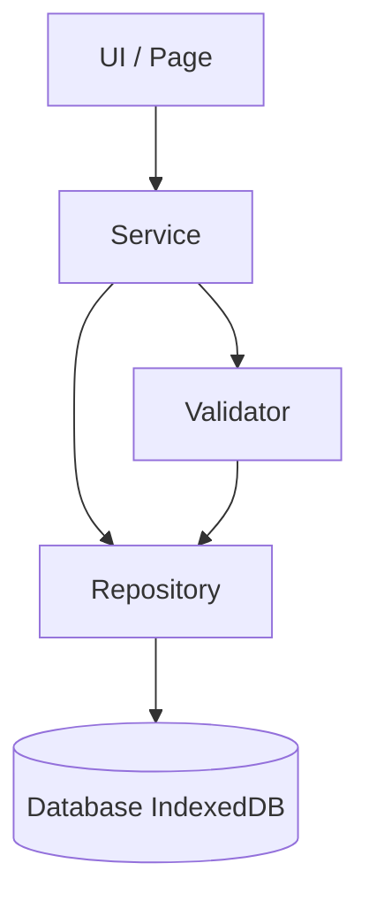
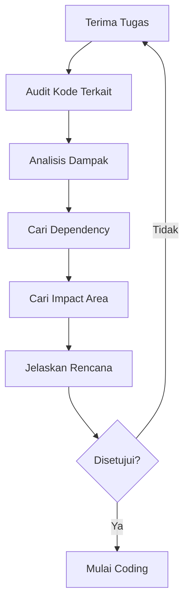
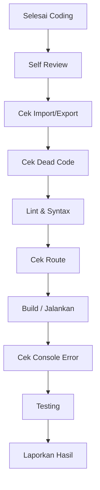

# AI DEVELOPMENT GUIDE

> **Aplikasi** : POS Offline PWA  
> **Versi** : 1.0  
> **Status** : Standar Resmi  
> **Berlaku Untuk** : SEMUA AI Coding Assistant

---

## Target AI

Dokumen ini berlaku untuk seluruh AI Coding Assistant yang mengerjakan proyek ini:

| AI | Platform |
|---|---|
| **OpenCode** | CLI / Agentic coding |
| **Cursor** | AI Code Editor |
| **Codex** | OpenAI coding agent |
| **GitHub Copilot** | IDE assistant |
| **Claude Code** | Anthropic CLI |
| **ChatGPT** | Chat / agent |
| **Gemini CLI** | Google CLI |
| **Qwen Code** | Alibaba CLI |
| Dan AI lain | Semua jenis |

> **Setiap AI yang menulis, mengubah, atau menghapus kode pada proyek ini WAJIB membaca dan mematuhi dokumen ini.**

---

## Tujuan

Dokumen ini adalah **aturan resmi** untuk AI Coding Assistant. Tujuannya:

| Tujuan | Keterangan |
|---|---|
| Konsistensi | Semua AI menghasilkan kode dengan gaya yang sama |
| Keamanan | AI tidak merusak arsitektur, business rules, atau data |
| Kualitas | AI menerapkan self-review & testing sebelum selesai |
| Dokumentasi | Setiap perubahan terdokumentasi & di-changelog |
| Kolaborasi | AI dan developer bekerja dengan aturan yang sama |

---

## Daftar Isi

1. [Prinsip Utama](#1-prinsip-utama)
2. [Struktur Project](#2-struktur-project)
3. [Layer Architecture](#3-layer-architecture)
4. [Business Rules](#4-business-rules)
5. [API Rules](#5-api-rules)
6. [Coding Standards](#6-coding-standards)
7. [Testing Rules](#7-testing-rules)
8. [Deployment Rules](#8-deployment-rules)
9. [Security Rules](#9-security-rules)
10. [Database Rules](#10-database-rules)
11. [Sebelum Mengubah Kode](#11-sebelum-mengubah-kode)
12. [Sesudah Coding](#12-sesudah-coding)
13. [Yang Dilarang](#13-yang-dilarang)
14. [Checklist AI](#14-checklist-ai)
15. [Prompt Template](#15-prompt-template)
16. [AI Quality Gate](#16-ai-quality-gate)

---

## 1. Prinsip Utama

Setiap AI **WAJIB** menghormati prinsip berikut. Pelanggaran prinsip utama dianggap sebagai kesalahan serius.

### 1.1 Dilarang Mengubah Hal Mendasar

| Prinsip | Penjelasan |
|---|---|
| **Jangan mengubah arsitektur** | Struktur layer & pola arsitektur tetap |
| **Jangan rename folder** | Nama folder di `src/` tidak berubah |
| **Jangan rename database** | Nama `PosOfflineDB` tidak berubah |
| **Jangan rename route** | Hash route (`#/produk`, dll) tidak berubah |
| **Jangan rename service** | Nama file & fungsi service tidak berubah |
| **Jangan menghapus file** | File apa pun tidak dihapus tanpa persetujuan |
| **Jangan mengubah Design System** | Token & variable di `variables.css` tidak berubah |

### 1.2 Pertanyaan Wajib Sebelum Melakukan Perubahan Struktural

```text
1. Apakah ini mengubah arsitektur?          -> Jangan tanpa persetujuan.
2. Apakah ini rename folder/file?           -> Jangan tanpa persetujuan.
3. Apakah ini mengubah nama database?       -> Jangan.
4. Apakah ini mengubah route?               -> Jangan tanpa alasan kuat.
5. Apakah ini mengubah nama service?        -> Jangan tanpa persetujuan.
6. Apakah ini menghapus file?               -> Jangan.
7. Apakah ini mengubah design system?       -> Jangan.
```

### 1.3 Sikap AI

```text
1. AI adalah pembantu, bukan pengambil keputusan arsitektur.
2. Perubahan besar wajib persetujuan developer.
3. Kode yang ditulis harus sekonsisten mungkin dengan kode yang ada.
4. Jika ragu -> tanya, jangan menebak.
5. Jika tidak yakin dengan aturan bisnis -> baca dokumentasi dulu.
```

---

## 2. Struktur Project

### 2.1 Struktur Folder

```
pos-offline-pwa/
├── docs/                    # Dokumentasi (wajib dibaca AI)
├── src/
│   ├── app/                 # Entry point & bootstrap
│   ├── auth/                # Autentikasi & session
│   ├── components/          # Komponen UI reusable
│   ├── config/              # Konfigurasi global
│   ├── database/            # IndexedDB, schema, migration, seed
│   ├── layouts/             # Layout halaman
│   ├── modules/             # Modul bisnis
│   ├── pages/               # Halaman & route handler
│   ├── router/              # Routing & guard
│   ├── services/            # Service lintas modul
│   ├── styles/              # CSS & design system
│   ├── utils/               # Helper murni
│   └── pwa/                 # Service Worker, manifest, cache
├── index.html
├── manifest.json
├── service-worker.js
└── package.json
```

### 2.2 Tanggung Jawab Setiap Folder

| Folder | Isi | AI Jangan Letakkan |
|---|---|---|
| `src/app/` | Entry point & lifecycle | Business logic |
| `src/auth/` | Login, session, auth | Komponen UI |
| `src/components/` | Komponen UI reusable | Query DB |
| `src/config/` | Konfigurasi global | Logika |
| `src/database/` | Dexie, schema, migration, seed | Business rules |
| `src/layouts/` | Kerangka layout | Business logic |
| `src/modules/` | Modul bisnis per fitur | Kode acak |
| `src/pages/` | Halaman & route | Query DB langsung |
| `src/router/` | Routing & guard | Business rules |
| `src/services/` | Service lintas modul | Query DB langsung |
| `src/styles/` | CSS & design system | JavaScript |
| `src/utils/` | Helper murni | Efek samping |
| `src/pwa/` | PWA lifecycle | Business logic |

### 2.3 Aturan Penempatan File Baru

```text
1. File khusus satu modul    -> taruh di dalam folder modul.
2. File dipakai banyak modul -> taruh di components/services/utils.
3. Halaman baru              -> taruh di pages/ (atau modules/.../pages/).
4. Komponen UI reusable      -> components/.
5. Business rule reusable    -> services/.
6. Helper murni              -> utils/.
```

---

## 3. Layer Architecture

### 3.1 Alur Layer



### 3.2 Aturan Layer

| Layer | Tugas | Boleh | Tidak Boleh |
|---|---|---|---|
| **UI / Page** | Menampilkan & interaksi | Memanggil Service | Akses DB langsung |
| **Service** | Business rules, workflow | Memanggil Repository & Validator | Akses DB langsung, DOM |
| **Repository** | Akses data, query | Akses DB (Dexie) | Business logic |
| **Validator** | Validasi input | Utils murni | DB, DOM |
| **Database** | Penyimpanan | — | — |

### 3.3 AI Tidak Boleh Melewati Layer

```text
X  Page  ->  db.products.get(...)            (melewati Service)
X  Service -> document.getElementById(...)   (masuk ke UI)
X  Repository -> menghitung diskon/pajak     (business logic di data layer)

✓  Page  ->  Service  ->  Repository  ->  Database
```

| Larangan | Benar |
|---|---|
| Page memanggil DB langsung | Page memanggil Service |
| Service menyentuh DOM | Service mengembalikan data |
| Repository berisi kalkulasi bisnis | Kalkulasi di Service |
| Validator mengakses DB | Validator murni |

---

## 4. Business Rules

### 4.1 Kewajiban

AI **WAJIB** membaca dokumentasi business rules sebelum mengubah fitur apa pun:

| Dokumen | Isi |
|---|---|
| `docs/17_BUSINESS_RULES.md` | Aturan bisnis lengkap |
| `docs/03_BUSINESS_RULES.md` | Aturan bisnis awal |
| `docs/16_DOMAIN_MODEL.md` | Model domain |

### 4.2 Aturan Utama

```text
1. AI TIDAK BOLEH mengubah Business Rules tanpa persetujuan.
2. Setiap kode yang ditulis harus mematuhi business rules yang ada.
3. Jika ada konflik antara kode dan business rules -> tanyakan ke developer.
4. Perubahan business rules wajib:
   -> Disetujui developer.
   -> Didokumentasikan.
   -> Ditest ulang.
```

### 4.3 Contoh Business Rules yang Wajib Dihormati

| Area | Aturan Contoh |
|---|---|
| Stok | Stok tidak boleh negatif (kecuali diizinkan) |
| Harga | Harga jual >= harga beli |
| Diskon | Diskon maksimum sesuai kebijakan |
| Permission | Role menentukan hak akses |
| Transaksi | Header + detail atomik |

> AI wajib membaca `17_BUSINESS_RULES.md` **sebelum** mengimplementasikan fitur.

---

## 5. API Rules

### 5.1 Kewajiban

AI **WAJIB** membaca kontrak API sebelum membuat atau mengubah fungsi:

| Dokumen | Isi |
|---|---|
| `docs/18_API_CONTRACT.md` | Kontrak API lengkap |

### 5.2 Aturan API

```text
1. AI TIDAK BOLEH mengubah API yang sudah ada tanpa persetujuan.
2. Signature fungsi (nama, parameter, hasil) mengikuti kontrak.
3. Nama fungsi camelCase, sesuai dokumen API.
4. Setiap fungsi baru yang diekspos publik dicatat di API contract.
5. Perubahan return type / parameter = perubahan API -> wajib approval.
```

### 5.3 Contoh Kepatuhan API

```js
// API contract menyatakan: getProduct(id) -> Product
// AI HARUS mengikuti signature ini, tidak mengubah nama/return
async function getProduct(id) {
  return productRepository.getById(id);
}
```

---

## 6. Coding Standards

### 6.1 Kewajiban

AI **WAJIB** membaca dan mematuhi standar coding:

| Dokumen | Isi |
|---|---|
| `docs/19_DEVELOPMENT_STANDARDS.md` | Standar pengembangan lengkap |
| `docs/09_CODING_STANDARD.md` | Standar penulisan kode |

### 6.2 Poin Penting Standar

| Aturan | Standar |
|---|---|
| Nama file | kebab-case (`product-service.js`) |
| Nama fungsi | camelCase (`createProduct()`) |
| Nama constant | UPPER_CASE (`DEFAULT_PAGE_SIZE`) |
| Nama class | PascalCase (`ProductRepository`) |
| Modul | ES Modules (`import`/`export`, tanpa `require`) |
| Async | `async/await`, tanpa callback hell |
| Panjang fungsi | Maksimal 150 baris |
| Error | `try/catch` + logger |
| Logging | `logger.info/warn/error`, tanpa `console.log` |
| UI | Design system, tanpa warna hardcode, tanpa inline style |

### 6.3 Contoh Kepatuhan

```js
// SESUAI STANDAR
import { authService } from '../services/auth-service.js';
import { productRepository } from '../modules/product/product-repository.js';

export async function getActiveProducts() {
  try {
    return await productRepository.getActive();
  } catch (error) {
    logger.error('[Product] Gagal memuat produk', error);
    return [];
  }
}
```

---

## 7. Testing Rules

### 7.1 Kewajiban

AI **WAJIB** membaca panduan testing:

| Dokumen | Isi |
|---|---|
| `docs/20_TESTING_GUIDE.md` | Panduan testing lengkap |
| `docs/13_TESTING_GUIDE.md` | Pedoman pengujian awal |

### 7.2 Aturan Testing untuk AI

```text
1. AI wajib menambah test untuk fitur baru.
2. AI TIDAK BOLEH menghapus atau melemahkan test yang ada.
3. AI wajib menjalankan regression test setelah mengubah kode.
4. Unit test mencakup: repository, service, validator, route, permission.
5. Hasil test dilaporkan ke developer.
```

### 7.3 Target Test AI

| Sasaran | Harus Diuji |
|---|---|
| Repository | CRUD, search, pagination, soft delete |
| Service | Business rules, kalkulasi |
| Validator | Input valid & tidak valid |
| Router | Guard & navigasi |
| Permission | Akses per role |

---

## 8. Deployment Rules

### 8.1 Kewajiban

AI **WAJIB** membaca panduan deployment:

| Dokumen | Isi |
|---|---|
| `docs/21_DEPLOYMENT_GUIDE.md` | Panduan deployment lengkap |

### 8.2 Aturan Deployment untuk AI

```text
1. Setiap perubahan asset wajib menaikkan cache version SW.
2. AI wajib update CHANGELOG.
3. AI wajib menaikkan versi aplikasi (semver).
4. AI tidak melakukan deployment tanpa persetujuan.
5. Rollback plan selalu disiapkan.
```

### 8.3 Checklist Deployment untuk AI

- [ ] `package.json` versi naik
- [ ] `service-worker.js` cache version naik
- [ ] `src/pwa/pwa-config.js` sinkron dengan SW
- [ ] CHANGELOG diupdate
- [ ] Dokumentasi deployment diperbarui

---

## 9. Security Rules

### 9.1 Kewajiban

AI **WAJIB** membaca standar keamanan:

| Dokumen | Isi |
|---|---|
| `docs/22_SECURITY_GUIDE.md` | Standar keamanan lengkap |

### 9.2 Aturan Keamanan untuk AI

```text
1. AI TIDAK BOLEH menyimpan password/token/secret di kode.
2. Password wajib di-hash (PBKDF2), bukan plaintext.
3. Session wajib punya expiry.
4. Setiap akses wajib dicek permission.
5. Input wajib divalidasi (anti XSS/injection).
6. Data sensitif tidak boleh masuk log.
```

### 9.3 Larangan Keamanan AI

- [ ] Dilarang hardcode kredensial
- [ ] Dilarang mencatat password ke log
- [ ] Dilarang menghapus cek permission
- [ ] Dilarang menaruh data pengguna mentah di `innerHTML`

---

## 10. Database Rules

### 10.1 Kewajiban

AI **WAJIB** membaca desain database:

| Dokumen | Isi |
|---|---|
| `docs/23_DATABASE_DESIGN.md` | Desain database lengkap |
| `docs/02_DATABASE_SCHEMA.md` | Skema database |
| `docs/14_UNIVERSAL_DATABASE_DESIGN.md` | Desain universal |
| `docs/15_DATABASE_ERD.md` | Diagram ER |

### 10.2 Aturan Database untuk AI

```text
1. AI TIDAK BOLEH mengubah schema tanpa migration.
2. Setiap perubahan schema:
   -> Naikkan SCHEMA_VERSION.
   -> Tambah db.version(n+1).
   -> Sync DB_CONFIG.schemaVersion.
   -> Update dokumentasi.
3. Nama tabel tidak boleh berubah.
4. Nama database (PosOfflineDB) tidak boleh berubah.
5. Seed idempoten.
```

### 10.3 Checklist Database untuk AI

- [ ] Nama tabel tidak berubah
- [ ] Nama database tidak berubah
- [ ] Perubahan schema punya migration
- [ ] Versi skema naik
- [ ] Index ditambahkan untuk query baru
- [ ] Seed tetap idempoten
- [ ] Dokumentasi database diperbarui

---

## 11. Sebelum Mengubah Kode

### 11.1 Alur Wajib AI



### 11.2 Checklist Sebelum Coding

| Langkah | Aksi | Contoh |
|---|---|---|
| **Audit** | Baca file terkait | Baca `product-service.js` sebelum ubah produk |
| **Analisis** | Pahami tujuan & konteks | Kenapa fungsi ini ada |
| **Cari dependency** | File yang mengimport/diimport | `grep` import `productService` |
| **Cari impact** | Fitur/halaman yang terdampak | Cek halaman yang memakai service |
| **Jelaskan rencana** | Sampaikan sebelum coding | "Saya akan menambah fungsi X di Y" |
| **Baru coding** | Mulai setelah rencana jelas | — |

### 11.3 Pertanyaan Wajib

```text
1. Siapa yang memanggil fungsi ini?
2. Apa dampak jika saya mengubahnya?
3. Apakah ada test yang terdampak?
4. Apakah ini mengubah business rules / API?
5. Apakah dokumentasi perlu diperbarui?
```

---

## 12. Sesudah Coding

### 12.1 Alur Wajib Sesudah Coding



### 12.2 Checklist Sesudah Coding

| Langkah | Aksi |
|---|---|
| **Self Review** | Baca ulang kode yang ditulis |
| **Broken Import** | Pastikan semua import benar (path & nama) |
| **Broken Export** | Pastikan semua export masih dipakai benar |
| **Dead Code** | Hapus kode tak terpakai (tanpa menghapus file) |
| **Lint** | Jalankan syntax check / lint |
| **Route** | Pastikan route terdaftar & guard benar |
| **Build** | Aplikasi tetap berjalan |
| **Console Error** | Tidak ada error baru |
| **Testing** | Jalankan unit + regression |

### 12.3 Contoh Validasi

```bash
# Syntax check untuk file yang diubah
node --check src/pages/ProductPage.js
node --check src/modules/product/product-service.js

# Cari import yang salah (dead/broken)
grep -r "productService" src --include="*.js"
```

---

## 13. Yang Dilarang

### 13.1 Daftar Larangan AI

| No | Dilarang | Konsekuensi |
|---|---|---|
| 1 | **Menghapus file** | Merusak referensi & dokumentasi |
| 2 | **Mengganti struktur** | Merusak arsitektur |
| 3 | **Mengubah nama tabel** | Merusak data |
| 4 | **Mengubah design system** | Inkonsistensi UI |
| 5 | **Mengubah routing tanpa alasan** | Merusak navigasi |
| 6 | **Mengubah business rules** | Merusak logika bisnis |
| 7 | **Mengubah API Contract** | Merusak integrasi |
| 8 | Menyimpan secret di kode | Risiko keamanan |
| 9 | Menghapus test lama | Hilangnya jaring pengaman |
| 10 | Mengubah database tanpa migration | Kerusakan data |

### 13.2 Aturan Emas

```text
JANGAN PERNAH mengubah apa pun yang berada di luar scope tugas,
tanpa persetujuan eksplisit developer.

Jika ragu -> TANYA.
```

---

## 14. Checklist AI

Checklist lengkap yang **wajib** dijalankan AI untuk setiap tugas. Centang seluruh item yang berlaku.

### 14.1 Persiapan (Sebelum Coding)

- [ ] Membaca `24_AI_DEVELOPMENT_GUIDE.md`
- [ ] Membaca business rules yang relevan (`17_BUSINESS_RULES.md`)
- [ ] Membaca API contract yang relevan (`18_API_CONTRACT.md`)
- [ ] Membaca coding standards (`19_DEVELOPMENT_STANDARDS.md`)
- [ ] Membaca testing guide (`20_TESTING_GUIDE.md`)
- [ ] Membaca database design bila menyentuh data (`23_DATABASE_DESIGN.md`)
- [ ] Audit kode terkait
- [ ] Mencari semua dependency (import/export)
- [ ] Mencari impact area
- [ ] Menjelaskan rencana ke developer
- [ ] Mendapat persetujuan untuk perubahan besar

### 14.2 Coding

- [ ] Mengikuti layer architecture (UI -> Service -> Repository)
- [ ] Tidak melewati layer
- [ ] Kode ES Modules (`import`/`export`)
- [ ] Nama file kebab-case
- [ ] Nama fungsi camelCase
- [ ] Nama class PascalCase
- [ ] Nama constant UPPER_CASE
- [ ] Fungsi maksimal 150 baris
- [ ] `async/await` (tanpa callback hell)
- [ ] Menggunakan `try/catch`
- [ ] Menggunakan logger (bukan console.log)
- [ ] Tidak ada warna hardcode
- [ ] Tidak ada inline style
- [ ] Memakai design system & variables.css
- [ ] Memakai Bootstrap Icons
- [ ] Tidak ada comment berlebihan
- [ ] Kode sesuai gaya file di sekitarnya
- [ ] Tidak ada kode duplikat (DRY)
- [ ] Tidak ada logika yang dipindah ke layer salah

### 14.3 Business Rules

- [ ] Business rules dipatuhi
- [ ] Tidak mengubah business rules
- [ ] Perhitungan sesuai aturan
- [ ] Permission dihormati
- [ ] Validasi sesuai aturan

### 14.4 Database

- [ ] Tidak mengubah nama tabel
- [ ] Tidak mengubah nama database
- [ ] Tidak mengubah schema tanpa migration
- [ ] Migration disiapkan bila perlu
- [ ] Versi skema naik
- [ ] Seed idempoten
- [ ] Index untuk query baru
- [ ] Soft delete dihormati
- [ ] Data tidak hilang

### 14.5 API & Contract

- [ ] API yang ada tidak diubah
- [ ] Signature fungsi mengikuti kontrak
- [ ] Fungsi baru didokumentasikan
- [ ] Return type konsisten

### 14.6 Self Review (Sesudah Coding)

- [ ] Baca ulang kode yang ditulis
- [ ] Tidak ada broken import
- [ ] Tidak ada broken export
- [ ] Tidak ada dead code
- [ ] Tidak ada referensi ke file yang dihapus
- [ ] Tidak ada file yang dihapus
- [ ] Syntax valid (node --check)
- [ ] Lint berjalan
- [ ] Route terdaftar (bila halaman baru)
- [ ] Guard route benar
- [ ] Sidebar diperbarui (bila halaman baru)
- [ ] Permission diperbarui (bila halaman baru)
- [ ] Tidak ada console.log
- [ ] Tidak ada console error
- [ ] Aplikasi tetap berjalan

### 14.7 Testing

- [ ] Unit test untuk repository
- [ ] Unit test untuk service
- [ ] Unit test untuk validator
- [ ] Unit test untuk route/guard
- [ ] Unit test untuk permission
- [ ] Regression test dijalankan
- [ ] Test lama tidak dihapus
- [ ] Test baru untuk fitur baru
- [ ] Semua test lolos
- [ ] Hasil test dilaporkan

### 14.8 UI

- [ ] Responsive
- [ ] Dark mode & light mode
- [ ] Loading/skeleton
- [ ] Modal & toast
- [ ] Dropdown
- [ ] Pagination
- [ ] Search
- [ ] Icon tampil
- [ ] Validasi form tampil
- [ ] Tidak ada inline style statis

### 14.9 Offline & PWA

- [ ] Fitur tetap berjalan offline
- [ ] Service Worker tidak rusak
- [ ] Cache version naik bila asset berubah
- [ ] Manifest tetap valid
- [ ] IndexedDB normal

### 14.10 Keamanan

- [ ] Tidak ada password plaintext
- [ ] Tidak ada token/secret di kode
- [ ] Session expiry dihormati
- [ ] Permission dicek
- [ ] Input divalidasi
- [ ] Tidak ada data sensitif di log
- [ ] XSS dicegah

### 14.11 Dokumentasi

- [ ] CHANGELOG diupdate
- [ ] Dokumentasi terkait diperbarui
- [ ] API contract diperbarui (bila fungsi baru)
- [ ] Dokumentasi database diperbarui (bila schema berubah)
- [ ] README diperbarui bila perlu

### 14.12 Kualitas

- [ ] Kode konsisten dengan proyek
- [ ] Tidak ada perubahan di luar scope
- [ ] Tidak ada perubahan arsitektur
- [ ] Tidak ada rename folder/file
- [ ] Tidak ada desain sistem diubah
- [ ] Tidak ada bug baru diperkenalkan
- [ ] Hasil dilaporkan dengan ringkas

---

## 15. Prompt Template

Template prompt siap pakai untuk berbagai jenis tugas. AI harus menerima prompt berbasis template ini.

### 15.1 Tambah Modul

```text
TAMBAH MODUL: [nama modul]

Konteks: [deskripsi modul]

Scope:
1. Buat modul di src/modules/[module-name]/ sesuai struktur standar.
2. Sertakan index.js, repository.js, service.js, validator.js.
3. Sertakan page di src/pages/ (atau modules/.../pages/).
4. Daftarkan route di router + sidebar + permission.
5. Tambahkan test untuk service & validator.

Aturan:
- Ikuti 19_DEVELOPMENT_STANDARDS.md & 23_DATABASE_DESIGN.md.
- JANGAN ubah business rules / API yang ada.
- JANGAN mengubah schema tanpa migration.

Lakukan audit dulu, jelaskan rencana, lalu coding.
```

### 15.2 Bug Fix

```text
BUG FIX: [deskripsi bug]

Gejala: [apa yang terjadi]
Expected: [seharusnya apa]
File terkait: [path file]

Langkah:
1. Audit kode terkait.
2. Temukan akar masalah.
3. Jelaskan penyebab & solusi.
4. Perbaiki dengan perubahan minimal.
5. Jalankan test & regression.
6. Pastikan tidak ada fitur lain rusak.

Aturan:
- JANGAN menghapus file / mengubah arsitektur.
- JANGAN mengubah business rules.
- Laporkan penyebab, solusi, dan hasil test.
```

### 15.3 Refactor

```text
REFACTOR: [file/fungsi]

Tujuan: [alasan refactor]

Langkah:
1. Audit kode & dependency.
2. Identifikasi impact area.
3. Jelaskan rencana refactor.
4. Refactor dengan perilaku yang SAMA (tanpa mengubah output).
5. Jalankan test untuk memastikan tidak berubah perilaku.

Aturan:
- JANGAN mengubah business rules / API.
- JANGAN mengubah nama fungsi yang dipakai pihak lain tanpa persetujuan.
- Pertahankan behavior.
```

### 15.4 UI

```text
UI: [deskripsi perubahan UI]

Konteks: [halaman/komponen]

Langkah:
1. Ikuti design system (04_UI_DESIGN_SYSTEM.md).
2. Gunakan variables.css, bukan warna hardcode.
3. Gunakan Bootstrap utility dulu, lalu CSS khusus.
4. JANGAN inline style (kecuali perlu).
5. Pastikan responsive & dark/light mode.
6. Uji di mobile & desktop.

Aturan:
- JANGAN mengubah design system / token yang ada.
- Perilaku bisnis tidak berubah.
```

### 15.5 Performance

```text
PERFORMANCE: [area yang lambat]

Gejala: [pengukuran]

Langkah:
1. Audit query & rendering.
2. Identifikasi bottleneck.
3. Terapkan: index, pagination, debounce, lazy load, batch write.
4. Ukur sebelum & sesudah.
5. Laporkan perbandingan.

Aturan:
- JANGAN mengubah arsitektur / business rules.
- Target mengikuti 20_TESTING_GUIDE.md section 14.
```

### 15.6 Security

```text
SECURITY: [area keamanan]

Langkah:
1. Baca 22_SECURITY_GUIDE.md.
2. Audit: password, session, permission, input, XSS, secret.
3. Perbaiki kerentanan.
4. Pastikan checklist keamanan (22) terpenuhi.

Aturan:
- JANGAN menghapus cek keamanan yang ada.
- JANGAN menyimpan secret di kode.
- Laporkan temuan & perbaikan.
```

### 15.7 Testing

```text
TESTING: [modul/fitur]

Langkah:
1. Baca 20_TESTING_GUIDE.md.
2. Tambah unit test: repository, service, validator.
3. Tambah test route & permission bila relevan.
4. Jalankan regression test.
5. JANGAN hapus test lama.
6. Laporkan hasil (pass/fail).

Aturan:
- Test mengikuti struktur describe/it/expect.
- Test lama tidak diubah tanpa alasan.
```

### 15.8 Database

```text
DATABASE: [perubahan data]

Langkah:
1. Baca 23_DATABASE_DESIGN.md.
2. Jelaskan kebutuhan perubahan.
3. Siapkan migration (naikkan versi, db.version).
4. Sync SCHEMA_VERSION & DB_CONFIG.
5. Update seed bila perlu.
6. Update dokumentasi.

Aturan:
- JANGAN ubah nama tabel / database.
- Migration wajib idempoten.
- Perlu persetujuan sebelum eksekusi.
```

### 15.9 Export

```text
EXPORT: [jenis export: Excel/PDF/CSV]

Konteks: [data apa]

Langkah:
1. Audit helper export yang ada (export-helper.js).
2. Ikuti format yang konsisten.
3. Pastikan sesuai permission.
4. Pastikan jalan offline.
5. Tambah test bila perlu.

Aturan:
- JANGAN mengubah API export yang dipakai.
- Data sesuai business rules.
```

### 15.10 Import

```text
IMPORT: [jenis import: Excel/CSV]

Konteks: [data apa]

Langkah:
1. Audit helper import yang ada (import-helper.js).
2. Validasi file: format, ukuran, isi.
3. Tangani duplikat & error.
4. Pastikan jalan offline.
5. Tambah test untuk kasus valid & tidak valid.

Aturan:
- Input wajib divalidasi semua lapisan.
- JANGAN merusak data yang ada.
```

### 15.11 Backup

```text
BACKUP: [perbaikan/fitur backup]

Langkah:
1. Baca backup.js & restore.js.
2. Jaga checksum integritas.
3. Jaga validasi versi.
4. Pastikan restore teruji.

Aturan:
- JANGAN mengubah format backup yang sudah ada tanpa approval.
- Backup harus bisa di-restore.
```

### 15.12 PWA

```text
PWA: [perubahan PWA: SW/manifest/offline]

Langkah:
1. Baca 21_DEPLOYMENT_GUIDE.md section 7.
2. Update service-worker.js & pwa-config.js.
3. Naikkan cache version bila asset berubah.
4. Uji offline.
5. Uji installable.

Aturan:
- JANGAN merusak cache lama tanpa cleanup yang benar.
- SW harus kompatibel offline.
```

---

## 16. AI Quality Gate

### 16.1 Syarat "Selesai"

Sebelum dianggap **selesai**, AI **wajib** menjawab seluruh pernyataan Quality Gate berikut dengan **✔ (ya)**:

| # | Quality Gate | Status |
|---|---|---|
| 1 | ✔ Tidak ada error | ☐ |
| 2 | ✔ Tidak ada warning | ☐ |
| 3 | ✔ Tidak ada broken import | ☐ |
| 4 | ✔ Tidak ada broken export | ☐ |
| 5 | ✔ Semua route aktif | ☐ |
| 6 | ✔ Semua permission benar | ☐ |
| 7 | ✔ Semua test lolos | ☐ |
| 8 | ✔ Console bersih | ☐ |
| 9 | ✔ Offline berjalan | ☐ |
| 10 | ✔ Database aman | ☐ |

### 16.2 Pernyataan Pendukung

```text
1. Tidak ada error:
   -> Aplikasi berjalan tanpa exception baru.

2. Tidak ada warning:
   -> Tidak ada peringatan sintaks/dependensi baru.

3. Tidak ada broken import:
   -> Semua path & nama import benar.

4. Tidak ada broken export:
   -> Semua export yang dipakai pihak lain masih valid.

5. Semua route aktif:
   -> Setiap route dapat diakses & menampilkan halaman.

6. Semua permission benar:
   -> RBAC berfungsi sesuai matriks.

7. Semua test lolos:
   -> Unit & regression pass.

8. Console bersih:
   -> Tidak ada error/warning baru di console.

9. Offline berjalan:
   -> Fitur tetap berjalan tanpa internet.

10. Database aman:
   -> Tidak ada data rusak, migrasi & seed benar.
```

### 16.3 Template Laporan Selesai AI

```markdown
## LAPORAN AI — [Ringkasan Tugas]

### Perubahan
- [File yang diubah]
- [Fungsi yang ditambah/diubah]

### Quality Gate
- [x] Tidak ada error
- [x] Tidak ada warning
- [x] Tidak ada broken import
- [x] Tidak ada broken export
- [x] Semua route aktif
- [x] Semua permission benar
- [x] Semua test lolos
- [x] Console bersih
- [x] Offline berjalan
- [x] Database aman

### Test
- [Unit test: hasil]
- [Regression test: hasil]

### Catatan
- [Catatan penting untuk developer]
```

### 16.4 Jika Quality Gate Tidak Lolos

```text
1. Identifikasi gate yang gagal.
2. Perbaiki kode.
3. Ulangi self review & testing.
4. Jangan lapor "selesai" sebelum semua gate ✔.
5. Jika gate tidak bisa dipenuhi, laporkan ke developer.
```

---

## Lampiran

### A. Ringkasan Dokumen Wajib Dibaca AI

| Dokumen | Kapan Dibaca |
|---|---|
| `24_AI_DEVELOPMENT_GUIDE.md` | Selalu |
| `17_BUSINESS_RULES.md` | Sebelum menyentuh fitur bisnis |
| `18_API_CONTRACT.md` | Sebelum membuat/mengubah fungsi |
| `19_DEVELOPMENT_STANDARDS.md` | Selalu saat menulis kode |
| `20_TESTING_GUIDE.md` | Sebelum menulis test |
| `21_DEPLOYMENT_GUIDE.md` | Sebelum menyentuh deployment/PWA |
| `22_SECURITY_GUIDE.md` | Sebelum menyentuh auth/keamanan |
| `23_DATABASE_DESIGN.md` | Sebelum menyentuh data/schema |
| `04_UI_DESIGN_SYSTEM.md` | Sebelum menyentuh UI |

### B. Definisi Selesai AI (Definition of Done)

- [ ] Semua quality gate ✔
- [ ] Checklist AI (Section 14) selesai
- [ ] Business rules tidak berubah (tanpa persetujuan)
- [ ] API contract tidak berubah (tanpa persetujuan)
- [ ] Test lulus
- [ ] Dokumentasi & changelog diperbarui
- [ ] Hasil dilaporkan ke developer

---

> **Versi 1.0** — Pedoman resmi AI Coding Assistant untuk POS Offline PWA.

### Riwayat Revisi

| Versi | Tanggal | Perubahan |
|---|---|---|
| 1.0 | 2026-08-06 | Versi awal: 16 section pedoman AI |
